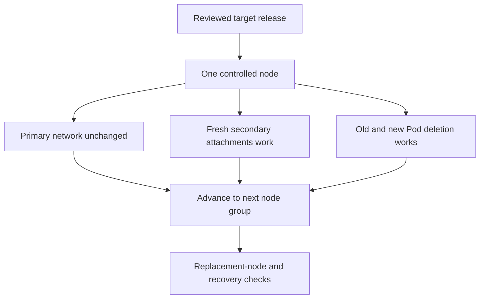

# Roll Out Multus Upgrades While Preserving the Primary CNI

Author: [nawazdhandala](https://www.github.com/nawazdhandala)

Tags: Multus, Kubernetes, Networking

Description: Build a staged Multus upgrade plan that preserves primary CNI ownership, checks old and new Pod lifecycles, and treats host files and rollback as part of the release.

A Multus upgrade can look successful while quietly breaking the next Pod creation. Existing interfaces often continue carrying traffic because an installed interface does not need a fresh CNI ADD call for every packet. That makes “the applications still answer” an incomplete upgrade test.

The other hidden risk is cleanup. A Pod created before the upgrade may later be deleted by the new plugin version. Your acceptance plan must cover both generations of workloads and preserve the state needed to remove their attachments.

This guide focuses on upgrading an existing Multus installation without changing its thin or thick architecture. It uses **Multus v4.3.1** as a concrete source reference, not a recommendation to upgrade every cluster to that release. Follow your distribution's supported version combinations. The snippets were locally checked; no live rolling upgrade was performed.

## Inventory the release beyond its image

Record the installed and target Multus image digests, host binary paths, daemon or thin-plugin configuration, delegate binaries, primary CNI configuration, and IPAM versions. IPAM means IP address management, the component that allocates and releases addresses.

Preserve the current manifests and the relevant node files in restricted operational storage. Include the configuration owner: an operator, package, chart, or node-management system. Reverting an image cannot necessarily undo host files installed by an init container or configuration written by a daemon.

The upstream v4.3.1 thick deployment explicitly describes itself as a quickstart rather than a comprehensive upgrade procedure. It also uses snapshot image references. Review both the main container and installer image rather than assuming a tagged YAML source guarantees a pinned running release. [Reference deployment](https://github.com/k8snetworkplumbingwg/multus-cni/blob/v4.3.1/deployments/multus-daemonset-thick.yml).

## Protect the primary network contract

Multus delegates the primary network to another CNI implementation. Preserve that relationship before adding any secondary-network checks. If new Pods cannot reach cluster DNS or Services, a secondary-interface success is not an acceptable result.



For the thick plugin, inspect how the daemon chooses its primary configuration. In v4.3.1, the configuration manager can use `multusMasterCNI` or discover a primary configuration from `multusAutoconfigDir`. Verify the effective selected file on every node class, especially when another installer changes filenames or directory contents. Do not rely only on the source manifest's intent. [Configuration manager](https://github.com/k8snetworkplumbingwg/multus-cni/blob/v4.3.1/pkg/server/config/manager.go).

Compare the actual primary delegate configuration before and after the canary update. An expected generated Multus file may change, but an unrelated primary network setting should not change without a reviewed reason. Avoid upgrading the primary CNI and Multus simultaneously unless the platform explicitly requires a coordinated release; otherwise failure attribution becomes much harder.

## Review the API change before host-side testing

Export the current object and review your proposed deployment through the owning configuration system. For a standalone installation using the upstream DaemonSet name:

```bash
kubectl -n kube-system get daemonset kube-multus-ds -o yaml
kubectl diff -f reviewed-multus-upgrade.yaml
kubectl apply --dry-run=server -f reviewed-multus-upgrade.yaml
```

The file must already contain your reviewed, deployment-specific target. `kubectl diff` returns one when it finds differences, so automation should not classify that result alone as a command failure. Server dry-run exercises API validation and applicable admission behavior without persisting the requested objects. It does not install a binary, run an init container, validate a Unix socket, or prove networking works. [kubectl diff](https://kubernetes.io/docs/reference/kubectl/generated/kubectl_diff/), [kubectl apply dry-run](https://kubernetes.io/docs/reference/kubectl/generated/kubectl_apply/).

Inspect changes to host mounts, privileges, service accounts, image pull access, configuration generation, and shutdown behavior. Preserve the host directories containing saved delegate configurations and allocation state. Those are not disposable installation leftovers.

## Choose rollout behavior deliberately

A Kubernetes DaemonSet can use RollingUpdate or OnDelete. RollingUpdate replaces Pods according to its update settings. OnDelete leaves existing Pods until they are removed, which can support an operator-controlled sequence when the surrounding deployment supports it. Neither strategy makes host-file changes transactional. [DaemonSet update strategies](https://kubernetes.io/docs/tasks/manage-daemon/update-daemon-set/).

For a standalone deployment whose owner supports rolling updates, this is a fragment to review in the complete DaemonSet:

```yaml
spec:
  updateStrategy:
    type: RollingUpdate
    rollingUpdate:
      maxUnavailable: 1
      maxSurge: 0
```

This limits unavailable DaemonSet Pods during replacement and avoids intentionally surging a second one on a node. It does not gate the rollout on application traffic or successful CNI cleanup. A daemon that becomes Ready before those tests pass can let the controller advance. Use the platform's canary or maintenance mechanism to enforce the additional acceptance boundary.

Do not create a competing DaemonSet that writes the same host paths to simulate a canary. Its installer can race with the existing owner. Likewise, an operator-managed DaemonSet may revert manual patches; configure the owning resource instead.

## Test both workload generations

Before the first update, create approved disposable test workloads and record their sandbox and Pod identities. Keep one available for deletion after the upgrade. Preserve its attachment definitions and allocator configuration.

After upgrading the controlled node, run this matrix:

| Workload or operation | Evidence required |
| --- | --- |
| Existing Pod traffic | Primary and required secondary paths still work |
| Fresh primary-only Pod | Sandbox creation, DNS, and required Services work |
| Fresh secondary-network Pod | Expected address, interface, route, and peer traffic |
| Delete a pre-upgrade Pod | Old attachment and allocation cleaned up correctly |
| Delete a post-upgrade Pod | New attachment and allocation cleaned up correctly |
| Create again | Released resources can be allocated without conflicts |

Include the network types actually used on that node class. A macvlan result does not certify SR-IOV device handling, DHCP lease release, or a plugin chain with additional routing behavior.

Multus v4.3.1's deletion path uses saved delegate information and has fallback behavior when records are unavailable. This is why checking deletion across the upgrade boundary matters and why clearing CNI state is not an appropriate installation step. [Multus DEL implementation](https://github.com/k8snetworkplumbingwg/multus-cni/blob/v4.3.1/pkg/multus/multus.go).

## Keep rollback aligned with node state

Define stop conditions before proceeding: new sandbox failures, unexpected primary configuration changes, lost allocations, cleanup errors, or failed application probes. Keep the affected node out of normal placement while investigating through the supported maintenance workflow.

Recovery must reconcile the deployment template, installed host binaries, generated configuration, and workloads created under the new version. Do not assume a DaemonSet revision rollback restores all four. Restore through the configuration owner and verify fresh ADD and DEL operations again. Preserve caches and allocations unless a plugin-specific recovery procedure proves a resource is orphaned.

As you expand, use rollout status as one signal:

```bash
kubectl -n kube-system rollout status daemonset/kube-multus-ds --timeout=5m
kubectl -n kube-system get pods -l app=multus -o wide
```

The first command waits for controller rollout progress, not network acceptance. Correlate it with your test matrix and node-specific evidence. [Rollout status reference](https://kubernetes.io/docs/reference/kubectl/generated/kubectl_rollout/kubectl_rollout_status/).

Finally, test a replacement node using the retained installation artifacts. A warm node can hide missing binaries, cached images, or unmanaged configuration. Close the upgrade only when existing traffic, fresh attachment, old and new cleanup, and replacement-node preparation all have recorded results.
