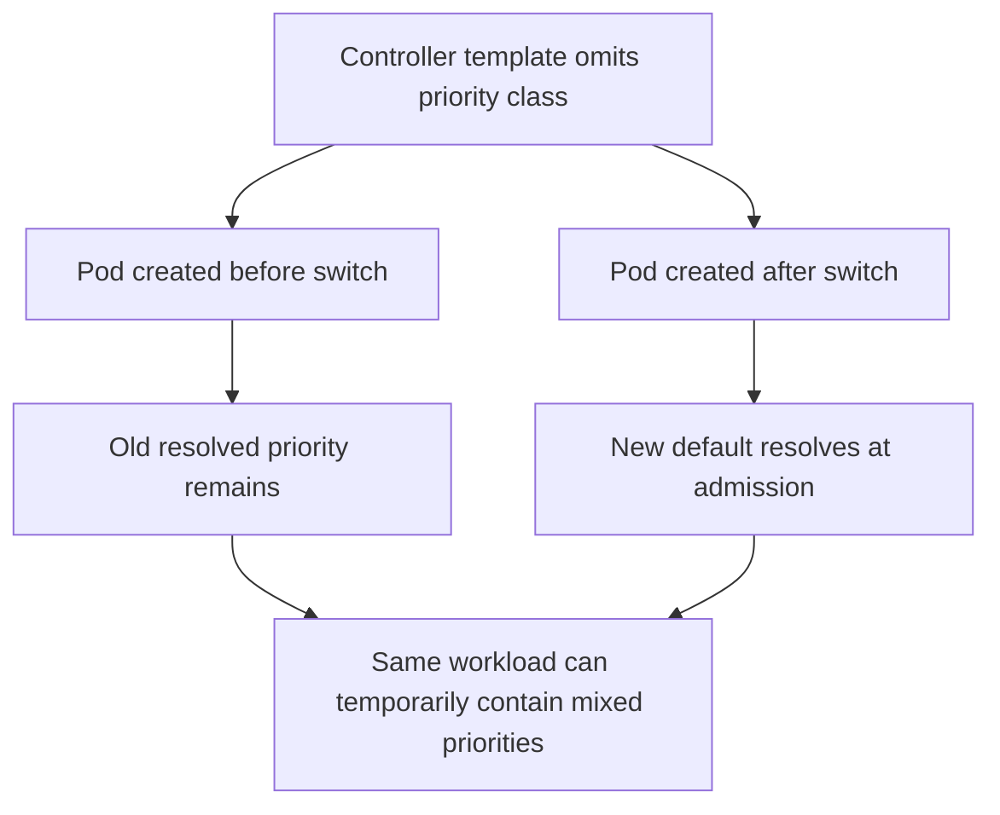

# Roll Out a New Default PriorityClass Without Hidden Changes

Author: [nawazdhandala](https://www.github.com/nawazdhandala)

Tags: Kubernetes, Scheduling, Change Management

Description: Plan a globalDefault PriorityClass change by separating existing Pods from new admissions, checking implicit templates, and controlling the non-atomic switch.

Changing the cluster's default PriorityClass does not rewrite running Pods. The surprise comes later: a controller creates a replacement from a template that omitted `priorityClassName`, and the new Pod receives a different priority from its surviving siblings.

A safe rollout therefore needs two inventories: existing admitted Pods and workload templates that create future Pods. Looking at only one of them misses part of the impact.

This guide follows **Kubernetes 1.34.0** priority admission behavior. The sample class names and values are illustrative and must be compared with your existing hierarchy before any change.

## Know when the default is applied

At Pod creation, the priority admission plugin resolves an explicit class or the current global default. It fills the Pod's numeric priority and can fill the class name from that default. Existing Pod priority values are not recalculated when a new default is selected.

Kubernetes documents the effect on existing Pods in its [priority guide](https://kubernetes.io/docs/concepts/scheduling-eviction/pod-priority-preemption/#notes-about-podpriority-and-existing-clusters). The [1.34.0 admission source](https://github.com/kubernetes/kubernetes/blob/v1.34.0/plugin/pkg/admission/priority/admission.go) shows the creation-time resolution and preservation behavior on updates.



A Pod restart inside the same object is different from replacing the Pod. A replacement has a new UID and goes through admission again. Scaling, rescheduling after deletion, and rolling updates can expose the new default even when the application team did not edit its template.

## Inventory defaults and admitted values

Begin with read-only snapshots:

```bash
kubectl --context staging get priorityclass -o yaml
kubectl --context staging get pods -A \
  -o custom-columns='NS:.metadata.namespace,NAME:.metadata.name,UID:.metadata.uid,CLASS:.spec.priorityClassName,PRIORITY:.spec.priority,POLICY:.spec.preemptionPolicy'
```

Replace `staging` with the intended context. Record the old class name, numeric value, `globalDefault`, and preemption policy. Changing both priority and preemption behavior at once makes the outcome harder to attribute.

Also inspect admission policies and class-scoped quotas. A new default name can change which quota selects a Pod, or cause a tenant policy to reject a replacement that previously passed. A default change is therefore more than scheduler queue ordering.

## Find templates that rely on the default

A current Pod can have a class name filled by admission even if its controller template omits it. To find implicit Deployment templates in a particular namespace, save the objects and inspect the template fields:

```bash
kubectl --context staging -n workloads get deployments -o json > deployments.json
jq '[.items[] |
  select((.spec.template.spec.priorityClassName // "") == "") |
  {name: .metadata.name, namespace: .metadata.namespace}
]' deployments.json
```

This filter covers Deployments only. Repeat the review for StatefulSets, DaemonSets, Jobs, CronJobs, and custom controllers using their actual template paths. CronJob Pod templates are nested under the Job template, so do not blindly reuse the same JSON path.

For workloads that must keep the old priority, set an explicit approved class in their source configuration before switching the default. A Pod-template change can trigger a controller rollout; plan that rollout under the workload's normal availability procedure. Do not mass-restart everything simply to make the inventory look uniform.

## Prepare the new class without activating it

Suppose the old default is `baseline-v1` at priority `100`, and both old and new classes permit lower-priority preemption. A staged replacement could be:

```yaml
apiVersion: scheduling.k8s.io/v1
kind: PriorityClass
metadata:
  name: baseline-v2
value: 1000
globalDefault: false
preemptionPolicy: PreemptLowerPriority
description: "Reviewed replacement baseline; initially selected explicitly."
```

Save this as `baseline-v2.yaml` and review it against existing critical services and tenant rules. An administrator can create it first with `globalDefault: false`, then explicitly select it for a small canary workload.

That canary proves the new class can be resolved and permitted in the relevant namespace. It does not prove every implicit workload or quota path is compatible. Increasing the baseline also changes which older, lower-priority Pods a newly created Pod may preempt when capacity is constrained.

## Treat the default switch as non-atomic

Kubernetes normally permits only one global default. In the pinned admission source, setting a second class as default is rejected when another default is already observed. The lowest-value fallback for race-created multiple defaults is not a supported rollout mechanism to rely on.

Changing two separate objects is not an atomic transaction. Clearing the old default before enabling the new one creates an interval during which Pods without an explicit class can receive the no-default priority of zero.

If your operating procedure can temporarily prevent the relevant implicit Pod creations, a reviewed switch might use:

```bash
kubectl --context staging patch priorityclass baseline-v1 \
  --type=merge -p '{"globalDefault":false}'
kubectl --context staging patch priorityclass baseline-v2 \
  --type=merge -p '{"globalDefault":true}'
```

These are change commands for an approved window, not an atomic pair. Check each response. If the second command fails, the cluster remains without that default until the failure is corrected or the old flag is restored. Admission caches and concurrent creators make a tightly timed shell sequence an insufficient safety guarantee.

If you cannot control implicit creation, prefer migrating critical templates to explicit classes first and plan how to identify and handle any Pods admitted during the transition. Avoid promising a zero-gap cluster-wide default swap.

## Verify new admission and retain the old class

After the switch, inspect all classes again and create a small approved canary from an implicit template. Record the admitted class, numeric priority, preemption policy, and UID. Compare an existing Pod from before the change: its priority should remain unchanged.

Then watch controller creation failures, quota rejections, pending Pods, and preemption events during the normal replacement cycle. A quiet first minute does not cover a CronJob that runs the following day or a StatefulSet member replaced the following week.

Do not delete `baseline-v1` just because it is no longer the default. Explicit templates may still reference it. Existing Pods retain their values if the class is deleted, but new Pods that reference the missing class cannot be created normally.

Rollback changes the default for future admission; it does not retroactively lower Pods already admitted under `baseline-v2`. Plan any replacement of those Pods through ordinary controlled rollout, with attention to the service's current health and capacity.

The class example passed Kubernetes 1.34.0 schema checks, the template filter was exercised against explicit, omitted, and empty class fixtures, and patch payloads were parsed locally. No live default switch or admission experiment was performed. Treat the rollout as a change to future Pod creation, with explicit handling for existing values and the transition interval.
