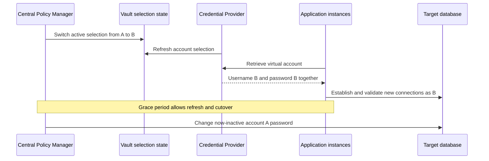

# Rotate CyberArk Dual Accounts Without Breaking Application Cutover

Author: [nawazdhandala](https://www.github.com/nawazdhandala)

Tags: CyberArk, Security, Reliability

Description: Plan CyberArk dual-account cutover around the active credential pair, provider caches, application refresh, and a measured grace period.

Dual accounts give an application time to move from one credential to another before the old password changes. They do not make an application that caches credentials forever rotation-safe. The application must retrieve and use the selected username and password together, and every relevant instance must refresh before its old credentials become unusable.

This guide focuses on the cutover protocol for a configured CyberArk dual-account pair. It uses the Credential Providers documentation identified as version **15.2** and a source-pinned CCP retrieval example. It does not claim a live rotation test or guarantee zero downtime in an unmeasured environment.

## Understand what changes first

A dual-account pair consists of two target accounts with equivalent privileges. Both remain enabled on the target. Active and Inactive are CyberArk selection states, not commands to disable a database login. The shared `VirtualUserName` identifies the logical pair. [Manage dual accounts](https://docs.cyberark.com/credential-providers/latest/en/content/cp%20and%20ascp/cv_managing-dual-accounts.htm).

The detailed rotation flow matters: CPM switches the roles, updates the group's active index, waits through `GracePeriod`, and then changes the now-inactive account's password. The grace period is the opportunity for consumers to move. [Configure dual accounts](https://docs.cyberark.com/credential-providers/latest/en/content/cp%20and%20ascp/cv_automatic_dual_account.htm).



Do not implement a separate script that flips `DualAccountStatus` while CPM is managing the same group. That creates two controllers for one transition. Use the supported rotational-group workflow and observe its state instead.

## Establish a usable pair before scheduling rotation

Both members must be in the same Safe, and the feature supports exactly two accounts through CPM. The documented creation script creates new accounts; it is not a generic tool for attaching an existing account. Account usages and the manual synchronization option have documented limitations. Review those constraints before converting an existing application. [Configuration requirements and limitations](https://docs.cyberark.com/credential-providers/latest/en/content/cp%20and%20ascp/cv_automatic_dual_account.htm).

For each target account, check more than “login succeeded.” Compare effective database roles, schema access, default database, network restrictions, and the application's actual operations. A missing permission on the standby account may remain invisible until the first cutover.

Record a baseline with one selected active member, the intended group membership, matching virtual identity, and a verified healthy standby credential. Confirm the application and provider are authorized to retrieve either member. A pair cannot protect availability if only the initially active account is accessible.

## Retrieve the pair through its virtual identity

For Central Credential Provider (CCP), a query-based POST body can select the virtual account:

```json
{
  "AppID": "REPLACE_APP_ID",
  "Query": "Safe=REPLACE_SAFE;Address=REPLACE_TARGET;VirtualUsername=REPLACE_VIRTUAL_USER",
  "QueryFormat": "Exact"
}
```

Replace the placeholders with approved values that satisfy the API's query restrictions. This is a body for your existing authenticated HTTPS retrieval client, not a standalone command. When `Query` is supplied, CCP uses it instead of the separate individual selection fields. Do not also hard-code `Object` or a physical username in the client and expect it to follow the active member. [CCP POST contract](https://docs.cyberark.com/credential-providers/latest/en/content/ccp/calling-the-web-service-using-rest_post.htm).

The `VirtualUsername` query pattern is documented in the official CCP integration guide **1.3**, pinned at `4dec83637ab47d0eee710eacd1f2de8375f40ff8`. [Pinned dual-account example](https://github.com/cyberark/Idira-Partner-Integration-Docs/blob/4dec83637ab47d0eee710eacd1f2de8375f40ff8/docs/secrets-management/central-credential-provider/development-guide.md).

Use the returned `UserName` and `Content` from the same response. Updating only the password while retaining username A can produce the invalid combination A/password-B. This original Python helper validates a response and constructs one immutable pair:

```python
from dataclasses import dataclass, field

@dataclass(frozen=True)
class CredentialPair:
    username: str
    password: str = field(repr=False)

def credential_pair(response):
    username = response.get('UserName')
    password = response.get('Content')
    if not isinstance(username, str) or not username:
        raise ValueError('Retrieval lacks a username')
    if not isinstance(password, str) or not password:
        raise ValueError('Retrieval lacks a password')
    return CredentialPair(username, password)
```

The password is excluded from the object's normal representation, but that does not make logging the response or serializing the object safe. This helper does not retrieve secrets, lock shared state, or update connection pools. Your application must publish the complete new pair through its own synchronized credential or pool-management mechanism.

## Size grace time from the slowest consumer

CyberArk recommends a `GracePeriod` three times the provider's `CacheRefreshInterval`; the grace setting is measured in minutes. Treat that as provider guidance, then measure the application's additional delay. [Grace-period configuration](https://docs.cyberark.com/credential-providers/latest/en/content/cp%20and%20ascp/cv_automatic_dual_account.htm).

For example, suppose a staging observation shows two minutes before the provider returns B, up to four more minutes before the slowest application refreshes, and one minute to validate and replace its connection pool. A three-minute application cutover budget is clearly insufficient. Add a justified margin and repeat the measurement under expected load rather than copying these illustrative numbers into production.

Include infrequent workers, scheduled tasks, paused deployments, and disaster-recovery instances. An application that reconnects only once a day must retrieve fresh credentials on reconnect; retaining yesterday's pair until a failed login is a fragile policy.

Connection lifetime is also different from credential freshness. An existing database session may continue after a password change, while new connections fail. Test both existing work and new authentication. Do not infer readiness from a green process-health endpoint that never opens a database connection.

## Rehearse one complete cycle

Start with a staging pair and representative application instances. Keep the target workload bounded and use an approved harmless operation that exercises the needed permissions.

| Checkpoint | Evidence to collect | Stop condition |
| --- | --- | --- |
| Before rotation | A selected; A and B independently usable | Standby permissions or password are wrong |
| Selection changes | Provider begins returning B's complete pair | Different instances retain inconsistent selection beyond budget |
| During grace | New connections use B successfully | Errors, lockouts, or workers still creating A connections near deadline |
| After A changes | Applications remain healthy on B | A's stale password is still used |
| Next rotation | Applications return to freshly managed A | Success depends on one permanently preferred account |

Measure durations and aggregate error counts without storing passwords. Retain the transition timestamps, application instance identifiers, and approved account labels. Test delayed provider refresh and an application restart during the grace period, since these expose assumptions that a steady-state test misses.

## Recover without assuming yesterday's password is valid

If cutover fails, pause further scheduled transitions using the approved operational procedure and inspect the current selection and target state. Do not blindly switch back to the old pair: its password may already have changed. Retrieve and validate the credential that the recovery plan intends to use.

Likewise, an application rollback must remain compatible with virtual-account retrieval. Reverting to a release that pins a physical username can reintroduce the failure even when CPM and the provider are healthy.

Promote the workflow only after both directions succeed, including new connections after each inactive password change. The protection comes from equivalent accounts, correct selection, bounded refresh, and verified application cutover working together.
