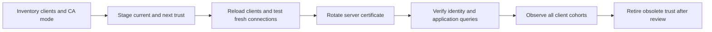

# Rotate RDS and Cloud SQL Certificates Without Breaking Client Trust

Author: [nawazdhandala](https://www.github.com/nawazdhandala)

Tags: PostgreSQL, Cloud, Reliability

Description: Stage database CA trust before certificate rotation, check provider-specific restart requirements, and prove fresh PostgreSQL connections still verify correctly.

A database certificate rotation can succeed on the server while applications lose the ability to connect. The server presents its new certificate, but a client still trusts only the previous issuer. Existing pooled connections can hide the problem until a deployment or traffic increase requires a new connection.

The reliable sequence is to prepare client trust first, verify it, change the server certificate, and verify fresh connections again. Whether the server change itself requires interruption depends on the provider, engine version, and certificate operation. Do not turn “without an outage” into a promise your particular database cannot meet.

This guide focuses on PostgreSQL connections to **Amazon RDS and Google Cloud SQL**. It separates provider procedures from the application rollout that both require.

## Identify the certificate being changed

A certificate authority, or CA, signs certificates that clients trust. The server's leaf certificate identifies the database endpoint. Rotating a leaf under an already trusted CA is different from changing the CA hierarchy. Client certificates, when required for authentication, are another independent item.

Inventory each client path before choosing a procedure:

| Client path | Trust boundary to inspect |
| --- | --- |
| Direct PostgreSQL connection | Driver trust bundle and endpoint name |
| Java application | The trust material actually used by its JDBC driver or TLS configuration |
| RDS Proxy | The proxy endpoint's certificate path, rather than assuming the direct database CA applies |
| Cloud SQL connector | Connector-managed server verification and supported connector version |
| Migration or reporting job | Its own image, runtime configuration, and certificate bundle |

RDS Proxy uses certificates from AWS Certificate Manager, so AWS distinguishes it from direct RDS certificate updates. See the [RDS rotation guidance](https://docs.aws.amazon.com/AmazonRDS/latest/UserGuide/UsingWithRDS.SSL-certificate-rotation.html). Inventory direct administrative connections even if most application traffic uses a proxy.

## Prepare overlapping client trust

Download trust material from the provider's documented source, record its provenance, and distribute it through your normal configuration delivery process. Before switching the database, clients should trust the current chain and the intended replacement chain.

Do not pin a short-lived server certificate when the supported integration expects CA trust. For RDS, AWS specifically advises registering root CAs rather than intermediates in the application trust store, because intermediate pinning can cause problems during automatic server certificate rotation. Its [TLS guide](https://docs.aws.amazon.com/AmazonRDS/latest/UserGuide/UsingWithRDS.SSL.html) links the regional and global bundles.

A file being present on disk does not prove the application loaded it. Establish whether the driver reads trust material for each new connection or retains a TLS context created at startup. Roll or reload clients according to their actual behavior, and retain a tested deployment artifact containing the previous configuration for recovery.



## Check the RDS engine's rotation support

Before scheduling an RDS PostgreSQL change, inspect the exact engine version and Region. This read-only AWS CLI example uses **CLI 2.38.1** syntax. Replace the Region and version with those of your instance; `17.4` is an illustrative filter, not a recommendation to deploy that version.

```bash
aws rds describe-db-engine-versions \
  --engine postgres \
  --engine-version 17.4 \
  --region us-east-1 \
  --query 'DBEngineVersions[].{Version:EngineVersion,NoRestart:SupportsCertificateRotationWithoutRestart,CAs:SupportedCACertificateIdentifiers}' \
  --output json
```

Inspect the returned restart-support flag and supported CA identifiers. An empty result is not evidence of compatibility; check the supplied version and Region. The fields are documented in the [CLI reference](https://docs.aws.amazon.com/cli/latest/reference/rds/describe-db-engine-versions.html).

AWS directs operators to this flag when determining whether a CA update requires restart. Complete the client rollout first, then use the supported instance modification or maintenance procedure for your deployment. Review other pending modifications before choosing when to apply a change. A capability flag does not prove that every client is ready or that the application can recover from unrelated connection failures.

## Match Cloud SQL commands to its CA mode

Cloud SQL documents different certificate workflows for per-instance CAs and shared or customer-managed CAs. Do not copy commands between those modes merely because both involve PEM certificate files.

For the **per-instance CA** workflow, the documented order is to create the next server CA, download certificate information, update clients, and then complete rotation. The management guide separately documents server-certificate operations for shared and customer-managed CAs. Its shared-CA bundles do not apply to every CA mode. Follow the appropriate section of [Manage SSL/TLS certificates](https://docs.cloud.google.com/sql/docs/postgres/manage-ssl-instance).

A useful read-only inventory command for the per-instance workflow is:

```bash
gcloud sql ssl server-ca-certs list \
  --project=PROJECT_ID \
  --instance=INSTANCE_NAME
```

Replace both placeholders and confirm the selected project. This lists certificate information; it does not rotate the instance. The exact command is documented in the [Google Cloud CLI reference](https://docs.cloud.google.com/sdk/gcloud/reference/sql/ssl/server-ca-certs/list). Review which certificate is active and which is staged before scheduling the change.

Keep hostname verification intact. Cloud SQL's ability to verify a DNS name depends on its CA and networking configuration. Confirm the instance's supported certificate name rather than substituting an arbitrary internal alias. Google's [server identity verification instructions](https://docs.cloud.google.com/sql/docs/postgres/configure-ssl-instance#enable-server-identity-verification) explain these distinctions.

## Verify a new TLS handshake, then a real query

For a directly reachable PostgreSQL endpoint with a certificate matching its DNS name, OpenSSL can inspect a fresh handshake. This example assumes an OpenSSL build supporting PostgreSQL STARTTLS, an approved CA bundle, and a server that does not require a client certificate for this probe. Replace the hostname and file path:

```bash
openssl s_client \
  -starttls postgres \
  -connect DB_DNS_NAME:5432 \
  -servername DB_DNS_NAME \
  -verify_hostname DB_DNS_NAME \
  -CAfile /approved/path/database-ca-bundle.pem \
  -verify_return_error \
  -brief </dev/null
```

`-starttls postgres` performs PostgreSQL's TLS negotiation. The hostname check verifies the endpoint identity; `-verify_return_error` makes certificate verification failures fatal instead of merely diagnostic. Inspect the verification result and command status. A reset after input closes is not the same diagnosis as a certificate verification failure. The [OpenSSL command reference](https://docs.openssl.org/3.5/man1/openssl-s_client/) describes these options.

This probe does not authenticate a database user or run a query. Follow it with a fresh connection from the actual application runtime and an approved operation. PostgreSQL clients should retain full verification, such as `sslmode=verify-full` with the correct root trust configuration; see [PostgreSQL 17 TLS support](https://www.postgresql.org/docs/17/libpq-ssl.html).

## Define completion and recovery evidence

Record successful fresh connections from each application cohort, scheduled job, and operational client after rotation. Include a cold process start, so a warm pool or old TLS context cannot mask missing deployment files. Monitor verification failures separately from password failures and connection timeouts.

Keep the old trust material during the reviewed transition period, but do not retain obsolete trust indefinitely without ownership. Before removing it, account for replicas, failover endpoints, and infrequently scheduled jobs. Recovery should use a provider-supported certificate rollback where available, or a corrected client trust deployment. Disabling certificate verification is not a recovery plan.

The AWS example was checked using local CLI output-skeleton generation without an API call. OpenSSL options and shell syntax were checked locally; no live certificate rotation, handshake, or database connection was performed.
