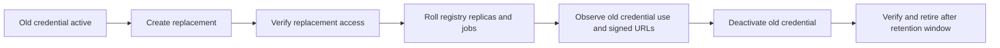

# Rotate Registry Storage Credentials Without Breaking Transfers

Author: [nawazdhandala](https://www.github.com/nawazdhandala)

Tags: Container Registry, Security, S3

Description: Rotate registry storage credentials with an overlap window, staged verification, and explicit handling of uploads, signed URLs, and maintenance jobs.

Rotating a registry's storage credential affects more than its next health check. A replica might still hold the old key in memory. A running garbage-collection job might use a separate secret. A client might already have a download URL signed with the old credential.

A safe plan creates an overlap window: introduce the replacement, verify every consumer, stop using the old credential, and only then retire it. This guide focuses on **Distribution 3.1.2 with its S3 driver**, using AWS IAM user keys as the concrete long-lived credential example. Adapt provider-specific steps for other S3-compatible services.

A rotation can preserve service availability when the deployment has enough healthy capacity and clients support the relevant retries. It cannot guarantee that every in-flight connection survives a process restart. Treat that distinction explicitly in the maintenance plan.

## Inventory every credential consumer

Separate storage credentials from client registry passwords, TLS certificates, and the registry's HTTP state-signing secret. Changing one does not require rotating all the others in the same operation.

List the actual consumers:

| Consumer | What to verify |
|---|---|
| Every registry replica | Effective storage credential source and process restart behavior |
| Garbage-collection jobs | Separate secret references, schedules, and running jobs |
| Backup or inventory tooling | Credential scope and independently loaded configuration |
| Blob redirects | Old credentials may have signed URLs still held by clients |
| Disaster-recovery environment | Recovery instructions reference the intended secret version |

Record secret version identifiers, not secret values. Check for credentials injected through environment variables as well as configuration files. A successful update in a secret manager does not prove that a running process loaded it.

AWS recommends temporary role credentials where possible. If using IAM user keys, a user can have at most two access keys, which can support an overlap rotation when an available slot exists. Do not delete an unexplained second key just to make room. [AWS access-key guidance](https://docs.aws.amazon.com/IAM/latest/UserGuide/id_credentials_access-keys.html).



## Establish how the driver loads credentials

The pinned S3 driver constructs a static credential provider when both configured `accesskey` and `secretkey` are present. An optional `sessiontoken` is included. Do not assume that editing the source file or environment later refreshes an already constructed driver. Plan a controlled process replacement for this static-credential path. [Distribution 3.1.2 S3 implementation](https://github.com/distribution/distribution/blob/v3.1.2/registry/storage/driver/s3-aws/s3.go).

If the deployment instead relies on an SDK credential provider such as a workload role, review that provider's refresh and identity behavior. Do not paste short-lived role credentials into static fields and expect automatic renewal. Rotation of a long-lived key and renewal of temporary credentials are different mechanisms.

Distribution configuration can be overridden through environment variables. For the static S3 fields, the relevant names include:

```text
REGISTRY_STORAGE_S3_ACCESSKEY
REGISTRY_STORAGE_S3_SECRETKEY
REGISTRY_STORAGE_S3_SESSIONTOKEN
```

Deliver the access key and secret as one reviewed secret version. Include the session token only when required by that credential type. Remove a stale token when moving to credentials that do not use one. Keep bucket, region, prefix, endpoint, TLS settings, and encryption settings unchanged unless a separate reviewed change requires otherwise. [Distribution environment overrides](https://github.com/distribution/distribution/blob/v3.1.2/docs/content/about/configuration.md#override-specific-configuration-options).

## Verify the replacement before changing traffic

Create the replacement using your approved identity-management process. Retain the old credential while verifying the new one, unless an active compromise requires immediate revocation and an incident response instead.

For AWS, the following read-only AWS CLI v2 example assumes a securely provisioned profile named `registry-storage-next`. It contains no credentials in the command:

```bash
aws sts get-caller-identity \
  --profile registry-storage-next \
  --no-cli-pager
```

Confirm the returned account and principal. This checks identity, not S3 permission; the operation does not require a normal permission grant. [AWS CLI identity command](https://docs.aws.amazon.com/cli/latest/reference/sts/get-caller-identity.html).

Next, inspect an approved existing object using its real bucket and key:

```bash
aws s3api head-object \
  --profile registry-storage-next \
  --bucket REPLACE_WITH_REGISTRY_BUCKET \
  --key REPLACE_WITH_KNOWN_EXISTING_OBJECT_KEY \
  --no-cli-pager
```

The expected result is object metadata. HEAD does not download or decrypt the image content for a full pull, nor does it test writes, multipart operations, listing, deletion, or encryption-key permissions needed by other operations. A missing object can appear as `403` rather than `404` when listing permission is absent, so choose a known object and interpret errors carefully. [AWS CLI HeadObject documentation](https://docs.aws.amazon.com/cli/latest/reference/s3api/head-object.html).

Use a separate staging registry and disposable repository to verify complete upload, pull, and approved cleanup behavior under the new credential. Match the production storage policy and encryption settings. Do not test deletion by removing live registry objects directly from the bucket.

## Replace consumers in controlled stages

For a replicated registry, start with one replica while the others continue serving. Drain it from new traffic, allow active requests their configured grace period, replace its credential configuration, and restart it. Verify through that replica before restoring its normal traffic share.

Distribution's `http.draintimeout` controls graceful shutdown waiting, and its `http.secret` protects client-carried state. Replicas behind a load balancer must share the same HTTP secret. Preserve that value during storage-key rotation; otherwise upload-state failures can be introduced at the same time as the credential change. [Pinned HTTP configuration](https://github.com/distribution/distribution/blob/v3.1.2/docs/content/about/configuration.md#http).

Check a previously stored image and a new disposable push. Include resumed or multipart uploads in the staging rehearsal. A single-replica deployment may need a maintenance window or an additional correctly configured replica; do not label a restart zero-downtime without testing the actual topology.

Update job definitions too. Let running maintenance jobs finish under the old credential or stop and reschedule them through the established procedure. Avoid introducing a credential transition halfway through garbage collection. Validate replacement job configuration before the next scheduled run, while retaining the normal read-only or stopped-writer requirements for collection.

## Account for already issued download URLs

When storage redirects are enabled, clients may hold presigned S3 URLs issued before the rollout. AWS states that such URLs expire when their signing credential is revoked, deleted, or deactivated, even if the URL itself advertises a later expiry. Temporary credential expiry also limits URL validity. [S3 presigned URL lifetime](https://docs.aws.amazon.com/AmazonS3/latest/userguide/using-presigned-url.html).

Base the overlap window on the configured signing lifetime, observed transfer duration, client retry behavior, and provider semantics. Complete the replica rollout, stop issuing URLs under the old key, and allow the relevant window to drain before deactivation. Do not assume that an absence of old-key traffic for a few seconds proves no client still holds an old URL.

Monitor storage access logs or audit events where available, registry error rates, failed redirects, and actual uncached pulls. Treat a cached client success as insufficient evidence.

## Retire the old key only after acceptance

Confirm that every replica and scheduled job references the intended secret version. Deactivate the old IAM key first under the approved change procedure, observe the service, and delete it only after the agreed rollback and retention window. A rollback requires an explicitly permitted old credential; it cannot depend on a key already deleted. [AWS staged key-update procedure](https://docs.aws.amazon.com/IAM/latest/UserGuide/id-credentials-access-keys-update.html).

Record the consumers updated, staged tests, retirement time, and observed impact. Keep old secret material only as long as policy permits, and remove obsolete references from recovery documentation.

For this article, the Distribution 3.1.2 configuration parser was checked with synthetic environment overrides. Driver loading behavior and the read-only AWS examples were reviewed against official source and documentation. No real AWS credentials were created, rotated, deactivated, or used; no live S3 transfer or garbage-collection job was exercised. The staged operational checks above remain necessary before applying the procedure to production.
