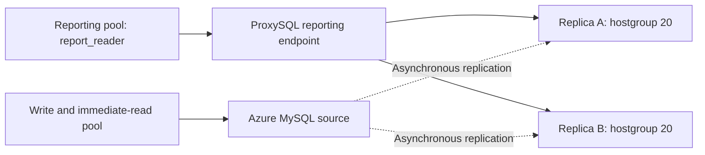

# Route Azure MySQL Reporting Traffic Across Replicas with ProxySQL

Author: [nawazdhandala](https://www.github.com/nawazdhandala)

Tags: Azure, MySQL, Performance, Networking

Description: Configure a dedicated ProxySQL read pool for Azure MySQL replicas, with explicit routing, TLS checks, connection limits, and replica freshness tests.

A reporting dashboard can tolerate seeing an order a little late. The checkout request that just created that order usually cannot. Both requests might run a `SELECT`, so the first word of a query is a poor way to decide where it belongs.

Use an explicit reporting connection pool instead. Give it a dedicated database account, route that account through ProxySQL to selected read replicas, and keep writes and immediate post-write reads on the source server. This makes the application's consistency requirements visible before traffic reaches the proxy.

Azure MySQL replicas update asynchronously. A successful query therefore proves availability, not that the result includes the latest committed changes. Microsoft documents ProxySQL as one option for distributing replica reads. Its newer reader endpoint is another option, currently in preview with separate limitations; this article uses individual replica hostnames. [Azure read replicas](https://learn.microsoft.com/en-us/azure/mysql/flexible-server/concepts-read-replicas)

## Define a small, explicit routing boundary

The example targets **ProxySQL 3.0.12** and an existing pair of Azure Database for MySQL Flexible Server replicas. It is a configuration example reviewed against documentation and tagged source, not a report of a live Azure deployment. [Pinned release](https://github.com/sysown/proxysql/releases/tag/v3.0.12)

A **hostgroup** is ProxySQL's numbered collection of destination servers. Here, hostgroup 20 contains only the two reporting replicas.



Before configuration, prepare a dedicated staging ProxySQL instance, working private DNS and network access to both replicas, and a protected administrative connection to ProxySQL. The administration interface is different from its application interface; run the configuration SQL below on the former.

Provision `report_reader` through your normal secret-management process on the MySQL source and in ProxySQL. Give the database account only the required read privileges on the reporting schema. Wait for that account and its permissions to reach both replicas. Azure replicates source user accounts to replicas. ProxySQL routing does not replace database authorization. [Replica accounts and connectivity](https://learn.microsoft.com/en-us/azure/mysql/flexible-server/concepts-read-replicas)

Confirm that no existing query rules, replication-hostgroup mappings, or automation can redirect this user elsewhere. The example assumes a dedicated reporting proxy without those mappings. Do not paste it into a shared proxy before reviewing its routing rules and configuration backup.

## Treat TLS as two separate connections

Transport Layer Security, or TLS, protects each network connection. Here there are two: application to ProxySQL, and ProxySQL to Azure MySQL.

Install a ProxySQL serving certificate that matches the hostname applications use. Configure application drivers to verify that hostname and its certificate chain. On the backend, use each replica's canonical Azure hostname and a maintained Azure-compatible certificate authority bundle, readable by the ProxySQL service account. A certificate authority, or CA, signs certificates that clients trust.

The settings below request backend TLS and supply CA material. They are **not evidence that your packaged build verifies the backend hostname**. ProxySQL's documented TLS switches and its tagged connection implementation must not be treated as a promise equivalent to a MySQL client's `VERIFY_IDENTITY` mode. [TLS configuration](https://proxysql.com/documentation/ssl-support/), [3.0.12 connection implementation](https://github.com/sysown/proxysql/blob/v3.0.12/lib/mysql_connection.cpp)

Make backend trust a release gate: on an isolated test backend, demonstrate rejection of an untrusted certificate and of a certificate for the wrong hostname, using the exact ProxySQL package you will deploy. A successful handshake or a nonempty cipher name does not pass these tests. If your build cannot enforce the identity checks your organization requires, stop at staging and choose an approved connection design; do not disable verification to make the test pass.

## Add the replica destinations

Replace both example hostnames and the CA path. Hostgroup 20 must be unused. This first SQL block adds destinations and per-server CA paths to ProxySQL's editable configuration:

```sql
INSERT INTO mysql_servers
    (hostgroup_id, hostname, port, weight, max_connections, use_ssl)
VALUES
    (20, 'report-a.mysql.database.azure.com', 3306, 1, 40, 1),
    (20, 'report-b.mysql.database.azure.com', 3306, 1, 40, 1);

INSERT INTO mysql_servers_ssl_params (hostname, port, ssl_ca)
VALUES
    ('report-a.mysql.database.azure.com', 3306,
     '/etc/proxysql/ca/azure-mysql-roots.pem'),
    ('report-b.mysql.database.azure.com', 3306,
     '/etc/proxysql/ca/azure-mysql-roots.pem');
```

The empty default username in the certificate table supplies a server-level entry. Certificate files must exist on the proxy host; storing their paths does not distribute the files. The table and columns are defined in the [3.0.12 administration schema](https://github.com/sysown/proxysql/blob/v3.0.12/include/ProxySQL_Admin_Tables_Definitions.h).

Equal weights request approximately equal distribution. They do not promise alternating queries or equal CPU usage. Forty connections per server is an example budget for this proxy instance, not an Azure recommendation. Include other proxy instances, direct clients, and monitoring connections when sizing the total. [Backend configuration](https://proxysql.com/documentation/backend-server-configuration/)

Next, update the already-provisioned user without exposing or replacing its password:

```sql
UPDATE mysql_users
SET default_hostgroup=20,
    transaction_persistent=1,
    use_ssl=1,
    max_connections=60
WHERE username='report_reader';

SELECT username, default_hostgroup, transaction_persistent, use_ssl
FROM mysql_users
WHERE username='report_reader';
```

Require the expected user row before proceeding; an update matching no rows does not create an account. `use_ssl=1` requires TLS from that user. `transaction_persistent=1` keeps a transaction in its hostgroup; it does not make replicas current or make separate transactions share one snapshot. [User configuration](https://proxysql.com/documentation/users-configuration/)

Once the editable configuration is reviewed, activate it:

```sql
LOAD MYSQL SERVERS TO RUNTIME;
LOAD MYSQL USERS TO RUNTIME;
```

These commands change live routing. Saving is separate: after the acceptance checks, run `SAVE MYSQL SERVERS TO DISK;` and `SAVE MYSQL USERS TO DISK;` to preserve the accepted settings across restarts. Review all pending changes in these configuration groups first, because loading and saving are not limited to the rows shown here. [Configuration layers](https://proxysql.com/documentation/main-runtime/multi-layer-configuration)

## Verify routing and freshness independently

Start with this read-only query on the administration interface:

```sql
SELECT hostgroup_id, hostname, port, status, use_ssl, max_connections
FROM runtime_mysql_servers
WHERE hostgroup_id=20
ORDER BY hostname;
```

Expect exactly the two intended destinations, with TLS enabled and the reviewed limits. An `ONLINE` configuration row is not proof that authentication or queries succeed.

Run a known reporting query through the application connection pool. Check backend activity on both replicas over a representative workload, errors, connection counts, and latency. Test account restrictions separately in staging; simply connecting with a read-only account does not prove every application operation is compatible with it.

Then write a uniquely identified test record through the normal source write path and measure when each replica can read it. Keep this separate from the application's latency measurement: fast stale responses are still stale. Define an acceptable age for reporting data and an explicit response when no replica meets it, such as pausing report generation.

This minimal configuration does not establish automatic freshness-based exclusion. Do not assume a `max_replication_lag` value alone proves the monitor works with your Azure replica implementation. Validate the monitor's permissions and observed values against Azure's replication metrics. Microsoft specifically warns that the SQL replica I/O-running field can show `No` for storage-based replicas without indicating failure. [Azure replication monitoring](https://learn.microsoft.com/en-us/azure/mysql/flexible-server/concepts-read-replicas)

## Exercise failure before adding production traffic

In staging, make one replica unavailable to the proxy and observe new requests, existing transactions, and application retries. Repeat with both unavailable. A read pool should produce a bounded, visible failure rather than silently sending the reporting surge to the source.

Also restart the proxy after saving configuration and repeat authentication and routing checks. Plan proxy availability itself: two healthy replicas do not help if every reporting request depends on one failed proxy process.

Roll out with a small reporting workload first. Record the routing configuration, trust-test results, freshness limit, and connection budget together. Those four pieces explain what the read endpoint promises, and make it possible to investigate whether a later problem is routing, security, capacity, or delayed data.
