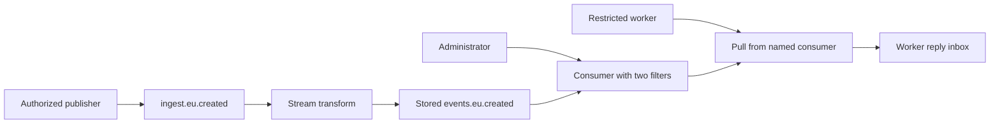

# Route JetStream Events with Filters, Transforms, and Narrow Permissions

Author: [nawazdhandala](https://www.github.com/nawazdhandala)

Tags: NATS, Messaging, Security, Go

Description: Combine JetStream subject transforms and multiple consumer filters while keeping consumer creation separate from a worker's narrowly scoped read permissions.

A reporting worker needs European order creations and American shipment events. Giving it every order and filtering in application code wastes bandwidth and exposes unnecessary data. Two JetStream consumer filters can select those event types before delivery. But the filters alone do not establish a security boundary if the same worker can create an unrestricted consumer.

Build routing and authorization together. First decide which subjects the stream stores, then which subset the consumer delivers, and finally who may change that selection. This example uses **NATS Server 2.11.4** and **nats.go v1.42.0**, with a separate administrator and restricted worker in one test account.

## Keep three kinds of subject separate

A subject is a dot-separated routing name. Here, publishers send to `ingest.eu.created`, while the stream stores the record as `events.eu.created`. The worker receives selected stored records through its request inbox.

| Stage | Example | What controls it |
| --- | --- | --- |
| Original publication | `ingest.eu.created` | Publisher permission and stream capture subjects |
| Stored record | `events.eu.created` | Stream subject transform |
| Consumer selection | `events.eu.created`, `events.us.shipped` | Consumer filter configuration |
| Pull request | `$JS.API.CONSUMER.MSG.NEXT.ROUTING.selected` | Worker's API publication permission |
| Delivery transport | Client-generated `_INBOX` subject | Worker's subscription permission |

These are different names for different purposes. Allowing an inbox subscription does not mean a worker may publish to every JetStream API endpoint. Conversely, denying subscriptions to `events.>` does not secure a stream if the worker can create arbitrary consumers and receive their output through an allowed inbox.



## Transform storage names deliberately

A stream transform rewrites matching subjects as messages enter storage. It does not automatically republish them for ordinary Core subscribers. An unmatched subject captured by the stream remains unchanged; transformation is not an exclusion rule. See the [official subject-mapping guide](https://docs.nats.io/learn/jetstream/subject-mapping).

The following administrator-side Go function requires `context`, `time`, and `github.com/nats-io/nats.go/jetstream` imports. Supply a connected JetStream context with provisioning permissions and a bounded request context. Run it against a fresh disposable account with no existing `ROUTING` stream; it is not a production migration script.

```go
func provision(ctx context.Context, js jetstream.JetStream) error {
    _, err := js.CreateStream(ctx, jetstream.StreamConfig{
        Name: "ROUTING", Subjects: []string{"ingest.*.*"},
        Storage: jetstream.FileStorage,
        MaxMsgs: 1000, MaxAge: 24 * time.Hour,
        SubjectTransform: &jetstream.SubjectTransformConfig{
            Source: "ingest.*.*",
            Destination: "events.{{wildcard(1)}}.{{wildcard(2)}}",
        },
    })
    if err != nil {
        return err
    }
    _, err = js.CreateConsumer(ctx, "ROUTING", jetstream.ConsumerConfig{
        Durable: "selected", AckPolicy: jetstream.AckExplicitPolicy,
        FilterSubjects: []string{
            "events.eu.created", "events.us.shipped",
        },
        MaxAckPending: 10, MaxRequestBatch: 10,
    })
    return err
}
```

Each `*` captures one subject token. The destination preserves the region and event type while replacing the `ingest` prefix. The stream uses file storage and bounded retention; adjust those limits to your recovery needs. A durable consumer retains its delivery state across worker reconnects. Explicit acknowledgment means the worker must acknowledge successful processing.

The transform does not edit old records retroactively. If you later change a live stream from `ingest.*.*` to stored `events.*.*`, old and new records can have different names. Before changing production, inventory existing stored subjects and decide how a replay reader should handle both formats.

## Multiple filters mean a union

The two filters select either matching event type, not an intersection requiring both. Publishing these three input subjects should produce the following result:

| Published subject | Stored subject | Delivered to `selected` |
| --- | --- | --- |
| `ingest.eu.created` | `events.eu.created` | Yes |
| `ingest.us.shipped` | `events.us.shipped` | Yes |
| `ingest.eu.canceled` | `events.eu.canceled` | No |

The unselected record remains in the stream under the configured retention policy. Filtering is a delivery decision, not deletion. The [filtering guide](https://docs.nats.io/learn/jetstream/filtering) describes this distinction. The [pinned client configuration](https://github.com/nats-io/nats.go/blob/v1.42.0/jetstream/consumer_config.go) requires Server 2.10.0 or later for `FilterSubjects` and makes it mutually exclusive with singular `FilterSubject`.

Prefer clearly separated filters like this example. Avoid combining a broad wildcard with specific entries it already covers. Review the resulting configuration rather than assuming a list of filters is always narrower than one wildcard.

## Separate provisioning from reading

A single-filter consumer can use a creation API subject containing that filter. In the pinned Go client, multiple filters use a creation subject containing the stream and consumer name, without the filter text. The filter list travels in the request body. Inspect the [creation path in v1.42.0](https://github.com/nats-io/nats.go/blob/v1.42.0/jetstream/consumer.go) before relying on subject permissions to constrain creation.

A permission on the creation endpoint therefore does not validate every filter in the JSON body. For this worker, the safer arrangement is simple: an administrator provisions `selected`; the worker may inspect and pull that consumer but cannot create or update consumers.

Place this permission object inside the worker's existing user entry in a NATS server configuration. It is an excerpt, not a complete authentication configuration. Keep approved credentials and TLS settings outside the example.

```text
permissions: {
  publish: {
    allow: [
      "$JS.API.CONSUMER.INFO.ROUTING.selected",
      "$JS.API.CONSUMER.MSG.NEXT.ROUTING.selected",
      "$JS.ACK.ROUTING.selected.>"
    ]
  }
  subscribe: { allow: ["_INBOX.>"] }
}
```

The worker can retrieve its consumer definition, request batches, acknowledge deliveries, and receive replies. There is no consumer-create, stream-get, stream-management, or general `$JS.API.>` allowance. A normal `js.Consumer(ctx, "ROUTING", "selected")` lookup binds to the existing consumer without provisioning it. Batch fetches should stay within the configured maximum of ten.

The inbox allowance is practical for a dedicated worker identity in this example, but is not private inbox isolation among mutually untrusted users sharing one account. For that threat model, assign per-user inbox prefixes and matching client configuration, or separate tenants into accounts. Adapt API and acknowledgment prefixes if using JetStream domains or cross-account imports; do not copy the standalone permissions blindly into those designs.

## Test denials as well as successful routing

A useful acceptance test publishes all three subjects as an authorized publisher, inspects stored names as an administrator, and reads using the restricted worker credentials. Expect two deliveries and three retained records. Acknowledge only after processing succeeds.

Then try to create another consumer as the worker. It must fail, and the client's asynchronous error handler should record the permission violation. Also test denied stream reads and other-consumer access in your deployment: a successful filtered read alone cannot prove authorization is narrow.

The local fixture executed the provisioning function, verified all three rewritten subjects, fetched and acknowledged the two selected records as the restricted worker, and rejected unauthorized consumer creation. It used temporary authentication credentials and a disposable local file store. TLS, domain routing, cross-account imports, and production credential rotation were not exercised.

When a worker stops receiving data, compare original publication, stored subject, consumer filter, and API permission in that order. Fixing a spelling mismatch is much safer than broadening the worker to `$JS.API.>` and accidentally making its filter optional.
