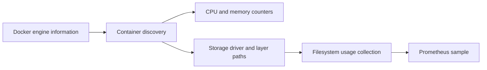

# Run cAdvisor on Synology DSM and Diagnose Missing Filesystem Metrics

Author: [nawazdhandala](https://www.github.com/nawazdhandala)

Tags: Docker, Linux, Prometheus, Monitoring, Troubleshooting

Description: Adapt cAdvisor to a Synology host's real Docker paths, then separate filesystem visibility problems from storage-driver collection limitations.

A cAdvisor container can start successfully on a Synology NAS and still omit filesystem metrics for its application containers. CPU and memory readings do not prove that writable-layer accounting is supported or that every storage path is visible.

Treat the NAS model, DSM version, Container Manager version, Docker engine, and storage driver as part of the monitoring configuration. A command copied from another machine can point at a directory that exists but contains none of the relevant runtime data.

The example below pins cAdvisor 0.55.1. It is an adaptation of upstream deployment guidance, not a tested compatibility claim for a particular Synology model. Use an approved maintenance window or a noncritical NAS for the first deployment.

## Inventory the actual Docker environment

From an authorized shell on the NAS, query the engine used by Container Manager:

```bash
docker info --format 'Root={{.DockerRootDir}} Driver={{.Driver}} Architecture={{.Architecture}}'
docker version
```

The [Docker info reference](https://docs.docker.com/reference/cli/docker/system/info/) documents formatted output. Record the reported root directory instead of assuming `/var/lib/docker` or copying `/volume1/@docker` from an older installation. The volume number and package layout can differ.

Also distinguish the NAS volume's filesystem from Docker's storage driver. A Btrfs-backed volume does not by itself tell you that Docker reports `btrfs` as its driver. Use the engine's answer when comparing it with cAdvisor's implementation.

Before pulling the image, confirm that the NAS architecture is supported by the selected image. The `0.55.1` image index reviewed for this article contains Linux amd64 and arm64 manifests. Older or different architectures require separate verification; a successful YAML parse does not prove the image can run.

## Adapt the upstream deployment deliberately

Synology Container Manager supports Compose-based projects; its [developer documentation](https://help.synology.com/developer-guide/resource_acquisition/docker-project.html) describes the Compose project format. You can use the same configuration through an available Compose CLI, but check which features your installed package supports.

This example follows the broad host access used in the [upstream cAdvisor quick start](https://github.com/google/cadvisor/blob/v0.55.1/README.md). It is a trusted host-monitoring deployment, not an isolated application container. Review the privileged setting and host mounts before use.

Set `NAS_DOCKER_ROOT` to the exact absolute root directory reported by Docker, using your project's supported environment configuration. Confirm `/dev/kmsg` exists before using the device mapping. Save this as `compose.yaml`:

```yaml
services:
  cadvisor:
    image: ghcr.io/google/cadvisor:0.55.1@sha256:e02855207ec07bb45ee41f720645945251f093f24c28f8c29cf718490f784922
    restart: unless-stopped
    privileged: true
    devices:
      - /dev/kmsg:/dev/kmsg
    ports:
      - '127.0.0.1:8080:8080'
    volumes:
      - type: bind
        source: /
        target: /rootfs
        read_only: true
      - type: bind
        source: /var/run
        target: /var/run
        read_only: true
      - type: bind
        source: /sys
        target: /sys
        read_only: true
      - type: bind
        source: ${NAS_DOCKER_ROOT:?Set the actual Docker root directory}
        target: ${NAS_DOCKER_ROOT:?Set the actual Docker root directory}
        read_only: true
        bind:
          create_host_path: false
```

The root filesystem mount preserves host-path context under `/rootfs`; the additional Docker-root mount preserves its actual absolute path. `create_host_path: false` helps prevent a typo from silently creating an empty source directory. Check support in your installed Compose implementation using the [Compose bind-mount reference](https://docs.docker.com/reference/compose-file/services/#volumes).

The upstream example also mounts `/dev/disk`. Inspect whether that directory exists on your NAS before adding it as a read-only bind mount. Do not create an empty directory merely to satisfy a copied command: that does not create device metadata. If `/dev/kmsg` is unavailable, this baseline requires platform-specific adjustment and validation rather than an invented replacement device.

Loopback publishing expresses the intended local-only route. Verify the NAS engine and firewall: [Docker documents](https://docs.docker.com/engine/network/port-publishing/) that engines before 28.0.0 can expose loopback-published ports to other hosts on the same layer-2 network. A remote Prometheus server needs an intentionally configured protected route; changing the bind address alone does not provide authentication. Read-only host mounts also do not remove the control privileges of an accessible runtime socket.

Validate and start only after setting the required environment value:

```bash
docker compose config
docker compose up -d cadvisor
```

[Compose config](https://docs.docker.com/reference/cli/docker/compose/config/) should show the resolved paths and image. [Compose up](https://docs.docker.com/reference/cli/docker/compose/up/) creates or updates the monitoring container. If Container Manager rejects a field, inspect its supported Compose version; do not silently remove path safeguards without replacing the checks.

## Separate discovery from filesystem collection



Choose one running application container and inspect both its raw metrics and cAdvisor logs. For a Compose deployment:

```bash
docker compose logs --since 10m --tail 200 cadvisor
```

Look for runtime-discovery errors, unreadable layer paths, filesystem-device lookup failures, or repeated scan errors. The [Compose logs reference](https://docs.docker.com/reference/cli/docker/compose/logs/) documents the bounded log view.

If application CPU and memory series are missing too, start with discovery and host visibility. If those series are present but filesystem usage is absent, focus on storage-specific collection and metric selection.

## Check the storage-driver code path

In cAdvisor 0.55.1's [Docker filesystem collector](https://github.com/google/cadvisor/blob/v0.55.1/container/docker/fs.go), usage collection handles named storage-driver cases and returns without adding filesystem usage for the default case. That switch includes aufs, overlay, overlay2, vfs, devicemapper, and zfs paths; it does not include a `btrfs` case.

This is a concrete reason to check the driver before repeatedly changing mounts. A Docker engine reporting `btrfs` does not gain that missing collector branch because more host directories become visible. Other collection paths and future releases need their own review.

The metric family also matters. Filesystem usage, filesystem capacity, and disk I/O counters answer different questions and can have different availability. A missing writable-layer metric does not mean the NAS lacks volume-capacity information elsewhere.

Do not compare a container's reported filesystem capacity directly with its writable-layer usage and assume the difference is wasted space. Capacity can describe the backing filesystem. Similarly, Docker's writable-layer size does not represent every bind-mounted directory used by the application.

## Define a realistic acceptance check

Verify a known container's identity, CPU and memory series, then the specific filesystem family your dashboard requires. Confirm the relevant `disk` metrics have not been disabled. Test actual sample availability before enabling a capacity or usage alert; missing data must not become zero usage.

If the driver or platform cannot supply the desired metric, document that limitation and use a supported host-volume monitoring source for NAS capacity. Keep container resource monitoring where it is reliable. Avoid presenting one partial source as complete storage coverage.

The configuration in this article was checked against the Compose schema, and the image manifest and versioned collector branches were reviewed. No Synology NAS deployment or live filesystem scan was performed. Your acceptance evidence should record the DSM/package versions, actual Docker root and driver, resolved mounts, relevant logs, and observed metric families so later upgrades can be compared against a known baseline.
