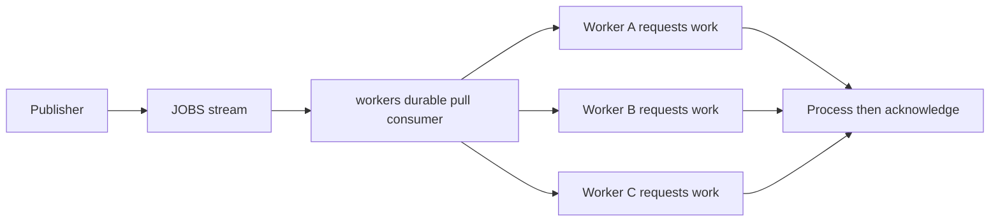

# Scale JetStream Workers with One Shared Pull Consumer

Author: [nawazdhandala](https://www.github.com/nawazdhandala)

Tags: NATS, Messaging, Go

Description: Share one JetStream pull consumer across worker replicas, bound outstanding work, acknowledge after processing, and verify scaling without accidental fan-out.

Adding worker replicas should increase processing capacity. It should not make every replica process the entire event stream independently. With JetStream, the distinction depends on whether workers share a consumer or each creates its own.

Use one named pull consumer for one logical worker pool, then have every worker bind to it. A pull consumer sends messages in response to requests from workers. The workers share delivery and acknowledgment state while running independently.

The examples below use **NATS Server 2.11.4**, **nats.go 1.42.0**, and **Go 1.25.0**. A local test used three independent client connections to process nine messages through one consumer. It also checked an empty fetch and a failed handler. This was not a throughput benchmark or a clustered failure test.

## Share the consumer, not just the subject

A stream can have multiple consumers, each with its own view of the retained messages. Creating `worker-1`, `worker-2`, and `worker-3` consumers is appropriate when each application independently needs the events. It is usually wrong when three replicas are meant to divide one job backlog.

For a shared pool, keep the stream name and consumer name identical in every replica. A unique worker ID belongs in logs and tracing, not in the durable consumer name. The official [worker-pool guide](https://docs.nats.io/learn/jetstream/worker-pool) describes this shared-consumer pattern.



This distributes normal deliveries among waiting workers. It does not promise that a message can never be processed twice: acknowledgment loss, worker failure, or processing beyond the acknowledgment deadline can cause redelivery. Make the handler safe to repeat before increasing concurrency.

## Provision the pool once

Assume an existing JetStream-enabled server and a `JOBS` stream retaining subject `lab.jobs`. The code fragments belong inside a Go application using the pinned client version. `js` is a connected `jetstream.JetStream`, and `ctx` is a context with a suitable deadline. Check every returned error.

Provision the consumer through a deployment or administration step, rather than having replicas race to change its configuration:

```go
consumer, err := js.CreateConsumer(ctx, "JOBS", jetstream.ConsumerConfig{
    Durable: "workers",
    FilterSubject: "lab.jobs",
    AckPolicy: jetstream.AckExplicitPolicy,
    AckWait: 30 * time.Second,
    MaxAckPending: 32,
    MaxWaiting: 32,
    MaxRequestBatch: 1,
})
if err != nil { return err }
_ = consumer
```

These values are small lab choices. `MaxAckPending` bounds outstanding unacknowledged messages for the entire consumer, not for each worker. `MaxWaiting` limits waiting pull requests, and `MaxRequestBatch` limits the size of one request. The [client configuration definitions](https://github.com/nats-io/nats.go/blob/v1.42.0/jetstream/consumer_config.go) describe each field.

Here every worker requests one message at a time. That makes local buffering predictable and is easy to reason about. A production pool might use larger batches or the client's continuous consumption API, but should size its in-flight work and deadlines deliberately.

A worker starts by binding to the existing consumer:

```go
consumer, err := js.Consumer(ctx, "JOBS", "workers")
if err != nil { return err }
```

Binding fails if the consumer is absent, making a provisioning error visible. Do not silently create a different durable name as a fallback.

## Acknowledge only after the handler succeeds

This helper processes at most one message per call. It requires imports for `context`, `errors`, `time`, `github.com/nats-io/nats.go`, and `github.com/nats-io/nats.go/jetstream`.

```go
func workOne(ctx context.Context, consumer jetstream.Consumer,
    handle func(context.Context, []byte) error) error {
    batch, err := consumer.Fetch(1, jetstream.FetchMaxWait(time.Second))
    if err != nil { return err }
    for msg := range batch.Messages() {
        if err := handle(ctx, msg.Data()); err != nil {
            return err // Leave this message unacknowledged for retry.
        }
        if err := msg.DoubleAck(ctx); err != nil { return err }
    }
    if err := batch.Error(); err != nil && !errors.Is(err, nats.ErrTimeout) {
        return err
    }
    return nil
}
```

Call it repeatedly while the worker is running, supplying your real handler. On a returned error, report the failure and use a bounded retry or supervision policy; do not spin in an immediate failure loop. The function treats an ordinary empty fetch timeout as idle time. It checks both the initial fetch error and the eventual batch error, following the [pull-consumer API model](https://docs.nats.io/learn/jetstream/pull-consumers).

`DoubleAck` waits for the server to confirm the acknowledgment. It does not make an external database transaction atomic with JetStream. If the handler commits a change but acknowledgment confirmation fails, the message may return. Use a stable job ID and a durable idempotency check around the business effect.

On handler failure, this example leaves the message unacknowledged. It will become eligible for redelivery according to the consumer's settings. A production service also needs an explicit poison-message policy so one permanently invalid payload does not retry indefinitely.

## Scale within the actual bottleneck

Three workers each handling one message at a time need roughly three processing slots, but network delay, acknowledgment latency, and retry traffic also affect the outstanding-message count. Do not interpret `MaxAckPending: 32` as “32 per replica.” Once the shared limit is reached, delivery pauses until acknowledgments free capacity.

Start with one worker and a controlled workload. Measure completed jobs per second, handler latency, failures, and the consumer's pending and unacknowledged counts. Add replicas while observing those same measurements. If throughput stops improving, inspect database connection limits, external API quotas, CPU contention, and storage performance before raising all consumer limits.

Batch size also affects fairness. A worker that requests a large batch can hold work locally while a newer worker waits. There is no useful guarantee that three replicas will each receive exactly one-third of the jobs. Evaluate total progress and processing latency, not equal message counts per process.

Preserve ordering requirements explicitly. Multiple workers can complete messages out of order even if the stream assigns increasing sequence numbers. If updates to the same business entity must be serialized, design partitioning or application coordination for that requirement; a shared consumer alone does not provide ordered side effects.

## Shut down and verify recovery deliberately

On a shutdown signal, stop issuing new pulls, give the current handler a bounded grace period, acknowledge successful work, and only then close the connection. The one-second fetch ceiling bounds an idle pull, but it does not bound your handler. Give external operations their own timeouts.

Do not delete the durable consumer when one replica exits. Its state belongs to the pool. If a process disappears with unacknowledged work, another worker may receive that work after the configured deadline. The [acknowledgment documentation](https://docs.nats.io/learn/jetstream/delivery-and-acknowledgment) explains why redelivery is part of recovery.

In staging, publish identifiable jobs and verify that the shared pool completes all of them. Then test a failed handler, a worker disconnect before acknowledgment, and a slow operation that approaches `AckWait`. Check both message progress and business records; a drained backlog alone does not prove that side effects happened exactly once.

Our local happy-path test observed nine distinct jobs across three connections with no duplicate delivery, and the failed-handler case remained unacknowledged. That is a useful wiring check, not a universal delivery guarantee. Keeping one consumer identity, bounded requests, and explicit acknowledgment handling makes the pool understandable as it grows.
