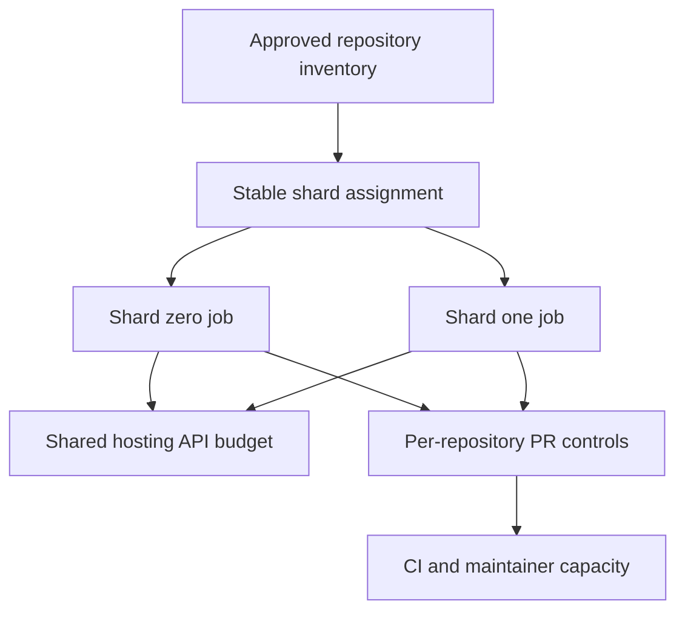

# Scale Renovate Across Repositories Within API and PR Limits

Author: [nawazdhandala](https://www.github.com/nawazdhandala)

Tags: Renovate, DevOps, GitHub

Description: Divide Renovate repository ownership, budget API requests separately from pull requests, and roll out workers without multiplying load unexpectedly.

Running Renovate across thousands of repositories is a scheduling problem as much as a compute problem. Adding workers can shorten a queue while increasing API traffic, new pull requests, and CI jobs beyond what the organization can handle.

Begin with a measured repository inventory, assign each repository to one worker group, and increase throughput gradually. This guide uses Renovate 44.257.6. Its examples were validated locally, including a synthetic 10,000-repository assignment test. That test is not a production throughput benchmark.

## Separate the three budgets

Track three different resources: hosting API requests, bot-created branches and pull requests, and the CI work those changes trigger. A limit on new PRs does not limit every API read. A low HTTP concurrency limit does not prevent a large number of requests over a long run.

GitHub distinguishes primary rate budgets from secondary protections against excessive activity. Authentication method and endpoint matter, and GraphQL has its own primary accounting. Consult [GitHub's rate-limit documentation](https://docs.github.com/en/rest/using-the-rest-api/rate-limits-for-the-rest-api) for the identity actually used by your installation instead of assuming every token provides the same budget.

For initial planning, measure API consumption and duration for a representative sample: a small repository, a large monorepo, and a project with expensive lockfile updates. Use observed values to estimate a cycle's demand, then retain capacity for retries, onboarding, and vulnerability fixes.

## Give every repository one owner

Maintain an inventory of eligible `owner/repository` names. Exclude archived or intentionally unmanaged projects according to your policy. Split that inventory into disjoint groups, called shards, and let only the assigned job process each group.



The accompanying [shard.py](./shard.py) script uses Python's SHA-256 implementation to assign normalized GitHub repository names deterministically. It rejects duplicates and malformed inputs. Save a reviewed inventory as `repositories.txt`, one name per line, then run:

```bash
python3 shard.py 8 0 < repositories.txt > shard-0.json
```

This selects shard zero out of eight and writes a JSON array. Generate the other arrays with indices one through seven. The script only processes local text; it neither discovers repositories nor starts Renovate. The local test confirmed that all 10,000 synthetic names appeared once across the eight outputs.

Keep the shard count stable during a run. Changing it moves ownership for many repositories. Finish or stop the old assignment before activating the new one, and prevent overlapping executions of the same shard. Hashing balances repository counts approximately, not execution cost; move exceptionally expensive projects into separately managed groups if necessary.

## Apply controls at their actual scope

Here is an administrative `config.cjs` fragment for one self-hosted worker. Inject `RENOVATE_SHARD_FILE` as the path to its generated inventory. Configure the platform identity and credentials separately through the runner's secret mechanism.

```javascript
const fs = require('node:fs');
if (!process.env.RENOVATE_SHARD_FILE) throw new Error('Missing shard inventory');
module.exports = {
  repositories: JSON.parse(fs.readFileSync(process.env.RENOVATE_SHARD_FILE, 'utf8')),
  autodiscover: false,
  prHourlyLimit: 1,
  prConcurrentLimit: 3,
  branchConcurrentLimit: 3,
  hostRules: [
    {
      matchHost: 'https://api.github.com/',
      concurrentRequestLimit: 2,
      maxRequestsPerSecond: 1
    }
  ]
};
```

The explicit repository list makes assignment reviewable. `autodiscover: false` avoids accidentally expanding that worker to every accessible repository. Renovate documents repository selection in its [self-hosted options](https://docs.renovatebot.com/self-hosted-configuration/#repositories).

The numeric values are conservative starting examples, not a guarantee of staying below every provider limit. The PR settings constrain routine work per repository. Across 1,000 active repositories, one new PR per repository per hour can still mean a large organization-wide burst. Repository configuration can also affect the effective policy; audit inherited and local overrides.

The host rule limits Renovate's HTTP client for `api.github.com`. It does not govern every external process, Git transfer, or package-manager request to every host. Add separately justified controls for other services instead of assuming the GitHub rule controls the entire job.

## Do not multiply a local limit accidentally

Local tests against the actual [HTTP limit resolver](https://github.com/renovatebot/renovate/blob/44.257.6/lib/util/http/rate-limits.ts) confirmed that this rule resolves to two concurrent requests and a 1,000-millisecond throttle interval for GitHub API URLs. An unrelated host retained its own defaults.

Renovate's [HTTP queue implementation](https://github.com/renovatebot/renovate/blob/44.257.6/lib/util/http/queue.ts) keeps its queues inside the process. Eight processes do not share one global one-request-per-second limiter. If they share a hosting identity's allowance, budget their combined load and stagger or serialize jobs as needed.

For example, eight continuously busy workers at one request per second can generate roughly 28,800 requests per hour in aggregate before considering how the provider accounts for them. This arithmetic is a capacity warning, not a prediction that every worker will remain busy or that every request consumes the same quota.

Increase active shards only after observing remaining allowance and throttling responses. Additional identities should represent legitimate separate installations or responsibilities, not an attempt to evade service limits.

## Control the work after PR creation

A PR limit alone does not control rebases of existing branches or their resulting test jobs. Observe CI minutes, queue length, and maintainer review time. If rebases dominate, review update schedules, branch policies, and the release's commit controls rather than raising the PR limit to clear an apparent backlog.

Vulnerability fixes also deserve explicit capacity. Renovate normally gives recognized vulnerability updates exceptions from ordinary scheduling and rate controls; see its [vulnerability configuration](https://docs.renovatebot.com/configuration-options/#vulnerabilityalerts). A newly onboarded repository with many alerts can therefore behave differently from an established repository with one routine patch.

Roll out new repository groups separately from steady-state maintenance. Watch the first cycle, then compare subsequent cycles before increasing coverage. This makes onboarding load visible instead of mixing it with normal growth.

## Make retries reduce pressure

When GitHub returns a throttling response, honor the indicated retry or reset time. Do not have the scheduler immediately restart every failed worker. GitHub's [REST API practices](https://docs.github.com/en/rest/using-the-rest-api/best-practices-for-using-the-rest-api) describe waiting for `retry-after`, observing exhausted-budget reset times, and increasing delays for repeated secondary-limit failures.

Retain a failed shard's identity and last successful completion time. Resume its own work after the delay rather than rediscovering and reprocessing the entire fleet. Distinguish throttling from authentication failures and malformed configuration; retries do not repair those errors.

## Verify before expanding

Validate the configuration with Renovate 44.257.6's strict validator while the shard-file environment variable points to a generated file. Check that the selected repository count matches expectations, that shard outputs do not overlap, and that each job uses its intended cache and workspace.

The local review passed strict validation on Node 24.11.0, with the known native RE2 fallback warning. It also tested malformed inventories, duplicate names, invalid shard counts, and the HTTP limit resolver. No real API requests, PR creation, distributed coordination, or 10,000-repository Renovate run was performed.

Measure maximum time since each repository's last successful run as well as average job duration. A fleet can look fast while a few large repositories never finish. Sustainable scaling means all assigned repositories receive timely attention within API, CI, and review capacity.
