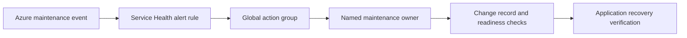

# Schedule Azure MySQL Maintenance and Make Notifications Actionable

Author: [nawazdhandala](https://www.github.com/nawazdhandala)

Tags: Azure, MySQL, Monitoring, Reliability

Description: Set an Azure MySQL maintenance window, route Service Health alerts to an owner, and verify application recovery with a practical maintenance checklist.

A maintenance email is useful only if somebody can connect it to the affected application, understand the time, and check recovery afterward. Choosing a quiet database maintenance window is the first step. Making that window operationally useful requires an owner, a tested notification route, and an application-level acceptance check.

This guide covers Azure Database for MySQL Flexible Server in Azure public cloud. The portal workflow is based on Microsoft's current documentation. The Python time-conversion example was run locally with Python 3.11; no maintenance operation or alert was triggered in Azure.

## Decide which behavior you need

Record the server's compute tier, maintenance policy, region, and application owner before changing its schedule. Do not assume that a development server and production server follow the same policy just because their database versions match.

Azure distinguishes routine, critical, and Virtual Canary maintenance. Virtual Canary provides early updates and does not follow the ordinary seven-day notice or 30-day minimum interval; Burstable servers are enrolled by default. Critical updates can also occur outside the usual cadence. Existing legacy Burstable custom windows have special restrictions, and new custom windows are not supported on that tier. Review the [maintenance policy documentation](https://learn.microsoft.com/en-us/azure/mysql/flexible-server/concepts-maintenance) for your actual server.

For production, write down the operational requirement first: for example, “a staffed window outside settlement processing, with no concurrent application deployment.” That is more useful than simply selecting Sunday because Sunday is usually quiet.

Include scheduled imports, reporting jobs, and external integrations in the discussion. A database may have low query traffic while an important batch process is about to begin.

## Set the window and verify its meaning

In the server's **Settings > Maintenance**, review the policy and choose the custom schedule when supported. The custom window is a 60-minute UTC window. Save it and record the displayed configuration. Some newer maintenance controls are rolling out by region and subscription.

Changing this preference affects a subsequent maintenance cycle. It does not move an already scheduled event. Use the separate rescheduling control for that event; rescheduling is unavailable during the documented 15-minute lock-in period before the original schedule. These distinctions are described in the [portal maintenance guide](https://learn.microsoft.com/en-us/azure/mysql/flexible-server/how-to-maintenance-portal).

Keep both the UTC start and the team's local start in the change record. UTC is a shared time reference that does not change for daylight saving. A fixed UTC schedule can therefore appear at a different local hour in summer.

This example converts two illustrative Sunday starts to London time. Run it with Python 3.11 and an installed IANA time-zone database. Replace `Europe/London` with your team's zone and the dates with actual scheduled UTC dates:

```python
from datetime import datetime
from zoneinfo import ZoneInfo

team_zone = ZoneInfo("Europe/London")
starts = (
    "2026-11-22T02:00:00+00:00",
    "2027-07-04T02:00:00+00:00",
)

for value in starts:
    scheduled = datetime.fromisoformat(value)
    local = scheduled.astimezone(team_zone)
    print(f"UTC {scheduled.isoformat()} -> team {local.isoformat()}")
```

The November example prints 02:00 with offset `+00:00`; the July example prints 03:00 with offset `+01:00`. This checks calendar interpretation only. It does not calculate Azure's next maintenance date or change a server setting. Python obtains zone rules from system data or the `tzdata` package, as explained in the [Python 3.11 zoneinfo documentation](https://docs.python.org/3.11/library/zoneinfo.html).

Use the event's actual scheduled time when it arrives. Do not turn a recurring calendar reminder into a substitute for the provider's notification.

## Create a Service Health alert

Azure Service Health notifications describe provider events. They are different from an application's error-rate alert or a Resource Health event about an individual resource.

In the portal, open **Service Health** and create a service health alert. Select the affected subscription, services and regions, and **Planned maintenance** as the event type. Use Advanced options to attach an action group, then review and create the rule. For this public-cloud workflow, Microsoft requires the action group's region to be **Global**. Follow the [Service Health alert instructions](https://learn.microsoft.com/en-us/azure/service-health/alerts-activity-log-service-notifications-portal).

An action group is the reusable list of recipients and automated actions associated with an alert. Give this group a clear owner and use a destination that survives staff rotation. A personal mailbox with no backup owner is a fragile maintenance process.



Treat this as a responsibility flow, not an automatic database recovery mechanism. An alert should not blindly restart servers, pause all traffic, or change connection settings.

## Test delivery separately from event matching

Use the action group's test capability and verify receipt at the intended destination. Complete recipient verification where the portal requires it. Email filtering and notification rate limits can affect delivery; Microsoft's [action group documentation](https://learn.microsoft.com/en-us/azure/azure-monitor/alerts/action-groups) describes these controls.

A successful test proves that the tested notification route worked at that moment. It does not prove that the Service Health rule matches the correct subscription, service, region, and event type. Review those filters separately, then inspect the first real maintenance notification end to end.

Keep these results distinct in your evidence:

| Check | Evidence to retain |
| --- | --- |
| Schedule saved | Server identity, selected policy, UTC preference |
| Alert scoped correctly | Subscription and condition review |
| Notification delivered | Test time and recipient confirmation |
| Real event identified | Tracking ID and impacted resource list |
| Application recovered | Probe results, error rate, and queue recovery |

If nobody receives the test, investigate delivery before changing the maintenance schedule. If tests arrive but real events do not, investigate scope, event filters, and whether Azure published an applicable event.

## Turn the notification into a bounded change

When a real notice arrives, confirm the impacted server rather than relying on a familiar display name. Record its resource ID, tracking ID, planned time, owner, affected applications, and the latest provider status.

Check that connection pools replace broken connections and that request retries have a bounded duration. For writes, a lost connection may leave the client uncertain whether a transaction committed. Recovery logic must resolve that uncertainty using the application's transaction or idempotency design; blindly repeating a payment is not a maintenance strategy.

Prepare an application probe that reads a known record and, where appropriate, performs a controlled reversible business operation using a designated test account. Define an acceptable recovery interval in advance. Keep the test narrow enough that it can run during an incident without creating misleading customer activity.

Avoid overlapping database configuration changes or start/stop operations with maintenance, following [Microsoft's maintenance guidance](https://learn.microsoft.com/en-us/azure/mysql/flexible-server/concepts-maintenance). This also makes failures easier to attribute: one planned change has one observable outcome.

## Close the event only after application checks

Provider completion and application recovery are separate milestones. After maintenance completes, inspect connection failures, request latency, background-job progress, and any backlog accumulated during the interruption. Confirm that the designated probe succeeds repeatedly, not just once.

If maintenance is still in progress, keep the incident record updated with the provider's status. If Azure reports completion but the application remains unhealthy, investigate the application path rather than repeatedly modifying the database.

Retain the observed interruption and recovery times with the tracking ID. Use those measurements to improve the next window, retry policy, and staffing plan. A quiet maintenance event should leave evidence that the notification arrived, the owner acted, and the application returned to useful work.
