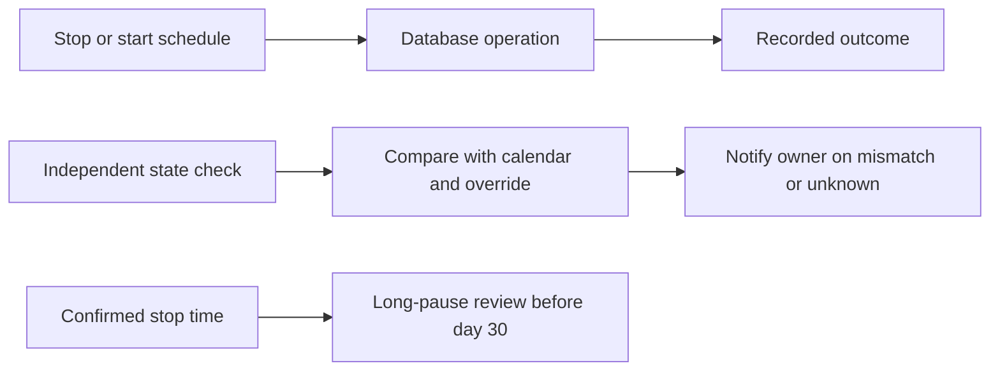

# Schedule Azure MySQL Stop/Start Around the 30-Day Restart

Author: [nawazdhandala](https://www.github.com/nawazdhandala)

Tags: Azure, MySQL, Azure Automation, Monitoring

Description: Schedule Azure MySQL dev/test shutdowns and startups, verify their outcomes, and detect unexpected running servers before the 30-day automatic restart surprises you.

A Friday shutdown can save compute time over the weekend. A forgotten shutdown during a long project pause is different: Azure Database for MySQL Flexible Server automatically starts a server after 30 continuous days stopped.

A dependable schedule therefore needs three parts: a planned stop, a planned start, and an independent check of the actual state. The last part catches disabled workflows, expired connections, manually started servers, and the service's automatic restart.

## Set the operating policy first

Stopping a server drops its active connections. Compute billing stops while the server is stopped, but storage remains billable. Many configuration changes also require the server to be started. These behaviors are documented in [MySQL server concepts](https://learn.microsoft.com/en-us/azure/mysql/flexible-server/concept-servers).

Agree on an explicit dev/test policy before creating tasks:

| Setting | Example decision |
|---|---|
| Server ownership | Named development team and backup contact |
| Normal availability | Monday 08:00 through Friday 18:00 UTC |
| Start request | Monday 07:30 UTC, with readiness checked before 08:00 |
| Stop request | Friday 18:15 UTC, after writers are drained |
| Overrides | Approved late-running tests with an expiry time |
| Long-pause review | Owner review before 25 continuous stopped days |
| Independent state check | Daily, with a separate alert for failed checks |

The lead time is a starting policy, not a guaranteed startup duration. Measure your server's startup and application warm-up, then adjust it.

Do not enroll a server that cannot be stopped. In particular, Microsoft documents that a server with a read replica cannot be stopped in that configuration. Do not remove a needed replica just to fit a weekend schedule. Review the [stop/start limitations and automatic-start behavior](https://learn.microsoft.com/en-us/azure/mysql/flexible-server/how-to-stop-start-server-portal).

## Create separate stop and start tasks

Azure MySQL exposes **Automation > Tasks (preview)** in the portal. These lightweight tasks are backed by Azure Logic Apps; they are distinct from Azure Automation runbooks. The feature remains preview, so use it only where your environment permits that dependency. See the [automation task guide](https://learn.microsoft.com/en-us/azure/mysql/flexible-server/create-automation-tasks).

On a staging server, add a **Stop server** task. Authenticate each required connection, name the task for its purpose, configure the recurrence, and review the exact target before creating it. Then create a separate **Start server** task. A stop task does not schedule the next working-day start for you.

Treat creation as activation: the generated workflow becomes live. Do not experiment with its first run on a shared database. Inspect the task's run history and, when available, open the underlying workflow to review its trigger and actions. Ensure the person maintaining the connections and permissions is part of the operating handoff.

The 30-day automatic start is a service safeguard, not the Monday startup task. A weekend schedule needs its own explicit start action regardless of that safeguard.

## Make the recurrence unambiguous

Use a fixed UTC schedule if the team wants the same global times year-round. If the requirement is local office time, select the intended named time zone and review daylight-saving transitions. Do not mix a UTC timestamp with an assumed local schedule.

For reference, this is a **trigger fragment**, not a complete deployable workflow. It represents a Monday 07:30 UTC start schedule using the built-in Recurrence trigger:

```json
{
  "Recurrence": {
    "type": "Recurrence",
    "recurrence": {
      "frequency": "Week",
      "interval": 1,
      "startTime": "2026-12-07T07:30:00Z",
      "schedule": {
        "weekDays": ["Monday"],
        "hours": [7],
        "minutes": [30]
      }
    }
  }
}
```

Place such a trigger under the workflow's `triggers` property only when editing an existing reviewed definition; retain its authenticated start action. Replace the example date with the intended first occurrence. Configure the stop workflow separately for Friday at 18:15 and give it its own start date.

Microsoft documents the property names and allowed values in the [Recurrence trigger reference](https://learn.microsoft.com/en-us/azure/connectors/connectors-native-recurrence). Provide a start time to avoid an immediate first run, and configure a future weekly recurrence at least seven days in advance. Test the first actual execution rather than assuming the preview proves it will run.

Recurrence triggers do not replay missed occurrences after a disruption or a period when the workflow was disabled. A missed Monday start can remain missed until the next scheduled occurrence. That behavior makes an independent state check necessary; see [recurring workflow scheduling](https://learn.microsoft.com/en-us/azure/logic-apps/concepts-schedule-automated-recurring-tasks-workflows).

## Observe the state independently

The following read-only inspection is source-reviewed for **Azure CLI 2.80.0**. Run it from an already authenticated operator session or an approved monitoring job. Replace the resource names, and ensure the active subscription is the intended one.

```bash
set -euo pipefail

MYSQL_RG='REPLACE_DEV_RESOURCE_GROUP'
MYSQL_SERVER='REPLACE_DEV_SERVER'

az mysql flexible-server show \
  --resource-group "$MYSQL_RG" \
  --name "$MYSQL_SERVER" \
  --query '{id:id,state:state}' \
  --output json
```

Record the returned state together with an observation timestamp. Do not substitute the workflow's green success icon for this readback. A resource can still be transitioning, and the application may need additional time before it can serve requests. The command is documented in the [Flexible Server CLI reference](https://learn.microsoft.com/en-us/cli/azure/mysql/flexible-server?view=azure-cli-latest).

The checker should compare the observation against the approved calendar and active overrides. Alert on three distinct cases: the server is unavailable during required hours, it is running outside approved hours, or the checker itself cannot read the resource. An authorization failure is an unknown state, not proof that the server is stopped.



Keep the checker separate enough that disabling both lifecycle workflows does not also disable the only way to detect their absence.

## Track continuous stopped time

Record a confirmed stop completion time in your operations record. Do not use the time someone clicked Stop or the last time the checker happened to see a stopped server. If a manual start occurs, close that stopped interval; a later confirmed stop begins another one.

For a long project pause, review the server before day 25. This is an internal warning threshold, not an Azure limit. The owner can plan a controlled start, decide whether the environment is still needed, or investigate a stale record. If the stop history is incomplete, report the age as unknown rather than calculating a reassuring but inaccurate deadline.

Do not depend on a precise midnight restart or set your first alert at day 30. An automatic restart can resume compute charges and make the database available to existing clients. Keep development workers, scheduled jobs, and outbound integrations under their own controls so database availability alone does not restart unwanted work.

If a server must remain unused for months, compare continued retention with an approved export-and-retirement plan. Such a plan needs a tested restore, credentials and configuration recovery, retention decisions, and owner approval. A recurring stop command is not a backup strategy.

## Rehearse missed runs and recover deliberately

Test a full lifecycle on staging: drain test writers, stop, verify the observed state, start, verify a fresh database connection, then resume test traffic. Record how long each phase took.

Also rehearse a missed start by disabling the staging start task temporarily. Confirm the independent checker raises the expected alert. Reenable it and follow the approved manual recovery path; do not wait for a past recurrence to replay. Restore the normal schedule after the test.

For troubleshooting, inspect both trigger history and individual action results. Microsoft distinguishes trigger success from workflow success and supports alerts on workflow failures in [Logic Apps monitoring](https://learn.microsoft.com/en-us/azure/logic-apps/view-workflow-status-run-history). An action that failed but was handled by a later step can also make the overall run appear successful.

Avoid launching opposing operations while a previous start or stop is still running. Serialize changes for a server, respect temporary overrides, and use bounded retries only after inspecting the current state. The schedule is ready when both planned transitions and missed-transition alerts work, with a named owner responsible for the long-pause review.
