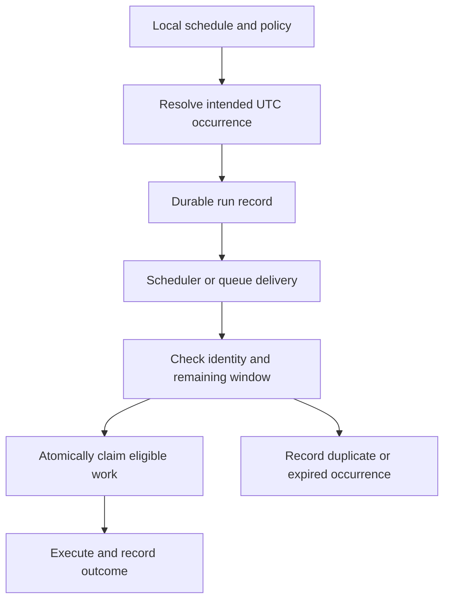

# Schedule Cloud Automation Across Time Zones Without DST Surprises

Author: [nawazdhandala](https://www.github.com/nawazdhandala)

Tags: Cloud Automation, Scheduling, Python

Description: Define daylight-saving policies, test ambiguous local times, and protect maintenance windows from duplicate or delayed cloud automation.

A patch job scheduled for 01:30 can have no matching local time when clocks move forward. Months later, the same local time can occur twice. A retry can also arrive after the approved maintenance window, even when the scheduler interpreted the calendar correctly.

Treat these as separate problems: choosing an occurrence, delivering it, and deciding whether work may still start. This article builds a small, locally testable time resolver and explains the checks around it. It does not deploy a scheduler or promise exactly-once execution.

## Start with the meaning of the schedule

Write the requirement in business terms before writing a cron expression. Cron is a compact notation for recurring calendar times, but its syntax and behavior depend on the scheduler.

| Requirement | Time basis | Important consequence |
| --- | --- | --- |
| Refresh inventory every six elapsed hours | Duration | Local display time may change after a clock transition |
| Produce a report at 09:00 in London | Local calendar and named zone | Consecutive runs need not be 24 hours apart |
| Patch during an approved regional window | Local window resolved to UTC instants | Both start eligibility and completion budget matter |
| Perform a migration at an approved instant | Explicit UTC timestamp | Show the corresponding local time during approval |

UTC is the common timeline used to compare instants. A named IANA time zone, such as `Europe/London`, supplies the rules for converting between that timeline and local clocks. An offset such as `+01:00` describes one conversion; it does not encode future seasonal changes.

Record the zone, recurrence, policy for missing times, policy for repeated times, allowed lateness, and overlap policy. For a daily report, skipping a nonexistent occurrence might be acceptable. For required maintenance, arrange an approved alternate window instead of silently shifting work into business hours.

## Check the scheduler's documented behavior

Do not copy a cron expression between services and assume equivalent execution.

| Service | Documented scheduling behavior | Design implication |
| --- | --- | --- |
| Amazon EventBridge Scheduler | Local cron occurrences in a spring gap are skipped; the repeated autumn occurrence runs once | Decide whether a skipped maintenance opportunity needs an alternate date |
| Google Cloud Scheduler | Wall-clock scheduling can behave unexpectedly during daylight-saving transitions | Prefer UTC for a strict cadence, or explicitly account for local transition dates |

AWS also distinguishes `rate(1 days)`, an elapsed 24-hour interval, from a daily local cron time. Its schedules have 60-second precision without a flexible time window, so “at 09:00” is not a guarantee of execution at exactly 09:00:00. See [EventBridge Scheduler schedule types](https://docs.aws.amazon.com/scheduler/latest/UserGuide/schedule-types.html).

Google documents its time-zone behavior and five-field cron format in [cron job format and time zone](https://docs.cloud.google.com/scheduler/docs/configuring/cron-job-schedules). Moving a London maintenance schedule to a fixed UTC hour avoids an ambiguous UTC timestamp, but changes the local hour seasonally. Check that the resulting hour still satisfies the business requirement.

## Test missing and repeated local times

The following helper resolves a single requested local time. It deliberately rejects spring gaps. For repeated times, callers must choose the earlier or later instant explicitly.

Use Python 3.11 and a temporary working directory. This reference fixture pins [the first-party tzdata package to 2025.2](https://pypi.org/project/tzdata/2025.2/) for repeatable results; it is not a recommendation to freeze production time-zone rules at that release.

```bash
python3.11 -m venv .venv
.venv/bin/python -m pip install tzdata==2025.2
```

Save this as `resolve.py`:

```python
from datetime import datetime, timezone
from zoneinfo import ZoneInfo


def resolve_local(local, zone_name, *, ambiguous="reject"):
    """Return a UTC instant; reject missing times and unspecified folds."""
    if local.tzinfo is not None:
        raise ValueError("Expected a local datetime without tzinfo")
    if ambiguous not in {"reject", "earlier", "later"}:
        raise ValueError("Unknown ambiguity policy")
    zone = ZoneInfo(zone_name)
    candidates = set()
    for fold in (0, 1):
        instant = local.replace(tzinfo=zone, fold=fold).astimezone(timezone.utc)
        back = instant.astimezone(zone).replace(tzinfo=None)
        if back == local:
            candidates.add(instant)
    ordered = sorted(candidates)
    if not ordered:
        raise ValueError("Local time does not exist")
    if len(ordered) == 2:
        if ambiguous == "reject":
            raise ValueError("Local time occurs twice; choose earlier or later")
        return ordered[0 if ambiguous == "earlier" else -1]
    return ordered[0]
```

The helper tries both interpretations of a local time, converts each to UTC, then converts back. A missing time does not survive that round trip. A normal time produces one unique instant. A repeated time produces two.

Python calls the distinction between repeated times `fold`. Its [zoneinfo documentation](https://docs.python.org/3.11/library/zoneinfo.html) explains this attribute and the search order for time-zone data. Merely attaching a zone does not implement this helper's explicit rejection policy.

Save a second file as `example.py`:

```python
from datetime import datetime
from resolve import resolve_local

repeated = datetime(2026, 10, 25, 1, 30)
for policy in ("earlier", "later"):
    print(resolve_local(repeated, "Europe/London", ambiguous=policy).isoformat())

try:
    resolve_local(datetime(2026, 3, 29, 1, 30), "Europe/London")
except ValueError as error:
    print(error)
```

Run it using the package's rules rather than the host's time-zone database:

```bash
PYTHONTZPATH='' .venv/bin/python example.py
```

Expected output is `2026-10-25T00:30:00+00:00`, then `2026-10-25T01:30:00+00:00`, then `Local time does not exist`. This is a policy-building component, not a cron parser or an emulation of either cloud service.

We exercised the helper locally against 15 cases, including both folds, all gap policies, invalid inputs, non-DST zones, and 23-hour and 25-hour intervals between consecutive London mornings. No cloud schedule was executed.

## Give each intended run a stable identity

A correct calendar does not prevent duplicate delivery. Google explicitly documents [at-least-once delivery and request deduplication](https://docs.cloud.google.com/scheduler/docs/overview): the target must tolerate repeated requests.

Use a durable run record keyed by schedule identity, schedule revision, and intended occurrence. For an explicitly resolved schedule, store the selected UTC instant alongside the original local date, time, zone, and ambiguity policy. Repeated deliveries must map to that same key; arrival time is unsuitable because retries arrive later.

For a once-per-business-day action, also enforce the business uniqueness rule, such as tenant plus reporting date. Otherwise two independently generated autumn instants could each obtain a different run key while duplicating the same daily effect.



Claim work atomically in shared storage. A process-local flag cannot coordinate multiple workers. If a worker crashes after a provider accepts a change, reconcile that external outcome before retrying. A run record alone cannot make a remote side effect transactional.

## Enforce the window at the worker

Resolve the approved window's opening and closing boundaries independently. A local window spanning a transition may have an unexpected elapsed duration. Reject an unresolved boundary or an end that is not later than its start.

At execution time, verify that the intended occurrence belongs to the approved window, the actual start is still allowed, and sufficient time remains for work and recovery. Keep a safety margin. Recheck before disruptive stages such as rebooting, because earlier steps may consume the budget.

Use a [monotonic clock](https://docs.python.org/3.11/library/time.html#time.monotonic) for elapsed task budgets after admission; retain UTC timestamps for audit records. A deadline should stop admission of new disruptive steps, not blindly terminate an operation that requires a safe completion procedure.

Record expired work visibly. Do not convert a delayed Tuesday maintenance request into an unapproved Wednesday run. Google notes that re-enabling its Scheduler API can immediately trigger jobs missed while it was disabled, another reason to enforce eligibility at the worker rather than trusting arrival time alone.

## Rehearse the calendar and delivery together

Before activation, review upcoming occurrences through both seasonal transitions for every configured region. Test a normal day, a missing time, both repeated-time policies, duplicate delivery, queue delay past closing, worker restart, and an already-running previous occurrence.

Keep expected UTC instants with the tests. When updating time-zone data, compare future occurrences and obtain approval for changed maintenance windows. Preserve already-approved run records instead of silently recomputing them with new rules.

Monitor intended, started, completed, skipped, expired, and unresolved occurrences separately. An empty error log does not prove a required job ran. A useful alert identifies the missing logical occurrence and its approved window, giving an operator enough information to choose a safe recovery time.
