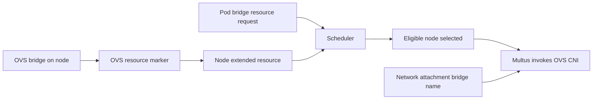

# Schedule Multus Pods on Nodes with the Required OVS Bridge

Author: [nawazdhandala](https://www.github.com/nawazdhandala)

Tags: Multus, Kubernetes, Networking

Description: Use OVS bridge resources to constrain Multus Pod placement, verify scheduler decisions, and separate bridge presence from working VLANs, uplinks, and application connectivity.

A secondary network definition can name an Open vSwitch bridge that exists on only some Kubernetes nodes. If the scheduler does not know about that requirement, it can place a Pod elsewhere. Multus then tries to attach the network and fails after scheduling has already succeeded.

The solution is to express the bridge requirement before placement. OVS CNI includes a resource marker that reports bridges as Kubernetes extended resources. A Pod can request the corresponding resource so the scheduler considers it alongside CPU, memory, taints, and other constraints.

This guide reviews **OVS CNI v0.40.0** and **Multus v4.3.1**. Examples were parsed and checked against source and Kubernetes v1.34.0 API definitions locally. No live scheduling or network attachment tests were performed.

## Understand the two decisions

A NetworkAttachmentDefinition describes how to attach an interface. A container resource request describes what a node must offer before the Pod can run there. Kubernetes does not derive the second requirement merely by reading an arbitrary Multus network annotation.



For a bridge named `br-data`, the resource name is `ovs-cni.network.kubevirt.io/br-data`. The marker's [documentation](https://github.com/k8snetworkplumbingwg/ovs-cni/blob/v0.40.0/docs/marker.md) shows this naming convention. The two names must agree character for character; requesting the resource for one bridge while attaching to another defeats the design.

An extended resource is an additional schedulable quantity advertised by a node. It is not necessarily a physical device. The [marker implementation](https://github.com/k8snetworkplumbingwg/ovs-cni/blob/v0.40.0/pkg/marker/marker.go) advertises 1000 units per discovered bridge as an accounting convention. That number is not a measured throughput limit or a guarantee that 1000 workloads will perform well.

## Verify the marker before changing workloads

The bridge must already exist, OVS must be running, and the OVS CNI executable must be in the CNI binary path used on that node. The marker observes bridge availability; it does not construct the host network.

Review the deployment you actually installed. The [v0.40.0 example manifest](https://github.com/k8snetworkplumbingwg/ovs-cni/blob/v0.40.0/examples/ovs-cni.yml) combines binary installation and the marker in a DaemonSet, a workload that runs on selected nodes. It uses an AMD64 node selector, host paths, a service account allowed to patch node status, and `latest` image references. A tagged source file therefore does not make its referenced images immutable. Resolve approved compatible image digests and adapt host paths and architecture selection before deploying it.

On a prepared staging node, inspect the bridge with host privileges:

```bash
sudo ovs-vsctl --timeout=5 br-exists br-data
```

A zero exit status confirms that OVS's database contains that bridge. It says nothing about whether an external switch allows the needed VLAN. The command is documented in the [OVS administration manual](https://www.openvswitch.org/support/dist-docs/ovs-vsctl.8.txt).

From an authorized Kubernetes client, inspect the reported resource:

```bash
kubectl get node REPLACE_NODE -o go-template='capacity={{index .status.capacity "ovs-cni.network.kubevirt.io/br-data"}} allocatable={{index .status.allocatable "ovs-cni.network.kubevirt.io/br-data"}}{{"\n"}}'
kubectl describe node REPLACE_NODE
```

Replace the node name. Expect a nonzero capacity and allocatable value, often displayed as `1k`. The description also shows allocated requests. Allocatable is the total offered to Pods, not a continuously decremented free-slot counter.

If the resource is absent, first confirm that the marker runs on this node. Then inspect its logs for OVS socket errors and API permission failures. Do not manually invent node capacity to hide a marker problem. The reported resource should follow the real bridge inventory.

## Match the attachment and the request

This staging definition creates a layer-two attachment without assigning an IP address. It is sufficient to test bridge selection and interface creation. It is not a complete application network: add your approved IP address management configuration before testing IP connectivity.

```yaml
apiVersion: k8s.cni.cncf.io/v1
kind: NetworkAttachmentDefinition
metadata:
  name: data-bridge
  namespace: network-lab
spec:
  config: |
    {
      "cniVersion": "0.3.1",
      "name": "data-bridge",
      "type": "ovs",
      "bridge": "br-data",
      "vlan": 100
    }
```

The [OVS CNI configuration reference](https://github.com/k8snetworkplumbingwg/ovs-cni/blob/v0.40.0/docs/cni-plugin.md) documents the bridge and VLAN fields. Use an existing staging namespace and a reviewed VLAN; VLAN 100 here is an example.

Create one test Pod using the following complete object after replacing the image placeholder with an approved image digest. That image must contain a `sleep` command.

```yaml
apiVersion: v1
kind: Pod
metadata:
  name: bridge-placement-check
  namespace: network-lab
  annotations:
    k8s.v1.cni.cncf.io/networks: '[{"name":"data-bridge","interface":"net1"}]'
spec:
  restartPolicy: Never
  containers:
    - name: check
      image: REPLACE_WITH_APPROVED_IMAGE_DIGEST
      command: ["sleep", "3600"]
      resources:
        requests:
          cpu: 10m
          memory: 32Mi
          ovs-cni.network.kubevirt.io/br-data: "1"
        limits:
          memory: 64Mi
          ovs-cni.network.kubevirt.io/br-data: "1"
```

The resource request and limit are equal because extended resources cannot be overcommitted. Their value must be an integer quantity. Kubernetes explains these rules in its [resource management documentation](https://kubernetes.io/docs/concepts/configuration/manage-resources-containers/#extended-resources).

The request is explicit in the Pod; this example does not depend on an admission injector adding it. Nor does it require a NetworkAttachmentDefinition `resourceName` annotation to select a physical device. The network definition names the bridge directly, while the Pod requests the marker's scheduling resource. Keep those responsibilities visible in a workload template review.

## Test placement separately from traffic

Inspect the test Pod after submission:

```bash
kubectl -n network-lab get pod bridge-placement-check -o wide
kubectl -n network-lab describe pod bridge-placement-check
kubectl -n network-lab get pod bridge-placement-check -o yaml
```

Verify that its chosen node advertises the required bridge and that the stored Pod still has the intended request. Admission policies may modify submitted objects. If the Pod is Pending with insufficient bridge resources, investigate eligible capacity and existing requests. If it is scheduled but stuck creating its sandbox, investigate Multus and OVS attachment errors instead.

For a negative test, use a staging environment where no eligible node advertises the requested bridge. The Pod should remain unscheduled. Do not delete a production bridge to create this condition. Also avoid `spec.nodeName`: it bypasses normal scheduler placement, as the [Kubernetes node assignment guide](https://kubernetes.io/docs/concepts/scheduling-eviction/assign-pod-node/) explains.

Once attachment succeeds, perform a separate application test with your real addressing configuration. A marker resource does not prove that a VLAN is permitted, an uplink is healthy, or a destination accepts connections.

## Keep the placement signal trustworthy

Bridge changes are not instantaneous scheduling transactions. The marker observes OVS and updates node status; the scheduler sees that state later. A bridge can disappear after selection. Existing Pods are not automatically repaired by a resource update, and a failed marker can leave stale information requiring investigation.

Use planned maintenance controls before removing bridges, and recreate only controlled test workloads when validating changes. If you choose node labels instead of marker resources, maintain those labels through a trusted reconciliation process and use a required selector, not merely a preference. A forgotten label can outlive the bridge it describes.

For rollout acceptance, retain three distinct results: the scheduler chose a node with the required bridge, CNI created the intended attachment, and the application reached its required peer. Together they establish the behavior you need; none of the three can substitute for the others.
