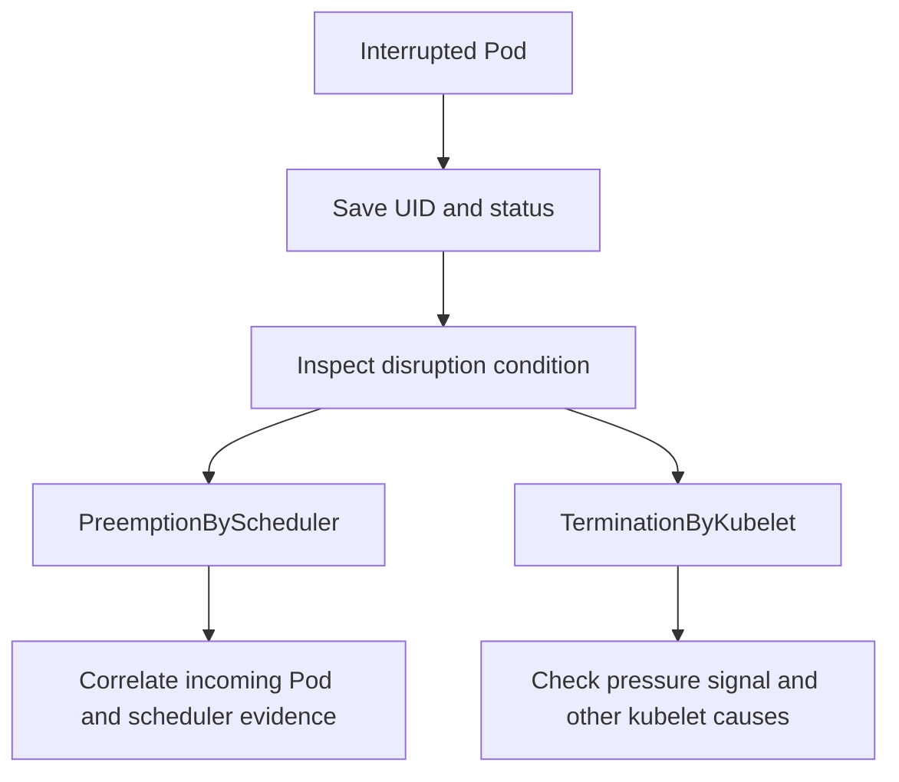

# Scheduler Preemption or Node-Pressure Eviction: Find the Cause

Author: [nawazdhandala](https://www.github.com/nawazdhandala)

Tags: Kubernetes, Troubleshooting, Incident Management

Description: Use Pod conditions, node evidence, and component logs to distinguish scheduler preemption from kubelet resource-pressure eviction before changing policy.

A Pod disappears, its controller creates a replacement, and the incident is described as “Kubernetes evicted it.” That description leaves out the most useful fact: which component decided to remove the Pod, and what problem was it trying to solve?

Scheduler preemption makes room for a pending, higher-priority workload. Node-pressure eviction protects a node that is running short of resources. Both can interrupt a service, but their inputs and remedies differ. Raising a priority value without finding the decision path can merely move the next interruption to another workload.

This diagnostic procedure uses **Kubernetes 1.34.0** source behavior. It is intended for read-only incident inspection. It does not require creating resource pressure or disrupting a production node.

## Start with the actor and trigger

| Question | Scheduler preemption | Node-pressure eviction |
|---|---|---|
| Who decides? | Scheduler's preemption logic | Node's kubelet |
| What starts it? | An incoming Pod cannot find a feasible placement | A monitored resource crosses an eviction threshold |
| What matters? | Priority, requested resources, placement constraints, victim choices | Resource signal, usage, requests, priority, node configuration |
| What should you recover? | Incoming Pod and victim identities plus scheduling evidence | Victim, node, resource signal, threshold, and contemporaneous usage |

A busy node is not sufficient proof of node-pressure eviction. Conversely, a new high-priority Pod arriving nearby in time is not sufficient proof of scheduler preemption. Gather the objects and timestamps that connect the decision to the victim.



The second branch needs extra investigation. `TerminationByKubelet` is broader than resource-pressure eviction: it can also describe graceful node shutdown or kubelet preemption for system-critical Pods. The [documented disruption reasons](https://kubernetes.io/docs/concepts/workloads/pods/disruptions/#pod-disruption-conditions) distinguish these paths.

## Preserve the original Pod evidence

Run this before the object disappears, substituting the actual context, namespace, and name. It writes a local evidence file but does not modify the cluster:

```bash
kubectl --context staging -n payments get pod REPLACE_WITH_POD \
  -o json > victim-pod.json
```

Treat saved Pod specifications as operational data: they can contain configuration details. Keep them in the incident's approved evidence location.

With `jq` installed, extract the relevant fields without dropping the underlying JSON:

```bash
jq '{
  name: .metadata.name,
  uid: .metadata.uid,
  node: .spec.nodeName,
  priority: .spec.priority,
  phase: .status.phase,
  reason: .status.reason,
  message: .status.message,
  disruption: [.status.conditions[]? |
    select(.type == "DisruptionTarget") |
    {status, reason, message, lastTransitionTime}]
}' victim-pod.json
```

An empty `disruption` array means the captured object has no matching condition. It does not prove that no disruption happened. The object may have been captured too early, replaced, or removed before collection.

A true `DisruptionTarget` condition with `PreemptionByScheduler` is strong evidence of the scheduler path. Still check the outcome: a condition can be set for an intended disruption that does not ultimately finish. The [1.34.0 preemption implementation](https://github.com/kubernetes/kubernetes/blob/v1.34.0/pkg/scheduler/framework/preemption/preemption.go) shows where the scheduler sets this condition before deleting the victim.

## Follow the scheduler branch

Identify the pending workload associated with the decision. Compare numeric priorities on the actual Pod objects and inspect the victim's node. Then examine why the incoming Pod could not fit: requested CPU or memory, affinity, volume restrictions, or another filter.

Do not substitute a dashboard's instantaneous utilization for scheduling resource accounting. A node can have low CPU usage while its requested CPU is already allocated. Also, removing lower-priority Pods does not solve every placement failure, such as an untolerated taint.

Review retained scheduler events and logs around the victim's UID and incident timestamp. The [default preemption code](https://github.com/kubernetes/kubernetes/blob/v1.34.0/pkg/scheduler/framework/plugins/defaultpreemption/default_preemption.go) restricts ordinary victims to lower-priority Pods and evaluates whether the incoming workload fits after candidate removals. A disruption budget influences victim preference but is not an absolute block.

The resulting action might be correcting a priority hierarchy, restricting elevated classes, supplying suitable capacity, or changing the incoming workload's placement constraints. Changing kubelet disk thresholds would not address this decision path.

## Follow the kubelet branch

Use the node name saved from the victim object:

```bash
kubectl --context staging get node REPLACE_WITH_NODE -o yaml
kubectl --context staging describe node REPLACE_WITH_NODE
kubectl --context staging -n payments get events \
  --sort-by=.metadata.creationTimestamp
```

Look for pressure conditions and eviction messages identifying memory, ephemeral storage, inodes, or process IDs. Capture the resource signal and its threshold, not just a generic “low resources” conclusion. Current node conditions may already be healthy because eviction reclaimed resources; historical metrics and kubelet logs are necessary to reconstruct the earlier state.

For memory pressure, the [1.34.0 ranking implementation](https://github.com/kubernetes/kubernetes/blob/v1.34.0/pkg/kubelet/eviction/helpers.go) orders candidates by whether usage exceeds requests, then priority, then usage relative to requests. Disk-related ranking depends on the filesystem signal and the storage being measured. Do not reduce every eviction to a fixed ordering of QoS names.

The [eviction manager](https://github.com/kubernetes/kubernetes/blob/v1.34.0/pkg/kubelet/eviction/eviction_manager.go) records the pressure eviction and marks the Pod failed. An `Evicted` reason plus the detailed message helps identify the immediate cause, but correlate it with the resource signal before deciding on remediation.

Possible fixes include accurate requests, application memory reduction, bounded logs, appropriate ephemeral-storage sizing, and correcting node reservations. Do not disable protective thresholds simply to suppress the symptom. The [node-pressure documentation](https://kubernetes.io/docs/concepts/scheduling-eviction/node-pressure-eviction/) explains reclaim, threshold behavior, and resource-specific differences.

## Keep nearby failure modes separate

An `OOMKilled` container is not automatically an evicted Pod. A container can restart inside the same Pod, leaving the UID unchanged. Check container termination state and restart counts alongside the Pod-level reason.

Likewise, a node drain using the Eviction API is a different actor from either mechanism discussed here. A `NoExecute` taint can trigger deletion through the taint manager. Use these alternatives when the expected scheduler or pressure evidence is missing instead of forcing every incident into one of two categories.

Close the investigation with a short causal statement: the component, the exact victim UID, the triggering constraint or signal, and the evidence timestamp. Then state which control changes that cause. This makes the next review much more useful than “the Pod was evicted.”

The JSON filter was executed locally against representative scheduler, kubelet, and missing-condition fixtures; shell syntax and source paths were checked. No live preemption or node-pressure event was induced. The procedure is an evidence collection guide, not a claim that a single field can reconstruct every cluster incident.
