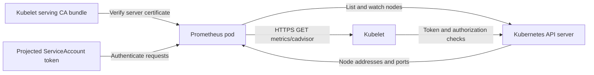

# Scrape Kubelet cAdvisor Metrics with Verified TLS and Scoped RBAC

Author: [nawazdhandala](https://www.github.com/nawazdhandala)

Tags: Kubernetes, Prometheus, Monitoring, Security

Description: Collect kubelet cAdvisor metrics with node discovery, trusted serving certificates, rotating ServiceAccount tokens, and narrowly scoped metrics permissions.

The kubelet already exposes container metrics on `/metrics/cadvisor`. You often do not need another privileged cAdvisor DaemonSet just to obtain this data. The difficult part is connecting the scraper correctly: discovering nodes, trusting their certificates, authenticating requests, and granting the right permission.

These are separate checks. A valid token cannot fix an untrusted certificate. A trusted certificate cannot grant access. And a successful request to the Kubernetes API does not prove that Prometheus can reach a node's kubelet.

This guide describes direct HTTPS scraping from an existing in-cluster Prometheus deployment. The examples are scoped to Kubernetes 1.35 authorization behavior and Prometheus 3.7.3 configuration syntax. Managed clusters may restrict direct kubelet access; check the provider's supported monitoring route first.

## Understand the two connections

Prometheus contacts the API server to discover nodes, then contacts each kubelet to fetch metrics. The endpoints and trust material can differ.



The kubelet also exposes `/metrics`, `/metrics/resource`, and `/metrics/probes`. Those endpoints have different purposes and metric lifecycles. Successfully scraping one does not mean that the cAdvisor endpoint is configured. [Kubernetes system metrics](https://kubernetes.io/docs/concepts/cluster-administration/system-metrics/).

Before continuing, confirm that kubelet bearer-token authentication and webhook authorization are enabled through your cluster's supported configuration. Keep anonymous access disabled. Under webhook authorization, the kubelet asks the API server whether the authenticated identity may perform the requested action. [Kubernetes 1.35 kubelet authentication](https://v1-35.docs.kubernetes.io/docs/reference/access-authn-authz/kubelet-authn-authz/).

## Grant discovery and metrics permissions separately

Assume the `monitoring` namespace already exists. Save the following as `kubelet-metrics-rbac.yaml` for review through your normal deployment process:

```yaml
apiVersion: v1
kind: ServiceAccount
metadata:
  name: prometheus-kubelet
  namespace: monitoring
---
apiVersion: rbac.authorization.k8s.io/v1
kind: ClusterRole
metadata:
  name: prometheus-kubelet-metrics
rules:
  - apiGroups: [""]
    resources: ["nodes"]
    verbs: ["get", "list", "watch"]
  - apiGroups: [""]
    resources: ["nodes/metrics"]
    verbs: ["get"]
---
apiVersion: rbac.authorization.k8s.io/v1
kind: ClusterRoleBinding
metadata:
  name: prometheus-kubelet-metrics
roleRef:
  apiGroup: rbac.authorization.k8s.io
  kind: ClusterRole
  name: prometheus-kubelet-metrics
subjects:
  - kind: ServiceAccount
    name: prometheus-kubelet
    namespace: monitoring
```

The first rule supports discovery. The second permits metric reads across nodes. In Kubernetes 1.35, the kubelet maps `/metrics/*` requests to the `nodes/metrics` subresource. This is different from granting a non-resource URL permission for an API server's own `/metrics` endpoint. [Versioned kubelet authorization implementation](https://github.com/kubernetes/kubernetes/blob/v1.35.0/pkg/kubelet/server/auth.go).

Do not substitute `nodes/proxy` as a convenient fix for a 403 response. That permission covers much broader kubelet operations. Also avoid assuming this role authorizes every other discovery job in an existing Prometheus installation; pod and service discovery have their own requirements.

## Wire the identity and trust bundle into Prometheus

Configure the Prometheus pod to use `serviceAccountName: prometheus-kubelet`, or bind the role to its existing dedicated account instead. Ensure a projected ServiceAccount token is available to the process. For the standard automatic mount, the token path is `/var/run/secrets/kubernetes.io/serviceaccount/token`.

If your workload disables automatic token mounting, explicitly arrange a projected token volume and use its actual path in the scrape configuration. The token audience must be accepted by the kubelet's authentication path. Preserve rotation by reading the mounted file instead of copying its value into a ConfigMap or a static secret. [ServiceAccount token projection](https://kubernetes.io/docs/tasks/configure-pod-container/configure-service-account/).

Separately mount a reviewed public certificate-authority bundle at `/etc/prometheus/kubelet-ca/ca.crt`. A certificate authority, or CA, is a trusted issuer used to verify the kubelet's serving certificate. This bundle contains public certificates, not a CA private key.

Do not assume the API server CA file automatically trusts kubelet certificates. Some clusters use different issuers or self-signed kubelet serving certificates. Obtain the correct trust bundle through your cluster's certificate-management process.

## Configure direct scraping

Merge this job into the existing Prometheus configuration:

```yaml
scrape_configs:
  - job_name: kubelet-cadvisor
    scheme: https
    metrics_path: /metrics/cadvisor
    scrape_interval: 30s
    scrape_timeout: 10s
    kubernetes_sd_configs:
      - role: node
    authorization:
      type: Bearer
      credentials_file: /var/run/secrets/kubernetes.io/serviceaccount/token
    tls_config:
      ca_file: /etc/prometheus/kubelet-ca/ca.crt
    relabel_configs:
      - source_labels: [__meta_kubernetes_node_name]
        target_label: node
```

In-cluster discovery uses the pod's Kubernetes client credentials. The job's `authorization` and `tls_config` settings apply to the scrape connection; they are not a replacement for API-server discovery credentials. [Prometheus configuration](https://prometheus.io/docs/prometheus/latest/configuration/configuration/).

For Prometheus 3.7.3, node discovery prefers the node's internal IP and uses its advertised kubelet port. It also sets `instance` to the node name. The added `node` label makes that identity explicit for queries. [Versioned node discovery](https://github.com/prometheus/prometheus/blob/v3.7.3/discovery/kubernetes/node.go).

Inspect the discovered URL before rollout. The address must be reachable from the Prometheus pod, and it must match a Subject Alternative Name, or SAN, in the serving certificate. An IP-address target needs a matching IP SAN. If certificates only cover DNS names, deliberately select a reachable certified DNS address through discovery relabeling and retain the correct kubelet port. Do not use one global server-name override to disguise unrelated node identities.

## Validate permissions without exposing tokens

An administrator who is allowed to impersonate the ServiceAccount can run:

```sh
kubectl auth can-i list nodes \
  --as=system:serviceaccount:monitoring:prometheus-kubelet
kubectl auth can-i get nodes --subresource=metrics \
  --as=system:serviceaccount:monitoring:prometheus-kubelet
```

Both should return `yes` after the binding is installed. These checks ask the API server about authorization; they do not establish kubelet reachability, token audience acceptance, or certificate validity. Impersonation itself requires permission, so an impersonation error does not prove the scraper lacks its role. [kubectl auth can-i](https://kubernetes.io/docs/reference/kubectl/generated/kubectl_auth/kubectl_auth_can-i/).

Run the matching `promtool check config` with the referenced files available in the validation environment. Treat a successful parse as a prerequisite, not an end-to-end test. Do not print the token to prove that the file exists.

## Diagnose failures in connection order

| Error or symptom | Check first |
| --- | --- |
| No discovered nodes | API-server access, discovery permissions, Prometheus logs |
| Timeout to node address | Pod-to-node routing, firewall, selected port |
| Unknown certificate authority | Kubelet serving chain and mounted CA bundle |
| Certificate name mismatch | Discovered address versus certificate SANs |
| HTTP 401 | Token availability, expiry, audience, kubelet authentication |
| HTTP 403 | Authenticated identity and `nodes/metrics` authorization |
| HTTP 200 but missing metrics | Endpoint contents, runtime support, metric filtering |

Changing RBAC will not repair a TLS handshake failure. Disabling certificate verification makes the connection easier to impersonate and hides the underlying certificate-management problem.

In staging, confirm one healthy `kubelet-cadvisor` target per expected node. Query `up{job="kubelet-cadvisor"}`, then inspect real container metrics for a known namespace and pod. Compare the target list with node inventory; absence from discovery is different from an explicit failed scrape.

## Plan for rotation and upgrades

Rehearse ServiceAccount token rotation without restarting Prometheus, and verify scraping continues. For a serving-CA change, distribute a bundle that trusts both issuers before rotating leaf certificates, then remove the old issuer after all nodes and clients have moved. Verify the reload behavior of your deployed Prometheus version as part of that rehearsal.

Finally, compare metric names and labels before Kubernetes upgrades. Kubelet cAdvisor metrics do not inherit a promise that every metric remains unchanged forever. Keep endpoint access, expected coverage, and dashboard compatibility as separate acceptance checks.
