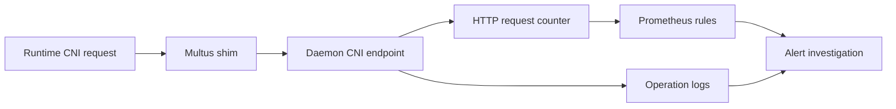

# Scrape Multus Thick-Plugin Metrics and Alert on CNI Failures

Author: [nawazdhandala](https://www.github.com/nawazdhandala)

Tags: Multus, Kubernetes, Prometheus

Description: Enable Multus daemon metrics, scrape each node, and build tested failure alerts while distinguishing HTTP request counters from individual CNI ADD and DEL operations.

A Multus daemon can be Running while new Pods fail to obtain their secondary networks. Metrics can reveal that failure before application dashboards show a wider outage. However, an alert is useful only if it describes what the metric actually measures.

In **Multus v4.3.1**, the thick plugin exposes an HTTP request counter. It does not expose separate ADD and DEL labels on that counter. ADD creates a network attachment; DEL removes it. Both can travel through the same CNI endpoint. This guide builds an honest request-failure alert and then uses logs to identify the failing operation.

The configuration and rules below were checked locally with **Prometheus 3.7.3 promtool**, including synthetic alert tests. They were not deployed against a live Multus cluster.

## Establish what the counter means

The metric is `multus_server_request_total`, with labels `handler`, `code`, and `method`. For normal shim requests, the handler is `/cni`. Request errors in the pinned implementation are returned as HTTP 400, so a query that looks only for 500 responses misses important failures. [Counter and error-response implementation](https://github.com/k8snetworkplumbingwg/multus-cni/blob/v4.3.1/pkg/server/server.go).

There is no `command="ADD"` or `command="DEL"` label to filter. Also, an HTTP success is not proof that application traffic works after attachment. Keep endpoint monitoring, operation diagnosis, and network acceptance tests separate.



## Enable the metrics listener safely

The daemon configuration accepts `metricsPort`. With no port configured, this metrics server is not enabled. The v4.3.1 implementation registers `/metrics` on an HTTP listener using the configured port. It also has optional profiling endpoints controlled by `enablePprof`. [Daemon listener source](https://github.com/k8snetworkplumbingwg/multus-cni/blob/v4.3.1/cmd/multus-daemon/main.go).

Merge these fields into your existing daemon configuration through its deployment owner; this is a fragment, not a replacement for the full configuration:

```json
{
  "metricsPort": 9091,
  "enablePprof": false
}
```

Port 9091 is an example. Check for conflicts first. The upstream thick-plugin deployment uses host networking, so the port is exposed through the node's network namespace. The listener shown in source does not configure TLS or authentication. Restrict access to approved monitoring systems with controls appropriate to your platform; do not expose it publicly or assume a Pod NetworkPolicy protects host-network traffic. [Reference deployment](https://github.com/k8snetworkplumbingwg/multus-cni/blob/v4.3.1/deployments/multus-daemonset-thick.yml).

Roll the configuration change through the supported maintenance process and verify the effective configuration on one node. A ConfigMap edit alone does not prove the running process has opened a listener.

## Scrape a small explicit node inventory first

For an initial staging setup, static targets make it easy to see which daemon each scrape represents. Replace the example DNS names with approved node addresses reachable from Prometheus. Save this as `prometheus.yml` in a temporary validation directory:

```yaml
global:
  scrape_interval: 30s
  evaluation_interval: 30s
rule_files:
  - multus.rules.yml
scrape_configs:
  - job_name: multus-daemon
    metrics_path: /metrics
    scrape_timeout: 10s
    static_configs:
      - targets:
          - worker-a.example.internal:9091
        labels:
          node: worker-a
      - targets:
          - worker-b.example.internal:9091
        labels:
          node: worker-b
```

This standalone example is for checking the approach; merge the job into the configuration managed by your monitoring deployment rather than replacing production configuration. Larger installations should generate targets from their trusted node inventory or configure discovery carefully. Ensure each intended daemon is scraped once. [Prometheus scrape configuration](https://prometheus.io/docs/prometheus/latest/configuration/configuration/).

Check the Targets page and query `up{job="multus-daemon"}`. A value of one means the scrape succeeded. It does not guarantee that the CNI counter already exists: labeled counter series appear when requests create those label combinations. Generate ordinary disposable Pod lifecycle traffic in staging instead of sending fabricated CNI requests directly to the daemon.

## Alert on request failures and missing scrapes

Save the following as `multus.rules.yml` alongside the configuration:

```yaml
groups:
  - name: multus-daemon
    rules:
      - alert: MultusCNIRequestFailures
        expr: |
          sum by (instance, node) (
            increase(multus_server_request_total{
              job="multus-daemon",handler="/cni",code!~"2.."
            }[5m])
          ) > 0
        for: 1m
        labels:
          severity: warning
        annotations:
          summary: Multus CNI requests failed; inspect operation logs
      - alert: MultusMetricsScrapeFailed
        expr: up{job="multus-daemon"} == 0
        for: 2m
        labels:
          severity: warning
        annotations:
          summary: Prometheus cannot scrape the Multus daemon
```

The first rule asks whether the error counter increased during the last five minutes. `increase` handles counter resets, which matters when a daemon restarts. Its result is an extrapolated increase, not an exact audit count. The one-minute hold avoids reacting to a single transient evaluation, while the five-minute window keeps recent errors visible long enough to investigate. [Prometheus increase behavior](https://prometheus.io/docs/prometheus/latest/querying/functions/#increase).

The second rule covers known targets whose scrapes fail. If a target is removed from discovery, `up == 0` alone is insufficient because the series can disappear. Compare discovered targets with the expected node inventory and add missing-target monitoring appropriate to that inventory.

Check both files before loading them:

```bash
promtool check config prometheus.yml
promtool check rules multus.rules.yml
```

Alertmanager routing and receiver delivery are separate requirements. Test that the warning reaches its intended owner; successful rule evaluation alone does not deliver a notification.

## Identify ADD versus DEL without inventing labels

When an alert fires, find the daemon Pod on the reported node and inspect a bounded log interval:

```bash
kubectl -n kube-system get pods -l app=multus -o wide
kubectl -n kube-system logs REPLACE_DAEMON_POD \
  -c kube-multus --since=10m --timestamps
```

Use names appropriate to your deployment. The tagged source includes verbose request-start and request-finish messages containing the CNI command. Check the configured log level and actual output before building a parser. Correlate node, time, sandbox identity, and Pod information; a retry can produce several requests for one Pod problem.

For durable per-operation alerts, derive bounded counters from verified log events or use additional instrumentation that explicitly records the operation. Limit metric labels to useful dimensions such as node, command, and outcome. Keep Pod UIDs and full error text in logs rather than turning them into unbounded metric labels.

## Test the alert contract

Use `promtool test rules` with synthetic series before rollout. Include a rising HTTP 400 counter, successful 200 requests, health-endpoint errors that must not trigger the CNI alert, a counter reset, and a failed scrape. These cases were tested locally for this example. [Prometheus rule testing](https://prometheus.io/docs/prometheus/latest/configuration/unit_testing_rules/).

Then conduct a controlled staging lifecycle test: create an approved disposable Pod, confirm its networks, delete it, and check allocation cleanup. During a deliberately scoped invalid network configuration, confirm the request alert and operation logs agree. Restore the staging configuration and verify recovery. Never break production networking just to exercise a rule.

The result should be an alert that says what failed, identifies the affected daemon, and points to evidence for the operation. That is more dependable than an impressive-looking ADD/DEL dashboard built from labels the exporter never supplied.
