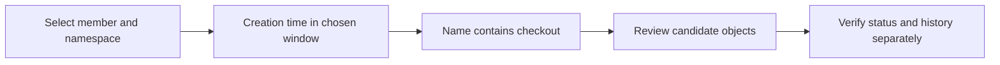

# Search Clusterpedia by Creation Window and Partial Resource Name

Author: [nawazdhandala](https://www.github.com/nawazdhandala)

Tags: Kubernetes, Multi-Cluster, Troubleshooting

Description: Combine precise creation-time windows with Clusterpedia partial-name searches while handling timezone encoding, boundaries, and incomplete results.

An incident starts at 10:00 UTC, and you remember that the affected Pods had "checkout" somewhere in their generated names. A creation window plus a partial-name filter can produce a useful candidate list without retrieving every Pod in the fleet.

The wording matters: this finds objects **created** in the window. It does not directly find every object updated, restarted, or affected by an incident during that time. Use the query to narrow an investigation, then verify the relevant object history elsewhere.

This walkthrough targets **Clusterpedia v0.9.0 with internal storage**. Local tests exercised its option converter and separate boundary fixtures. No live Kubernetes search or Clusterpedia database query was run.

## Choose the time field and interval deliberately

Clusterpedia's internal storage records the object's Kubernetes creation timestamp as `created_at`. The [tagged storage implementation](https://github.com/clusterpedia-io/clusterpedia/blob/v0.9.0/pkg/storage/internalstorage/resource_storage.go) takes it from `metadata.creationTimestamp`, not from the moment Clusterpedia first saw the object.

A Pod whose container restarts at 10:15 can retain an earlier creation timestamp. Similarly, changing a Deployment's template does not recreate the Deployment object itself, even though it can lead to new ReplicaSets and Pods. Pick the resource type that corresponds to the event you want to investigate.

The interval is:

```text
since <= object creation time < before
```

The start is included; the end is excluded. This permits adjacent windows such as 10:00–11:00 and 11:00–12:00 without including the 11:00 boundary object twice. The [query builder](https://github.com/clusterpedia-io/clusterpedia/blob/v0.9.0/pkg/storage/internalstorage/util.go) uses `>=` for `since` and `<` for `before`.



The diagram is a logical intersection, not a claim about database execution order.

## Start with a whole-day investigation

For a date-sized query, the special search selectors are readable. Use an already configured Clusterpedia search kubeconfig and replace the member and namespace:

```bash
kubectl --kubeconfig clusterpedia-search.yaml get pods -n payments \
  --chunk-size=50 \
  -l 'search.clusterpedia.io/clusters=member-a,search.clusterpedia.io/since=2026-11-20,search.clusterpedia.io/before=2026-11-21,internalstorage.clusterpedia.io/fuzzy-name=checkout,search.clusterpedia.io/with-continue=false' \
  -o json
```

For the pinned parser, these date-only bounds mean midnight UTC at the start of November20 and November21. They do not automatically use your laptop's local timezone. This command asks for a bounded page, not proof that no additional matches exist beyond its fifty-object limit.

The fuzzy-name key is a Clusterpedia internal-storage search control. You do not need to add it as a label to Pods. The [search documentation](https://clusterpedia.io/docs/usage/search/multi-cluster/#fuzzy-search) describes it as an experimental partial-name feature.

For an exact hour, prefer timestamp URL parameters. A full timestamp contains punctuation that is unsuitable for an ordinary label-selector value, while URL encoding handles it cleanly.

## Build an encoded one-hour request

Save this Python3 snippet as `build-query.py`:

```python
from urllib.parse import urlencode

params = {
    "clusters": "member-a",
    "namespaces": "payments",
    "since": "2026-11-20T10:00:00Z",
    "before": "2026-11-20T11:00:00Z",
    "labelSelector": "internalstorage.clusterpedia.io/fuzzy-name=checkout",
    "limit": 50,
    "withContinue": "true",
    "orderby": "created_at,name",
}
path = "/apis/clusterpedia.io/v1beta1/resources/api/v1/pods"
print(path + "?" + urlencode(params))
```

`Z` explicitly means UTC. The helper prints an encoded request path, including the fuzzy expression inside the ordinary `labelSelector` query parameter. It does not invent a separate `fuzzy-name` URL option. The API converter extracts that expression into the internal-storage search controls.

Send the resulting path through an ordinary hosting-cluster context:

```bash
set -euo pipefail
query_path=$(python3 build-query.py)
kubectl --context HOST_CONTEXT get --raw="$query_path"
```

Replace `HOST_CONTEXT` with the context that reaches Clusterpedia's aggregated API. Do not send the full prefix through a search kubeconfig whose server already includes that prefix.

If your incident time is `11:00:00+01:00`, URL-encode the plus sign. A literal `+` in a query can decode to a space, corrupting the timestamp. `urlencode` handles this, and the [v0.9.0 time converter](https://github.com/clusterpedia-io/clusterpedia/blob/v0.9.0/staging/src/github.com/clusterpedia-io/api/clusterpedia/v1beta1/conversion.go) explicitly notes the issue. Local tests confirmed that `10:00:00Z` and `11:00:00+01:00` represent the same start instant.

## Understand what partial-name matching means

For plain name fragments such as `checkout`, the internal backend builds a SQL `LIKE` expression with the fragment between wildcards. This is substring matching, not edit-distance matching: it will not automatically correct a misspelling.

Multiple fragments use a surprising rule. The expression below requires **both** fragments to occur:

```text
internalstorage.clusterpedia.io/fuzzy-name in (checkout,api)
```

Thus `checkout-api-7d9f` is a candidate, while `checkout-worker-6bc2` is not. The backend adds one condition per fragment and combines them. Do not assume this special search control uses the same "either value" interpretation as an ordinary label's `in` selector.

To search for either checkout or billing, issue two bounded searches and reconcile their results by member and UID, or use another reviewed filtering approach. Be explicit about duplicates if an object matches both searches.

Use simple known name fragments rather than treating the field as a regular-expression interface. SQL wildcard characters and backend collation can affect matching semantics. A small staging fixture should establish the behavior you actually need before a report relies on it.

## Test boundary cases before trusting the report

Use a controlled fixture with objects just before the start, exactly at the start, just before the end, and exactly at the end. Include names with neither fragment, only one fragment, and both fragments. The expected membership should be written down before running the query.

For this article, a local boundary fixture selected objects at the start and inside the interval while excluding the end boundary. The actual Clusterpedia API converter accepted the UTC and offset timestamps and rejected reversed or malformed intervals. Those checks validate request interpretation and the illustrative predicate, not a running storage backend.

Keep a successful empty result distinct from an error. If the server rejects a timestamp or the member's Pods are not synchronized, replacing that outcome with an empty list hides the problem.

## Preserve completeness and meaning

The raw query requests continuation information. Inspect `.metadata.continue` and follow it with unchanged scope, timestamps, name filter, and ordering when you need a complete result. A single page may be enough for exploration, but a report must say whether it covered all pages.

Creation-time filtering does not turn offset pagination into a snapshot. A matching object may disappear while you read pages, or a previously missing object may arrive through delayed synchronization. Record observation time and verify representative identities against the member before making a completeness claim.

Finally, treat the candidate list as a starting point. Correlate it with rollout events, controller state, application logs, or audit records as appropriate. The value of this search is a clearly bounded question: which currently stored objects were created in this interval and have these name fragments?
