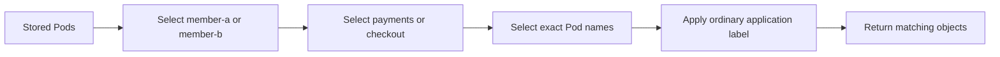

# Search Pods by Cluster, Namespace, and Name with Clusterpedia

Author: [nawazdhandala](https://www.github.com/nawazdhandala)

Tags: Kubernetes, Multi-Cluster, kubectl

Description: Build precise Clusterpedia Pod queries across selected clusters and namespaces, combine application labels, and avoid misleading empty results.

During an incident, "show me the API Pods" is rarely precise enough. You may need Pods from two member clusters, only the payments and checkout namespaces, and only a small set of names. Running an unqualified query and filtering the printed table later makes it easy to lose cluster identity or overlook a namespace restriction.

Clusterpedia can express these choices in the request itself. This guide uses **Clusterpedia v0.9.0** and **kubectl1.34.0** syntax. The selector conversion examples were exercised against the tagged Clusterpedia API code locally. No live Pod searches were performed.

## Establish which API receives the request

You need a working Clusterpedia search kubeconfig, separate from an ordinary member-cluster context. In the examples, `clusterpedia-search.yaml` is that already configured file. Its server points to the Clusterpedia resource API through the hosting cluster. It retains the authentication and TLS settings needed for that host.

A second context, `HOST_CONTEXT`, reaches the ordinary hosting API. Use it for raw requests that include the full Clusterpedia prefix. Do not add that prefix twice by sending those raw examples through the already prefixed search kubeconfig.

Check that the intended member clusters are imported and that Pods are synchronized. Query filters cannot retrieve a Pod that was never collected. Keep the same authorization checks you normally use for the search service; a cluster filter narrows results and is not an access-control boundary.

The [Clusterpedia access guide](https://clusterpedia.io/docs/usage/access-clusterpedia/) explains the prefixed server configuration. Avoid assuming that an arbitrary `--context member-a` automatically means "search member-a through Clusterpedia."

## Use search selectors for location and names

Clusterpedia recognizes several reserved selector keys:

| Key | Meaning |
| --- | --- |
| `search.clusterpedia.io/clusters` | Imported PediaCluster names |
| `search.clusterpedia.io/namespaces` | Namespace names within those members |
| `search.clusterpedia.io/names` | Exact resource names |
| `app.kubernetes.io/part-of` | An ordinary application label in this example |

The first three keys are request controls. You do not need to add those labels to each Pod. In [v0.9.0's conversion code](https://github.com/clusterpedia-io/clusterpedia/blob/v0.9.0/staging/src/github.com/clusterpedia-io/api/clusterpedia/v1beta1/conversion.go), they populate dedicated search options; the ordinary application selector remains a label filter.

Start with a single member and namespace:

```bash
kubectl --kubeconfig clusterpedia-search.yaml get pods -n payments \
  -l 'search.clusterpedia.io/clusters=member-a'
```

Replace the illustrative member and namespace names. Expect only collected Pods from that member's `payments` namespace. The member name is the PediaCluster object's name, which need not equal a kubeconfig context name or cloud-provider cluster identifier.

Next, expand to two members and two namespaces:

```bash
kubectl --kubeconfig clusterpedia-search.yaml get pods -A \
  -l 'search.clusterpedia.io/clusters in (member-a,member-b),search.clusterpedia.io/namespaces in (payments,checkout)'
```

The `-A` flag is important. Without it, kubectl can put its current or default namespace into the request path, unintentionally narrowing a multi-namespace search. The official [multi-cluster search documentation](https://clusterpedia.io/docs/usage/search/multi-cluster/) calls out this requirement.



The diagram explains the logical intersection. It does not prescribe database execution order. Values within each `in` set are alternatives; the different selector requirements narrow the result together.

## Add exact names and application labels

Suppose your investigation concerns StatefulSet-style names `api-0` and `worker-0`. Add those names and your application's actual label:

```bash
kubectl --kubeconfig clusterpedia-search.yaml get pods -A \
  -l 'search.clusterpedia.io/clusters in (member-a,member-b),search.clusterpedia.io/namespaces in (payments,checkout),search.clusterpedia.io/names in (api-0,worker-0),app.kubernetes.io/part-of=shop' \
  -o json
```

This is an exact-name selection, not a prefix or wildcard match. A Deployment-managed Pod whose generated name is `api-7c95b7d8f4-k9bq2` does not match `api-0`. When names are unstable, a well-maintained application label is usually the better filter.

Keep the selector quoted so the shell does not interpret its spaces or parentheses. Use the positive equality and `in` forms shown here for the reserved search controls. Do not assume every operator supported for ordinary Kubernetes labels has equivalent semantics for those special keys.

There is another subtlety: these are independent sets, not paired tuples. The query can match `api-0` in either namespace on either member. If you want only member-a/payments and member-b/checkout, run two explicit queries or perform a clearly documented tuple filter on structured results. One combined cluster set plus one namespace set describes their combinations, not their pairing.

## Use a raw URL when debugging the request

The equivalent location/name constraints can be sent as URL query parameters:

```bash
kubectl --context HOST_CONTEXT get \
  --raw='/apis/clusterpedia.io/v1beta1/resources/api/v1/pods?clusters=member-a,member-b&namespaces=payments,checkout&names=api-0,worker-0'
```

This example deliberately omits the application-label requirement, so it can return more objects than the preceding command. The `api/v1` portion identifies the core Pod API. Resources in named groups use a different path, such as `apis/apps/v1` for Deployments.

The [tagged API option definitions](https://github.com/clusterpedia-io/clusterpedia/blob/v0.9.0/staging/src/github.com/clusterpedia-io/api/clusterpedia/v1beta1/types.go) expose `clusters`, `namespaces`, and `names` as query fields. Prefer one consistent mechanism for each constraint rather than sending conflicting URL parameters and reserved selectors in the same request.

For these Kubernetes-style names, the literal URL is readable. When constructing URLs programmatically, use your language's URL encoder instead of concatenating untrusted strings. Quote the complete shell URL so `&` remains part of the request rather than a background-job operator.

## Preserve identity when reading results

Two clusters can contain the same namespace and Pod name. Never flatten such results into a map keyed only by name. At minimum, retain member identity, namespace, name, and UID when producing an incident artifact.

A useful inspection step is to run a deliberately narrow query per member and retain the member name alongside its JSON response. That makes the origin explicit without relying on terminal column formatting. A UID distinguishes a recreated Pod from an earlier instance with the same name; compare it with the member API if freshness matters.

For larger result sets, also inspect pagination behavior. A raw response with a continuation token is not necessarily the whole result. Do not conclude that a member is absent merely because its matching objects are beyond the first page. Keep pagination handling separate from the filter logic you are trying to debug.

## Diagnose empty results in a repeatable order

Remove only one constraint at a time. Start with a known member and `-A`, then add namespace, exact name, and application label. This identifies which condition excluded the expected object.

If the broad member query is already empty, inspect Pod synchronization status and test a known Pod through that member's own API. If namespace filtering removes it, check the spelling and whether an unintended namespace was embedded in the path. If the name filter removes it, compare the complete generated name. If the label removes it, inspect the actual Pod label rather than the Deployment template you expected to create it.

Finally, distinguish a successful empty list from authentication, permission, discovery, or transport errors. Preserve the command's failure instead of converting it to an empty report. A precise query is valuable only when its scope and the completeness of its result are both clear.
