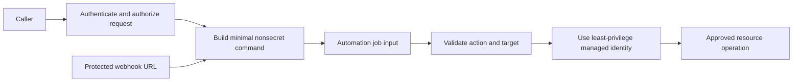

# Secure Azure Automation Webhooks Without Leaking Secrets into Job Logs

Author: [nawazdhandala](https://www.github.com/nawazdhandala)

Tags: Azure Automation, Security, PowerShell

Description: Rotate Azure Automation webhook URLs, validate a small request contract, and prevent sensitive inputs from reaching Automation job history.

An Azure Automation webhook is convenient: a client sends an HTTP request and a runbook starts. That convenience creates two responsibilities. Protect the URL that permits invocation, and carefully control the data that reaches the job.

The URL contains an access token. Possession of it permits invocation without another authentication step at the webhook endpoint. Treat the entire URL as a credential. More subtly, Azure Automation records runbook input parameters with the job. Removing `Write-Output` statements does not undo that automatic recording. [Microsoft's webhook documentation](https://learn.microsoft.com/en-us/azure/automation/automation-webhooks).

The design below uses a small inventory request, overlapping webhook rotation, and validation before any resource operation. It does not claim that input validation authenticates the caller.

## Keep the incoming contract small

A useful request contains a nonsecret request ID, an allowed action, and a logical target name:

```json
{
  "requestId": "check-42",
  "action": "inspect",
  "target": "dev-a"
}
```

Map `dev-a` to an approved resource in trusted runbook configuration. Do not let callers supply a subscription-wide query, a script, an arbitrary URL to fetch, or a resource ID that escapes the intended scope. This keeps authorization decisions outside untrusted request data.

If the request needs credentials to contact a downstream system, retrieve them inside the trusted execution environment. Prefer a managed identity when the destination supports it. Managed identities avoid placing a client secret in the request and are the recommended Automation authentication method. [Automation authentication overview](https://learn.microsoft.com/en-us/azure/automation/automation-security-overview).

For sensitive operations, place caller authentication and authorization before the Automation invocation, or choose an authenticated job-starting integration. A gateway must forward only an approved, nonsecret command; forwarding the original authorization header defeats the data-minimization goal. Keep the backend webhook URL private, since someone holding it can bypass the gateway and call the endpoint directly.



This is a proposed architecture, not an assertion that Automation webhooks provide gateway authentication themselves. Apply the same target restrictions inside the runbook as defense in depth.

## Validate before touching Azure resources

Webhook input arrives through `WebhookData`, including the webhook name, headers, and request body. Do not print the whole object. The following validation-only runbook accepts two names during rotation and a single read-only action. It returns a sanitized acceptance message and performs no Azure operation.

The syntax targets Windows PowerShell 5.1-compatible features. Microsoft's webhook guide currently notes a PowerShell 7 input-conversion issue and recommends PowerShell 5 for that integration. Local tests here ran under PowerShell 7.4.6 using constructed input objects, so they do not establish Azure PowerShell 5.1 webhook compatibility. Verify the published runbook through your actual Automation runtime before rollout.

Save this as `Validate-Request.ps1`:

```powershell
param([object] $WebhookData)
$ErrorActionPreference = 'Stop'
try {
    if ($null -eq $WebhookData -or
        $WebhookData.WebhookName -cnotin @('inventory-a', 'inventory-b')) {
        throw 'invalid'
    }
    $body = $WebhookData.RequestBody
    if ($body -isnot [string] -or
        [Text.Encoding]::UTF8.GetByteCount($body) -gt 4096 -or
        -not $body.TrimStart().StartsWith('{') -or
        -not $body.TrimEnd().EndsWith('}')) {
        throw 'invalid'
    }
    $request = ConvertFrom-Json -InputObject $body -ErrorAction Stop
    if ($request -isnot [System.Management.Automation.PSCustomObject]) {
        throw 'invalid'
    }
    $names = @($request.PSObject.Properties.Name)
    if ($names.Count -ne 3 -or
        @($names | Where-Object { $_ -cnotin @('requestId','action','target') }).Count) {
        throw 'invalid'
    }
    if ($request.requestId -isnot [string] -or
        $request.requestId -cnotmatch '\A[a-z0-9-]{1,64}\z' -or
        $request.action -isnot [string] -or $request.action -cne 'inspect' -or
        $request.target -isnot [string] -or $request.target -cne 'dev-a') {
        throw 'invalid'
    }
}
catch {
    throw 'Webhook request rejected; inspect approved metadata only.'
}
# No Azure action is performed by this validation-only example.
Write-Output ('Validated request {0}; action=inspect; target=dev-a' -f $request.requestId)
```

The 4,096-byte limit is an application choice, not a claimed Azure service limit. The validator accepts exactly three fields, rejects other actions and targets, and limits the request ID to safe characters. Its rejection message does not include the body or parser exception.

This is not a cryptographic verifier or a strict canonical JSON parser. `ConvertFrom-Json` can retain only the last occurrence of duplicate keys. If an upstream component signs or interprets JSON, define one consistent parsing contract and reject ambiguous input there; do not assume parsing and reserializing preserves signed bytes. [PowerShell 5.1 JSON conversion reference](https://learn.microsoft.com/en-us/powershell/module/microsoft.powershell.utility/convertfrom-json?view=powershell-5.1).

Test the ordinary path locally without a webhook URL:

```powershell
$sample = [pscustomobject]@{
    WebhookName = 'inventory-a'
    RequestBody = '{"requestId":"check-42","action":"inspect","target":"dev-a"}'
}
& ./Validate-Request.ps1 -WebhookData $sample
```

Expected output is `Validated request check-42; action=inspect; target=dev-a`. Changing the action to `delete` must throw the fixed rejection message. Twelve local cases covered both rotation names, malformed input, oversized data, unknown targets, additional fields, and unsafe request IDs.

A webhook-name check helps detect configuration mistakes; it is not proof of who sent the request. Similarly, a request ID is a correlation value, not authorization. Before adding mutating operations, introduce durable duplicate suppression keyed to the business operation and reconcile uncertain outcomes.

## Rotate by overlapping two webhooks

Use a separate webhook per caller when practical so revocation and incident ownership are clear. Inventory each client's owner, secret-store location, expiration, and last verified successful request. Record a credential reference rather than the tokenized URL in the inventory.

For routine rotation, create `inventory-b` for the same published runbook while `inventory-a` remains available. Preserve the intended runbook parameters and worker placement. Choose an expiry that gives the team time to rotate again, and store the newly returned URL directly in the caller's protected secret store. The creation command returns the URL only at creation; do not expect to retrieve it later. [New-AzAutomationWebhook reference](https://learn.microsoft.com/en-us/powershell/module/az.automation/new-azautomationwebhook?view=azps-16.5.0).

Then follow a controlled handover:

1. Allow both webhook names in the runbook and publish that change before switching clients.
2. Update one caller to the new stored URL and send a harmless inventory request with a new request ID.
3. Verify the resulting job and its intended outcome, not just the HTTP response.
4. Switch the remaining callers and observe them through their normal retry window.
5. Disable the old webhook, verify that old-URL requests no longer start jobs, and remove its name from the accepted list once outstanding work is accounted for.

Disabling an old webhook is supported by `Set-AzAutomationWebhook -IsEnabled $False`; use your reviewed deployment process or portal controls to apply it. Do not confuse extending an expiry with replacing a compromised token. [Set-AzAutomationWebhook reference](https://learn.microsoft.com/en-us/powershell/module/az.automation/set-azautomationwebhook?view=azps-16.0.0).

If a URL is exposed, prioritize disabling it instead of maintaining a long overlap. Separately investigate jobs already accepted; turning off future invocation is not a cancellation strategy for running work.

## Control every place a secret might appear

Review three surfaces: the caller, the job input, and the runbook streams. The caller must not include the webhook URL in verbose HTTP traces, exception reports, command history, or monitoring labels. Prefer a secret reference in configuration and a client that redacts URLs before recording failures.

The request body and headers must be safe to retain. Adding a second shared secret header is a poor default when those inputs can enter job history. Validation inside the runbook happens too late to prevent input capture. Remove sensitive fields before the request reaches Automation.

For runbook streams, log the validated request ID, an allowlisted operation, a coarse result, and a duration. Do not print credentials, full downstream responses, or raw exception objects. Output, error, and warning streams can be retained in job history; verbose records can also be retained when enabled. [Automation output and message streams](https://learn.microsoft.com/en-us/azure/automation/automation-runbook-output-and-messages).

Encrypted Automation assets protect stored credentials and other supported assets, but that is not permission to copy their plaintext into job output. Keep asset access narrowly scoped. [Secure asset encryption](https://learn.microsoft.com/en-us/azure/automation/automation-secure-asset-encryption).

## Verify the complete path before relying on it

In a staging account, test a valid request, invalid action, unknown target, duplicate request ID, and the old URL after rotation. Inspect job parameters as well as output and error streams. Use an unmistakably fake marker when checking for accidental logging; never test redaction with a real credential.

The local validator tests do not prove caller authentication, token revocation, job logging behavior, or downstream permissions. Those are deployment acceptance tests. The desired result is a callable integration with a small, nonsecret input contract, a documented revocation path, and evidence that only the intended resource operation can run.
