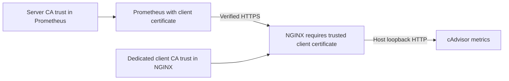

# Secure cAdvisor Metrics with NGINX, TLS, and Client Certificates

Author: [nawazdhandala](https://www.github.com/nawazdhandala)

Tags: Docker, Prometheus, Nginx, Security, Monitoring

Description: Put cAdvisor behind a restricted NGINX endpoint with verified server TLS and client-certificate authentication, then test both successful scrapes and rejected clients.

A cAdvisor endpoint can reveal container names, image references, labels, and resource activity. Encrypting that endpoint protects traffic in transit, but it does not decide who may read it. Authentication and protection against bypassing the proxy are separate requirements.

This guide uses NGINX 1.30.7, cAdvisor 0.55.1, and Prometheus 3.7.3. The example authenticates the scraper with mutual TLS, or mTLS: the client verifies the server's certificate, and the server requires a trusted client certificate. It exposes only the metrics path through the proxy.

## Keep the unprotected backend off the network

The example assumes cAdvisor and NGINX run directly on the same native Linux host. Bind cAdvisor to the host loopback address using these arguments, while preserving its other required settings:

```text
--listen_ip=127.0.0.1
--port=8080
```

The pinned cAdvisor command defines these listener options. Confirm the effective listener after changing the service; do not infer it from a configuration file alone. [cAdvisor listener flags](https://github.com/google/cadvisor/blob/v0.55.1/cmd/cadvisor.go).

Loopback here means the host's own network namespace. If NGINX and cAdvisor run in separate containers, `127.0.0.1` inside NGINX refers to NGINX's container. Use a deliberately private backend network for that topology and prevent other untrusted containers from joining it. Do not publish the unprotected backend port as a shortcut.

Local processes on the host can still reach a loopback backend. This design protects remote access; it does not isolate the exporter from other privileged or untrusted processes on the same machine.



## Prepare certificates for two distinct trust decisions

Have your certificate authority issue a server certificate for `cadvisor.metrics.example.internal`. Its subject alternative name, or SAN, must contain that DNS name. Install the leaf certificate followed by needed intermediate certificates in the server chain file, and keep its private key readable only by the service accounts that require it.

Separately issue a client certificate to the Prometheus scraper, suitable for client authentication. Use a dedicated client CA or issuing policy for authorized monitoring clients. NGINX's certificate verification trusts certificates issued through the configured CA chain; it is not automatically a per-user authorization database.

The files used below are deployment placeholders:

| File | Purpose |
| --- | --- |
| `/etc/nginx/tls/server-chain.pem` | Proxy leaf certificate and server intermediates |
| `/etc/nginx/tls/server-key.pem` | Proxy private key |
| `/etc/nginx/tls/scraper-ca.pem` | Trusted client CA chain |
| `/etc/prometheus/tls/server-ca.pem` | CA trust for verifying the proxy |
| `/etc/prometheus/tls/scraper-cert.pem` | Scraper certificate and needed intermediates |
| `/etc/prometheus/tls/scraper-key.pem` | Scraper private key |

Do not copy the client private key onto the proxy. The proxy needs the client's trust chain, not the client's identity secret. NGINX documents certificate chain order and client-certificate verification separately. [NGINX TLS directives](https://nginx.org/en/docs/http/ngx_http_ssl_module.html).

## Expose only the authenticated metrics route

Place this server block inside the existing NGINX `http` context:

```nginx
server {
    listen 8443 ssl;
    server_name cadvisor.metrics.example.internal;

    ssl_certificate /etc/nginx/tls/server-chain.pem;
    ssl_certificate_key /etc/nginx/tls/server-key.pem;
    ssl_protocols TLSv1.2 TLSv1.3;
    ssl_client_certificate /etc/nginx/tls/scraper-ca.pem;
    ssl_verify_client on;
    ssl_verify_depth 2;

    location = /metrics {
        limit_except GET { deny all; }
        proxy_pass http://127.0.0.1:8080;
        proxy_set_header Host $host;
        proxy_set_header Authorization "";
        proxy_connect_timeout 2s;
        proxy_read_timeout 15s;
    }

    location / {
        return 404;
    }
}
```

Adapt verification depth to the reviewed client CA chain. The exact location matches `/metrics`; other paths receive no application content. `limit_except GET` also permits HEAD under NGINX's documented method semantics. The configuration does not expose cAdvisor's other routes. [NGINX location and method rules](https://nginx.org/en/docs/http/ngx_http_core_module.html#limit_except).

`proxy_pass` forwards to the loopback backend without replacing the request URI. The proxy clears any Authorization header because this backend does not need forwarded credentials. The configured read timeout bounds inactivity between upstream reads, not a universal total-request deadline. [NGINX proxy directives](https://nginx.org/en/docs/http/ngx_http_proxy_module.html).

Validate the full installed configuration with `nginx -t`, then reload using your service manager's normal procedure. Restrict the listening port to the intended monitoring network as an additional control. `server_name` alone is not a network access policy.

## Configure the scraper to verify both identity and trust

Merge this job into Prometheus's existing configuration:

```yaml
scrape_configs:
  - job_name: cadvisor
    scheme: https
    metrics_path: /metrics
    scrape_interval: 30s
    scrape_timeout: 20s
    static_configs:
      - targets: ["cadvisor.metrics.example.internal:8443"]
    tls_config:
      ca_file: /etc/prometheus/tls/server-ca.pem
      cert_file: /etc/prometheus/tls/scraper-cert.pem
      key_file: /etc/prometheus/tls/scraper-key.pem
```

The target name must resolve to the proxy and match its server certificate. The CA file establishes server trust; the certificate and key identify Prometheus to NGINX. Mount these files read-only where practical and grant only the required process access. [Prometheus TLS configuration](https://prometheus.io/docs/prometheus/latest/configuration/configuration/#tls_config).

Validate the final configuration with matching `promtool check config`. Do not disable certificate verification to get a green target: fix the trust chain, name, time, or certificate purpose indicated by the error.

## Test rejection as well as successful access

Before rollout, verify these outcomes from the intended monitoring network:

| Test | Expected result |
| --- | --- |
| Trusted server CA and authorized client certificate | Metrics returned |
| No client certificate | Metrics denied |
| Certificate from an unrelated client CA | Metrics denied |
| Wrong server CA or wrong hostname | Client refuses the TLS connection |
| Authenticated request to another path | No cAdvisor application content |
| Direct connection to backend port from another host | No reachable unprotected endpoint |

Also test a non-GET write method against `/metrics`; it must not reach the backend. During local validation, NGINX's actual TLS and routing behavior was exercised against a mock metrics backend. That verifies the proxy controls, not production firewall rules or a live cAdvisor deployment.

## Renew without introducing a bypass

Track expiry for both server and client certificates. For CA rotation, distribute the new trust chain alongside the old one before replacing leaf certificates. Verify the new client and server identities, then remove old trust only after all intended scrapers have moved.

If an identity is compromised, follow the CA's revocation and replacement policy; merely waiting for a long-lived certificate to expire is inadequate. Keep certificate-file changes atomic and verify reload behavior for the installed services.

A protected deployment needs all three properties together: a verified encrypted connection, an authenticated scraper, and no remotely reachable unprotected backend. Preserve those properties during troubleshooting and renewal.
