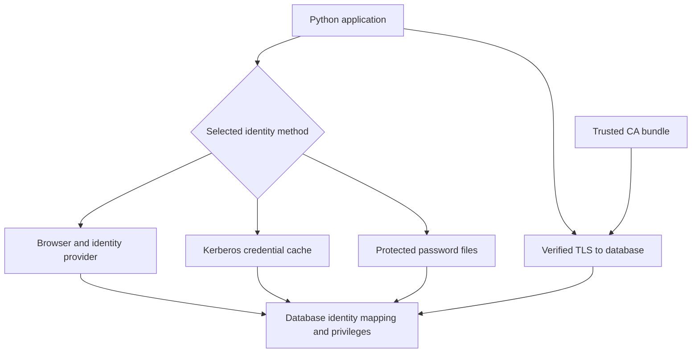

# Secure Teradata Python Connections with TLS and Identity

Author: [nawazdhandala](https://www.github.com/nawazdhandala)

Tags: Python, Database, Security

Description: Configure verified Teradata TLS, choose browser OIDC or Kerberos appropriately, and use stored-password protection without confusing encryption with access control.

A secure database connection answers two separate questions: did the client reach the intended server, and which identity is allowed to log on? Encrypting the network connection does not choose an authentication method. Encrypting a stored password does not establish server trust.

This guide uses `teradatasql` 20.0.0.76 and official source commit `5762e99d5af6173e0cb0359154f6aa86cd8ee86f`. The package imported successfully locally, and configuration branches were tested without network access. No database TLS handshake, identity-provider login, Kerberos exchange or stored-password decryption was performed.

## Keep transport trust and identity separate

TLS, or Transport Layer Security, encrypts communication and can authenticate the server certificate. A certificate authority, or CA, signs the chain used to establish trust. The database hostname must also match the certificate when full verification is enabled.

The driver's `sslmode='VERIFY-FULL'` requires TLS, certificate trust and hostname verification. Its `sslca` parameter identifies a PEM file containing trusted CA certificates. The [pinned driver settings](https://github.com/Teradata/python-driver/blob/5762e99d5af6173e0cb0359154f6aa86cd8ee86f/README.md#connection-parameters) document these behaviors. Choose the CA bundle and hostname from your administrator; do not fix a mismatch by disabling verification.

Authentication then identifies the user or service. Use one explicit method appropriate to that actor, rather than supplying every credential field and hoping the driver selects the intended flow.



## Use browser OIDC for an interactive user

OpenID Connect, or OIDC, delegates login to an identity provider. The driver's `BROWSER` mechanism uses an authorization-code flow with PKCE, a protection that binds the authorization exchange to the initiating client. It is intended for interactive users and is supported on Windows and macOS in this driver version.

The database must already have the federation configuration and identity mapping. The required database permission described as logon with null password enables this external-authentication path; it does not mean anyone can connect without authentication. The [logon-method table](https://github.com/Teradata/python-driver/blob/5762e99d5af6173e0cb0359154f6aa86cd8ee86f/README.md#LogonMethods) defines the prerequisites and forbidden credential combinations.

Do not attach a database password or `logdata` to a BROWSER connection. For a headless scheduled job, choose an administrator-approved service-account flow instead of attempting to automate a human browser prompt. The driver offers separate OIDC methods for service identities; their credential fields are not interchangeable with BROWSER.

## Prepare Kerberos before selecting KRB5

Kerberos uses tickets issued through a trusted authentication infrastructure. Selecting `logmech='KRB5'` does not configure that infrastructure for you. Confirm the client libraries, realm settings, service identity and database mapping with the administrators responsible for them.

For single sign-on, the Python process needs access to the intended credential cache. MIT's [cache documentation](https://web.mit.edu/kerberos/krb5-latest/doc/basic/ccache_def.html) explains that it stores credentials and lifetime information. A ticket visible in your interactive shell may not be visible to a service running under another operating-system account.

On a host using MIT Kerberos tools, this read-only check avoids printing ticket details:

```bash
klist -s
```

Under the documented [MIT klist behavior](https://web.mit.edu/kerberos/krb5-latest/doc/user/user_commands/klist.html), status zero indicates a readable, unexpired cache; status one indicates otherwise. That is a prerequisite check, not proof of a valid Teradata service ticket or database authorization. Verify the installed tool's options on other Kerberos implementations.

## Build explicit connection options

The included helper keeps TLS verification enabled for all three illustrated paths. Replace the host and CA path at the call site. Stored-password mode assumes two already-provisioned files at the shown paths; those are deployment placeholders, not files created by the helper.

```python
def connection_options(mode, host, ca_file, user=None):
    options = {
        'host': host,
        'sslmode': 'VERIFY-FULL',
        'sslca': ca_file,
        'connect_timeout': '5000',
        'logon_timeout': '180',
        'request_timeout': '60',
    }
    if mode == 'browser':
        options.update(logmech='BROWSER', oidc_sslmode='VERIFY-FULL')
    elif mode == 'kerberos':
        options.update(logmech='KRB5')
    elif mode == 'stored':
        if not user:
            raise ValueError('Stored-password mode requires a database user')
        options.update(
            logmech='TD2',
            user=user,
            password=(
                'ENCRYPTED_PASSWORD('
                'file:/run/secrets/td-key.properties,'
                'file:/run/secrets/td-password.properties)'
            ),
        )
    else:
        raise ValueError('Choose browser, kerberos or stored')
    return options
```

For browser mode, `oidc_sslmode` also verifies the identity provider's HTTPS connection. Ensure the configured CA trust covers the required endpoints. Choose timeout budgets that allow the approved login flow; the example's values are illustrative.

Once the prerequisites are ready, use the chosen options on a dedicated connection:

```python
import teradatasql
from connection_options import connection_options

options = connection_options(
    'browser',
    'REPLACE_WITH_CERTIFICATE_HOSTNAME',
    '/REPLACE/WITH/TRUSTED-CA-BUNDLE.pem',
)
with teradatasql.connect(**options) as connection:
    with connection.cursor() as cursor:
        cursor.execute('SELECT CURRENT_TIMESTAMP')
        cursor.fetchone()
```

A successful query confirms this basic connection path. It does not establish permission to access application tables or prove that scheduled credential renewal works. Test those separately using the intended operating-system and database identities.

## Protect both stored-password files

The stored-password expression names the encryption-key file first and encrypted-password file second. It is not a generic secret-manager URI. Teradata supplies a [TJEncryptPassword sample](https://github.com/Teradata/python-driver/blob/5762e99d5af6173e0cb0359154f6aa86cd8ee86f/samples/TJEncryptPassword.py) for producing the required properties-file format.

Review that provisioning tool and your secret-input method before using real credentials. Keep plaintext passwords out of shell history, process arguments, source control and ordinary logs. Restrict both generated files to the intended runtime identity and manage their distribution through the approved secret-delivery process.

Possession of both files permits decryption. Storing them beside each other in a broadly readable application image does not provide meaningful access separation. The feature protects the stored representation; it does not remove the need for filesystem controls, controlled backups and a password-rotation procedure.

## Test renewal and failure paths deliberately

Use a staging identity to verify certificate renewal, password rotation or ticket expiry handling. For CA changes, distribute the reviewed overlapping trust bundle before changing the server chain, then remove obsolete trust only after clients have migrated. For password-file rotation, deploy a matching key/password pair together and retain a controlled recovery path.

Classify failures by stage: certificate trust or hostname, identity-provider access, missing Kerberos credentials, database identity mapping, or SQL authorization. Keep diagnostic records restricted and avoid dumping token caches or password properties. A useful connection test preserves verification and explains which boundary failed, so recovery strengthens the intended configuration instead of bypassing it.
