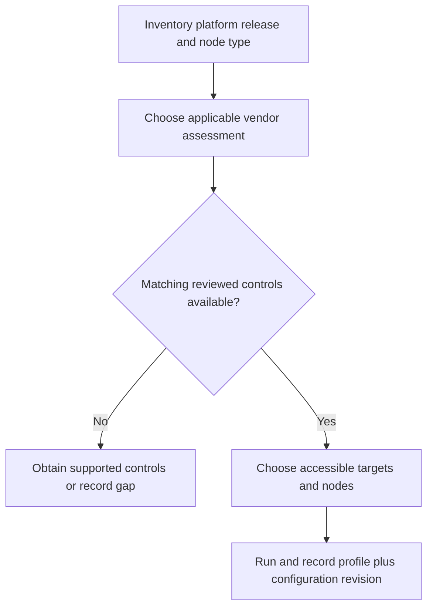

# Choose the Right kube-bench Profile for Your Distribution

Author: [nawazdhandala](https://www.github.com/nawazdhandala)

Tags: Kubernetes, Security, Compliance

Description: Select kube-bench profiles for EKS, AKS, GKE, K3s, RKE2, and MicroK8s by checking distribution guidance, bundled controls, and assessment scope.

Two clusters can report the same Kubernetes minor version and require different security assessments. A managed service may hide control-plane files from customers. A lightweight distribution may package components into one executable. A benchmark expecting another layout can produce findings that describe the scanner's assumptions rather than the system's security.

Choose the distribution and assessment scope before choosing the kube-bench profile. Then verify that your installed release contains the appropriate controls. A profile that parses successfully is not automatically the right assessment for your cluster.

This guide uses **kube-bench v0.14.0** as a fixed reference. The profile names below were checked in that release's configuration tree. They illustrate selection and verification; they are not a universal recommendation for today's versions of every managed service.

## Record four versions, not one

Capture the Kubernetes version, distribution release or service mode, kube-bench version, and benchmark version. These describe different things.

On a workstation with authorized read access, collect the Kubernetes inventory:

```bash
kubectl version -o yaml > kubernetes-version.yaml
kubectl get nodes -o json > nodes.json
jq -r '.items[] | [.metadata.name, .status.nodeInfo.kubeletVersion,
  .status.nodeInfo.osImage, .status.nodeInfo.architecture] | @tsv' nodes.json
```

Also record the provider's node-group type, operating-system image, and management mode from its inventory. A server version alone does not distinguish a conventional worker VM from a mode that prohibits host inspection. For K3s, RKE2, and MicroK8s, retain the exact distribution build and packaging details.

Run `kube-bench version` on the scanner installation to identify the tool. Do not confuse that subcommand with `--version`, which supplies a Kubernetes version for benchmark selection.

## Start with the distribution's assessment guidance

Use this table as a map of what exists in **v0.14.0**, then compare it with the vendor guide applicable to your deployment:

| Distribution | Example bundled profile | Selection question |
|---|---|---|
| EKS | `eks-1.7.0` | Does the EKS benchmark revision match the approved assessment and node type? |
| AKS | `aks-1.7` | Are you assessing AKS-specific controls or a separately documented generic benchmark? |
| GKE | `gke-1.8.0` | Does the assessment cover customer-controlled GKE settings and accessible nodes? |
| K3s | `k3s-cis-1.8` | Do the distribution release, datastore, and packaged component paths match? |
| RKE2 | `rke2-cis-1.8` | Is this benchmark revision appropriate, or does the deployment need newer controls? |
| MicroK8s | `cis-1.24-microk8s` | Does the revised MicroK8s configuration match the installed snap and assessment? |

These exact names and available targets come from the tagged [configuration tree](https://github.com/aquasecurity/kube-bench/tree/v0.14.0/cfg) and [target mapping](https://github.com/aquasecurity/kube-bench/blob/v0.14.0/cfg/config.yaml). A name such as `cis-1.24-microk8s` is a benchmark identifier; it should not be interpreted as a command to downgrade the cluster to Kubernetes 1.24.

For **EKS**, AWS describes an EKS-specific benchmark that reflects how the managed service is implemented. Use its [infrastructure security guidance](https://docs.aws.amazon.com/eks/latest/best-practices/protecting-the-infrastructure.html) to separate customer responsibilities from service-owned controls. Node operating-system hardening is a related assessment, not the same report as Kubernetes configuration checks.

For **AKS**, Microsoft publishes benchmark results with an explicit AKS version range and classifications such as not applicable or equivalent control. Its [CIS guidance](https://learn.microsoft.com/en-us/azure/aks/cis-kubernetes) also distinguishes the generic Kubernetes benchmark from the AKS benchmark. Do not assume a generic report and an AKS-specific report have interchangeable control IDs or totals.

For **GKE**, Google recommends prioritizing the GKE benchmark because it addresses settings customers can control. Some generic recommendations refer to managed components customers cannot inspect or change. Follow the [GKE benchmark guidance](https://docs.cloud.google.com/kubernetes-engine/docs/concepts/cis-benchmarks), and keep unavailable host evidence separate from successful checks.

## Account for lightweight distribution differences

K3s does not use ordinary static Pod manifests for its core components in the same way as a conventional installation. Its [hardening guide](https://docs.k3s.io/security/hardening-guide) explains that architectural difference. A missing manifest can therefore indicate an inappropriate generic check rather than a file that should be created. Confirm the datastore as well: an assessment written around embedded etcd does not establish equivalent coverage of another datastore.

RKE2's `profile: cis` setting configures hardening behavior. It is not the name of a kube-bench control directory. The [RKE2 hardening guide](https://docs.rke2.io/security/hardening_guide) links assessments for particular release ranges, including benchmarks newer than some directories bundled in v0.14.0. If the approved assessment is newer, update or obtain the reviewed controls; do not rename an older directory and treat it as the new benchmark.

MicroK8s provides a `cis-hardening` addon and a kube-bench integration. Enabling the addon changes node configuration, so it is not a read-only way to discover the current compliance state. Canonical documents both the plugin and using its revised configuration for an assessment before hardening in the [MicroK8s CIS guide](https://canonical.com/microk8s/docs/how-to-cis-harden). Preserve the relevant configuration revision with the results.

## Inspect bundled targets before scanning

With Python 3 and PyYAML installed, save this as `inspect-profile.py` beside a complete extracted kube-bench bundle:

```python
import sys
from pathlib import Path
import yaml

root = Path(sys.argv[1]).resolve()
profile = sys.argv[2]
config = yaml.safe_load((root / "config.yaml").read_text())
targets = config.get("target_mapping", {}).get(profile)
if not targets:
    raise SystemExit("Profile is absent from target_mapping")
for target in targets:
    control = root / profile / f"{target}.yaml"
    if not control.is_file():
        raise SystemExit(f"Missing controls: {control}")
    document = yaml.safe_load(control.read_text())
    print(f"{target}: {document.get('text', '(no description)')}")
```

For the pinned release, an inspection example is:

```bash
python3 inspect-profile.py ./cfg eks-1.7.0
```

This reads configuration files only. It lists the profile's target descriptions and fails if a declared target file is missing. It does not validate every check or run a scan. An existing `master` target does not give you access to a provider's control-plane host; it may contain manual or otherwise scoped recommendations that still need interpretation.

## Understand what autodetection can miss

Autodetection is implemented by the particular kube-bench release you installed. In v0.14.0, the [platform selection source](https://github.com/aquasecurity/kube-bench/blob/v0.14.0/cmd/util.go) has explicit version branches and defaults. For example, its GKE selection treats 1.31 through 1.34 differently from 1.28 through 1.30. Its K3s-specific branches do not cover every later minor release.

A successful automatic choice therefore proves that the code selected something, not that the result matches a newer vendor assessment. Review the selected benchmark in the output and compare it with your documented decision.

Likewise, forcing a plain Kubernetes version can bypass distribution-specific selection. The [selection logic](https://github.com/aquasecurity/kube-bench/blob/v0.14.0/cmd/common.go) distinguishes explicit version and benchmark arguments. Do not use a generic version override solely to eliminate platform detection errors.



## Make the final command reflect the approved scope

After reviewing an EKS deployment against the EKS 1.7.0 benchmark, an authorized node-only invocation using the matching bundle would be:

```bash
bundle_dir="$PWD"
./kube-bench run --benchmark eks-1.7.0 --targets node \
  --config "$bundle_dir/cfg/config.yaml" \
  --config-dir "$bundle_dir/cfg" --json
```

This is an actual scan command, not a preflight. It assumes execution with the required visibility on the intended node. Do not add `--version` alongside `--benchmark`; the release rejects that combination. Keep other targets separate when they require different credentials, manual review, or provider evidence.

Compare successive reports only after checking their profile, control revision, scope, and node inventory. A better score after switching profiles may reflect fewer applicable checks rather than improved security. The useful result is an assessment whose controls fit the deployment and whose coverage limitations are explicit.
