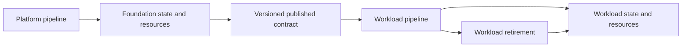

# Separate Shared Foundations from Disposable Cloud Resources

Author: [nawazdhandala](https://www.github.com/nawazdhandala)

Tags: Terraform, Cloud Automation, Architecture

Description: Split cloud resources by ownership and lifetime, publish a small foundation contract, and keep disposable workload teardown away from shared infrastructure.

A preview application's lifecycle should not control the network used by every team. Yet that dependency can appear accidentally when one Terraform root configuration creates the shared network, the application, and its database together.

The solution involves more than moving files into two directories. Separate ownership, state, credentials, and release processes, then give the disposable workload a small, explicit interface to the foundation. That makes teardown easier to review and foundation upgrades easier to coordinate.

## Classify resources by who may retire them

Ask a practical question for every resource: if this application disappears today, who decides whether the resource survives?

| Resource | Typical lifecycle owner | Retirement rule |
| --- | --- | --- |
| Shared network and transit connectivity | Platform team | All consumers migrated or retired |
| Central audit storage and encryption keys | Security/platform team | Retention and recovery requirements satisfied |
| Preview compute and application routing | Application team | Preview lifecycle ends |
| Preview-specific test database | Application team | Approved disposal or backup policy satisfied |
| Production data store | Data/service owner | Explicit data retirement procedure |

These are examples, not universal classifications. A database is not disposable merely because it appears in an application module. An encryption key may outlive the application because retained backups still require it.

Write down the owner, consumers, retention requirements, and change authority. A resource with multiple independent consumers usually belongs outside an individual consumer's teardown boundary.

## Split the execution boundary

In Terraform, a child module organizes configuration but does not by itself create a separate state or permission boundary. Put foundation and workload roots in independently configured execution contexts, each with its own state storage and narrowly scoped deployment identity.

The foundation pipeline can change shared resources. The workload pipeline consumes their published identifiers and manages only workload-owned resources. Infrastructure identity and access management must enforce that distinction; a folder name cannot stop a deployment role with broad delete permissions.



Avoid a reverse dependency in which the foundation requires an output from a short-lived workload to remain valid. Shared attachment points should have a stable owner. Consumers can register their own attachments without taking ownership of the shared network itself.

Terraform's module-composition guidance describes passing dependencies into modules rather than having every module discover or create them. Apply that principle across lifecycle boundaries too. See [module composition](https://developer.hashicorp.com/terraform/language/modules/develop/composition).

CLI workspaces are useful for multiple instances of one configuration, but are not the right isolation mechanism for system decomposition requiring separate credentials and access controls. HashiCorp makes that distinction in its [workspace guidance](https://developer.hashicorp.com/terraform/cli/workspaces).

## Publish a small contract instead of exposing all state

A foundation contract is a versioned document containing the information consumers need: account, Region, subnet IDs, approved endpoints, and compatibility metadata. Keep secrets out of it. Publish it through an access-controlled artifact or configuration store, and pin the reviewed revision used by a workload run.

Although `terraform_remote_state` exposes root outputs in Terraform expressions, its reader needs access to the underlying state snapshot. That snapshot can contain sensitive data beyond those outputs. HashiCorp recommends explicitly publishing shared data where possible so it can have separate access controls. See [remote-state sharing considerations](https://developer.hashicorp.com/terraform/language/state/remote-state-data).

Do not make consumers select an arbitrary document called `latest` without review. Publishing a new network does not migrate old workloads. Keep old contract revisions available until their consumers have moved, and maintain an inventory linking workloads to the revisions they use.

## Validate the contract before planning workload changes

The following provider-free example uses **Terraform 1.11.4**, the version used for local checks. Save it as `main.tf` in an empty directory. It models only the consumer interface; it creates no network or workload resources.

The account and Region are illustrative policy values. Replace them with the approved deployment target when adapting the example. The two subnet IDs in the test below are placeholders; validation checks their shape, not their existence.

```hcl
terraform {
  required_version = "= 1.11.4"
}

variable "foundation" {
  description = "Reviewed, non-secret network contract from the platform pipeline."
  type = object({
    schema_version     = number
    account_id         = string
    region             = string
    private_subnet_ids = set(string)
  })
  nullable = false

  validation {
    condition = try(
      var.foundation.schema_version == 1 &&
      var.foundation.account_id == "222222222222" &&
      var.foundation.region == "eu-west-1" &&
      length(var.foundation.private_subnet_ids) >= 2 &&
      alltrue([for id in var.foundation.private_subnet_ids :
      can(regex("^subnet-[0-9a-f]{17}$", id))]),
      false
    )
    error_message = "Expected contract v1 for the approved account/Region and at least two subnet IDs."
  }
}

output "selected_subnets" {
  value = var.foundation.private_subnet_ids
}
```

The object type requires the named fields. The validation rejects unsupported schema versions, wrong target metadata, malformed IDs, and fewer than two distinct subnets. Using a set prevents duplicate IDs from satisfying the count. Terraform documents these mechanisms under [input variable validation](https://developer.hashicorp.com/terraform/language/values/variables).

In a real workload root, pass these values into the workload module. Independently verify the actual provider account and Region, subnet ownership, availability zones, and routing requirements. A document declaring the right account is not proof that the deployment credentials target it.

To test the interface without cloud credentials, create `tests/contract.tftest.hcl`:

```hcl
variables {
  foundation = {
    schema_version     = 1
    account_id         = "222222222222"
    region             = "eu-west-1"
    private_subnet_ids = ["subnet-0123456789abcdef0", "subnet-0123456789abcdef1"]
  }
}

run "valid_contract" {
  command = plan
  assert {
    condition     = length(output.selected_subnets) == 2
    error_message = "Expected two selected subnets."
  }
}
```

Run these commands in that example directory:

```bash
terraform init -backend=false
terraform validate
terraform test
```

Expect initialization and validation to succeed and the test to pass. The test explicitly uses a plan; Terraform tests can otherwise execute applies, so inspect test files before running them against infrastructure-bearing configurations. See the [Terraform testing documentation](https://developer.hashicorp.com/terraform/language/tests).

Local validation also covered rejected schema versions, accounts, Regions, duplicate subnets, and malformed IDs. Those tests establish interface behavior, not real cloud isolation.

## Give foundation changes a migration window

A foundation release should say whether it adds a compatible capability or replaces an existing dependency. Adding a subnet may let old and new consumers coexist. Removing a subnet used by workloads requires a migration plan and proof that no consumers remain.

Track both desired and observed consumer revisions. A pipeline accepting a new document is not proof that all running resources moved. Verify actual attachment state before retiring the old foundation resources.

For disposable teardown, review the plan from the workload root using the workload identity. Shared resources must not appear as managed deletions. Separately verify that the identity cannot delete the foundation and that workload retirement leaves shared services healthy. A local contract test cannot establish those permission and operational guarantees.

## Treat lifecycle protections as additional safeguards

`prevent_destroy` can reject destructive plans while the rule remains in configuration. It does not protect a resource after its configuration is removed. It also does not constrain direct cloud API calls by another principal. See the [Terraform lifecycle reference](https://developer.hashicorp.com/terraform/language/meta-arguments/lifecycle).

If resources already share one state, treat the split as a controlled ownership migration. Freeze competing changes, back up state, identify every physical resource, and use a reviewed transfer procedure appropriate to the backend and Terraform version. Do not copy resource blocks into a second root and apply: that can leave two systems believing they own the same object.

The end state should be easy to demonstrate: workload creation reads an approved foundation contract, workload teardown removes only workload-owned resources, and foundation retirement waits for all consumers and retention obligations. That is what makes the lifecycles independent in practice.
