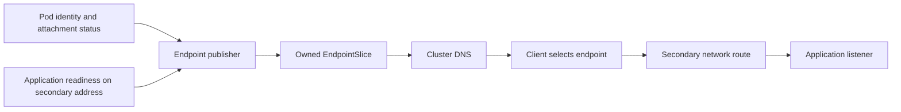

# Design Service Discovery for Multus Secondary IP Addresses

Author: [nawazdhandala](https://www.github.com/nawazdhandala)

Tags: Multus, Kubernetes, DNS

Description: Publish secondary-network endpoints deliberately with a selectorless headless Service, clear readiness ownership, and a reconciliation plan for Pod replacement and address reuse.

A Multus attachment gives a Pod another address, but clients still need a reliable way to find it. Copying that address into a configuration file works until the Pod is replaced. Adding a normal Service selector is not an instruction to choose a particular Multus interface.

Separate three questions: which endpoint should be published, who keeps it current, and can the client actually reach it? DNS can answer the first question only after a publisher makes a correct decision. It cannot repair routing or prove that the application listens on the secondary address.

This guide uses a small, manually managed staging example with stable Service and EndpointSlice APIs. The YAML was checked against the **Kubernetes v1.34.0 OpenAPI definitions** and additional consistency assertions. No live DNS or Kubernetes cluster tests were performed.

## Choose the discovery contract before the object

| Approach | What clients receive | Responsibility to resolve |
| --- | --- | --- |
| Normal selector-based Service | Service address backed by controller-selected endpoints | Verify those endpoints are the intended network |
| Selectorless ClusterIP Service | Virtual Service address with explicitly managed backends | Service implementation must reach secondary backends |
| Selectorless headless Service | Endpoint addresses through cluster DNS | Each client must reach the secondary network directly |
| External registry or DNS zone | Application-specific endpoint records | Publisher, health, expiry, and external client reachability |

A Service without selectors lets you supply backend endpoints independently. A headless Service uses `clusterIP: None` rather than allocating a virtual IP. These are useful building blocks, not a built-in Multus discovery controller. [Services without selectors](https://kubernetes.io/docs/concepts/services-networking/service/#services-without-selectors).

For this example, clients already have a route to the secondary network and can use cluster DNS. Choose another design if clients are outside that routing domain or need a gateway to reach it.

## Give publication an explicit owner

The `k8s.v1.cni.cncf.io/network-status` annotation can provide candidate addresses. Treat it as attachment information, not a health check. Match the full network name and intended interface, reject ambiguous results, and validate the address family and allowed subnet before publication. Never select the first address simply because it exists. [Network attachment status format](https://github.com/k8snetworkplumbingwg/network-attachment-definition-client/blob/v1.7.6/pkg/apis/k8s.cni.cncf.io/v1/types.go).



A production publisher needs a defined lifecycle: observe Pod creation, wait for the intended attachment and application readiness, publish, withdraw during termination or failure, and remove obsolete records. Pod UID matters because a replacement can reuse a name while representing a different workload.

The manual example below has no controller to perform those steps. Use it to validate the DNS and network contract, then implement or adopt a reviewed publisher before relying on dynamic addresses.

## Create a selectorless headless Service

Assume the `telemetry` namespace exists and an approved staging server listens on its secondary address at TCP port 4317. Save the following as `secondary-discovery.yaml`:

```yaml
apiVersion: v1
kind: Service
metadata:
  name: collector-secondary
  namespace: telemetry
spec:
  clusterIP: None
  ports:
    - name: otlp-grpc
      protocol: TCP
      port: 4317
      targetPort: 4317
---
apiVersion: discovery.k8s.io/v1
kind: EndpointSlice
metadata:
  name: collector-secondary-manual
  namespace: telemetry
  labels:
    kubernetes.io/service-name: collector-secondary
    endpointslice.kubernetes.io/managed-by: manual-staging.example.com
addressType: IPv4
ports:
  - name: otlp-grpc
    protocol: TCP
    port: 4317
endpoints:
  - addresses:
      - 192.0.2.50
    conditions:
      ready: true
```

Replace `192.0.2.50` with the verified secondary address. Set `ready: true` only after your staging check confirms the intended application is ready on that address. A human-set condition will not automatically change when the Pod fails.

The Service has no selector. The EndpointSlice is associated through `kubernetes.io/service-name`, in the same namespace. Its port name matches the Service port name, and its address family is explicit. Use a distinct manager label to identify the component responsible for your slices; do not impersonate the built-in controller. [EndpointSlice association and management](https://kubernetes.io/docs/concepts/services-networking/endpoint-slices/).

The example's port is a real backend port, not an instruction to expose a previously closed listener. For a headless Service without selectors, keep the Service port and targetPort aligned as shown. Review your cluster DNS implementation's EndpointSlice support before deployment.

## Validate the objects and observe the answer

With access to the staging namespace, ask the API server to validate the file first:

```bash
kubectl apply --dry-run=server -f secondary-discovery.yaml
```

Then apply the reviewed file through your normal staging workflow. A successful dry-run checks API and admission behavior; it does not query DNS or test the backend. [kubectl apply](https://kubernetes.io/docs/reference/kubectl/generated/kubectl_apply/).

Inspect the association after deployment:

```bash
kubectl -n telemetry get service collector-secondary -o yaml
kubectl -n telemetry get endpointslices \
  -l kubernetes.io/service-name=collector-secondary -o yaml
```

From an approved client Pod with DNS tools, resolve `collector-secondary.telemetry.svc.cluster.local`, substituting your configured cluster domain if it differs. For a functioning headless discovery setup, expect the published ready endpoint address rather than a ClusterIP. Kubernetes DNS also supports records for named Service ports, but clients must explicitly use the record type and behavior they need. [Service DNS records](https://kubernetes.io/docs/concepts/services-networking/dns-pod-service/).

Next, connect using the application's actual protocol. Confirm the source interface, destination, TLS identity, authentication, and response. A DNS answer containing the secondary IP is only the discovery result; it does not prove the selected client network can reach that address.

## Plan for replacement, readiness, and stale answers

A production controller should reconcile desired endpoints from current Pod identities rather than append addresses indefinitely. It should withdraw an obsolete address when the attachment disappears, the Pod terminates, or the application is no longer eligible. Keep secondary-interface health separate from a generic Pod readiness condition when the latter does not test this listener.

DNS caching and client connection reuse mean withdrawal is not instantaneous. Test the actual client's resolution frequency, retry behavior, and handling of multiple addresses. A short DNS lifetime alone does not force a long-lived connection to reconnect. Delay address reuse where your network design requires protection from stale clients, and rely on application identity and authentication rather than IP identity alone.

Endpoint-writing permissions are sensitive because they can redirect clients. Restrict the publisher to its intended namespace and owned resources, validate allowed subnets, and protect the source workload metadata. Do not grant every application permission to edit shared EndpointSlices merely to simplify registration.

Finally, exercise the lifecycle in staging: publish one healthy endpoint, replace the Pod, verify the old address is withdrawn, confirm the new address resolves, and repeat with a failed readiness check. Remove only the manually owned staging objects afterward. Discovery is reliable when its update and removal behavior is as deliberate as its first successful lookup.
