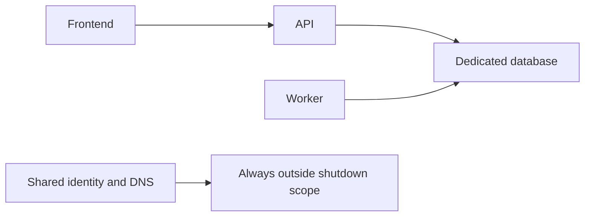

# Shut Down Idle Dev Environments and Verify They Can Start Again

Author: [nawazdhandala](https://www.github.com/nawazdhandala)

Tags: AWS, Cloud Automation, Cost Optimization

Description: Reduce idle development costs with explicit opt-in, reliable activity checks, dependency-aware shutdown, and verified startup before restoring traffic.

Low CPU usage does not mean a development environment is safe to stop. It might be waiting for a long-running test, processing a sparse queue, or hosting a database used by another team's environment. A shutdown job needs to understand ownership and dependencies as well as activity.

Start with an environment-level policy rather than a list of instances. Define which resources belong together, which are shared, how users opt out, and what proves the environment is usable after restart. A cost-saving workflow that cannot reliably start its environment again is unfinished.

This guide uses standalone, EBS-backed EC2 instances as its concrete compute example. Managed groups and databases need their own lifecycle adapters. The Python planner was tested locally; the cloud stop and start commands below were not executed.

## Require explicit eligibility and fresh evidence

Use `Environment=dev` and `AutoStop=true` as positive enrollment requirements. Allow `KeepRunning=true` as an immediate opt-out. The example treats unexpected opt-out values conservatively so a typo does not silently authorize shutdown. Restrict who can change these tags, and re-read them immediately before acting.

Store the environment owner, permitted schedule, timezone, expected wake-up time, and exemption expiry in a durable registry. A calendar schedule can nominate a candidate, but activity checks decide whether the candidate is idle now. Account for daylight-saving changes explicitly rather than assuming every local day has the same UTC boundary.

Combine request activity, active development sessions, deployment status, queue depth, running jobs, and database work. Define the observation window and acceptable age of each signal. Missing, delayed, or inaccessible metrics should hold the environment for review. An average CPU value near zero cannot prove the absence of a significant transaction.

Keep a recent-activity cooldown after startup or deployment. Record why each candidate was skipped so owners can distinguish a genuine opt-out from broken telemetry.

## Map dependencies before issuing stop requests

In this example, a frontend depends on an API, and both the API and a worker depend on a dedicated database. Arrows point from a component to something it needs:



Shutdown must drain entry points and stop dependents before their prerequisites. Startup reverses that relationship: establish the database first, then its clients, then open user traffic. Independent components do not need a fabricated ordering, but every dependency must be explicit.

Shared identity, DNS, secrets services, registries, and networking belong outside this example's shutdown set. Verify that they remain available during startup. If you find an unexpected external dependency, stop planning and review it instead of expanding deletion or shutdown scope automatically.

## Produce a plan that refuses ambiguous inputs

Python 3.11 includes [TopologicalSorter](https://docs.python.org/3.11/library/graphlib.html), which orders prerequisites before dependents and rejects cycles. This function produces a plan only; it does not call AWS:

```python
from graphlib import TopologicalSorter

def plan_environment(resources):
    if not resources:
        raise ValueError("No environment resources supplied")
    graph = {}
    for name, item in resources.items():
        tags = item.get("tags", {})
        if tags.get("Environment") != "dev" or tags.get("AutoStop") != "true":
            raise ValueError(f"{name}: explicit dev opt-in required")
        if tags.get("KeepRunning", "false") != "false":
            raise ValueError(f"{name}: opt-out or invalid opt-out value")
        for key in ("dedicated", "idle_verified", "restart_verified"):
            if item.get(key) is not True:
                raise ValueError(f"{name}: {key} is not verified")
        dependencies = set(item.get("depends_on", []))
        if not dependencies <= resources.keys():
            raise ValueError(f"{name}: dependency outside reviewed inventory")
        graph[name] = dependencies
    start = list(TopologicalSorter(graph).static_order())
    return {"start": start, "stop": list(reversed(start))}
```

Here `restart_verified` means the component has a previously rehearsed startup procedure. It does not claim the next startup has already succeeded. The Boolean inputs represent fresh, timestamped decisions from the inventory and activity checks; do not populate them with permanent hard-coded `True` values.

For a graph containing `db: []`, `worker: [db]`, `api: [db]`, and `frontend: [api]`, every valid start order places the database before both clients and the API before the frontend. The reverse order respects shutdown dependencies. A cycle means the lifecycle needs a more explicit bootstrap procedure; do not arbitrarily break it in the scheduler.

## Drain work and stop one reviewed resource at a time

Before the first stop, acquire an environment lease so a wake-up request and a scheduled shutdown cannot run concurrently. Recheck eligibility, capture current resource states, and persist the plan. Stop accepting new work, then wait for active work to finish using application-specific limits. If draining fails, hold the workflow rather than forcing every instance off.

After those checks, this is the source-verified AWS CLI 2.38.1 command shape for one standalone instance. Replace the profile, region, and identifier with a reviewed lab resource:

```bash
INSTANCE_ID=i-0123456789abcdef0
aws --profile dev-automation --region eu-west-1 ec2 stop-instances \
  --instance-ids "$INSTANCE_ID" --no-cli-pager
aws --profile dev-automation --region eu-west-1 ec2 wait instance-stopped \
  --instance-ids "$INSTANCE_ID"
```

These are real lifecycle operations when run. Keep them behind the planner and fresh checks; do not paste a broad account inventory into `--instance-ids`. The [StopInstances API](https://docs.aws.amazon.com/AWSEC2/latest/APIReference/API_StopInstances.html) normally attempts an operating-system shutdown. This example does not request force stopping or skipping that shutdown.

The [instance-stopped waiter](https://docs.aws.amazon.com/cli/latest/reference/ec2/wait/instance-stopped.html) polls for the stopped state. A timeout is an unresolved transition requiring inspection, not proof that the instance stayed running. Persist observed state and request evidence before deciding whether to retry.

## Account for service-specific consequences

AWS documents that [stopping an EC2 instance](https://docs.aws.amazon.com/AWSEC2/latest/UserGuide/Stop_Start.html) loses instance-store data and does not preserve RAM. EBS volumes remain, and a restarted instance can receive a new public IPv4 address. Verify that important data and discovery mechanisms survive these changes. Stopping compute also does not eliminate storage and other retained-resource costs.

Do not use the standalone-instance adapter for an Auto Scaling group. Its controller may replace instances or restore capacity. AWS provides a [standby lifecycle](https://docs.aws.amazon.com/autoscaling/ec2/userguide/as-enter-exit-standby.html), but desired-capacity and replacement behavior still need deliberate planning. Manage the group through its own reviewed workflow.

RDS is different again: eligible DB instances can be stopped temporarily, but AWS automatically starts them after seven consecutive days. Storage and other retained charges continue, and startup can take substantial time. Check engine and configuration restrictions in the [RDS stop documentation](https://docs.aws.amazon.com/AmazonRDS/latest/UserGuide/USER_StopInstance.html). Never advertise a permanent “off” state for that service.

## Make startup a tested workflow, not a reverse API loop

Start prerequisites first and verify each before releasing its dependents. For an EC2 component, request startup, wait for the appropriate instance state and health checks, then run an application-level probe. The [instance-status-ok waiter](https://docs.aws.amazon.com/cli/latest/reference/ec2/wait/instance-status-ok.html) checks the instance status field; it does not establish that your application can authenticate or complete a transaction.

Verify database connectivity, credentials, migrations, queue access, and an isolated read/write fixture where appropriate. Refresh discovery information if addresses changed. Bring up a controlled request path and confirm the full user journey before opening ordinary traffic or resuming scheduled writers.

Persist results per component. If the database starts but the API fails, leave the environment unavailable to users and report the actual partial state. Do not automatically stop a recovered database containing newly accepted writes as an improvised rollback. Use a reviewed recovery action for that state.

Finally, measure both savings and reliability: hours stopped, resources still billing, skipped shutdowns, wake-up duration, and failed probes. A successful run ends with either a confirmed stopped environment or a verified usable one, with an audit trail explaining every transition.
