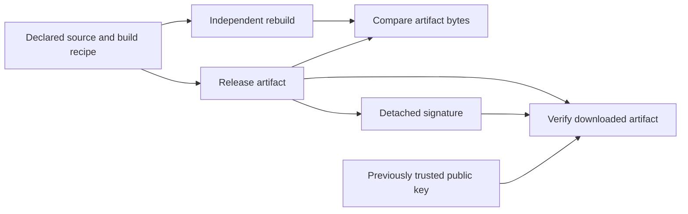

# Sign and Reproduce Open Source Releases Users Can Verify

Author: [nawazdhandala](https://www.github.com/nawazdhandala)

Tags: Open Source, Security, CI/CD

Description: Build a deterministic release archive, verify its detached signature, and explain the source, environment, and trusted-key evidence users need.

A download page offers an archive, a checksum, and a signature. Those files can help users verify a release, but only if the project explains what each check establishes and where trust begins.

A checksum detects changed bytes relative to an expected value. A signature connects bytes to a signing key. A reproducible build lets another party recreate the specified artifact from the declared source and environment. None of these independently proves that the software is free of vulnerabilities.

## Define the artifact and the claim

The Reproducible Builds project defines reproducibility in terms of identical output bytes from the same source, build environment, and instructions. Specify which outputs belong to that claim: a source archive, a platform binary, a package, or all of them. [Reproducible build definition](https://reproducible-builds.org/docs/definition/).

Record the exact source commit, dependency versions, build tools, flags, environment variables, and artifact names. A label such as “built on Linux” is too broad if compiler versions, system libraries, locale, or generated files affect the result.



Keep signatures outside the reproducibility comparison unless your declared build specifically includes them. Signing is a release-authorization step; it should not require every independent builder to possess the maintainer's private key.

## Start with a small deterministic packaging example

The following example packages two ordinary text files, `README.md` and `hello.py`, from a prepared source directory. It uses **Python 3.11.13** and deliberately produces an uncompressed ZIP. This demonstrates reproducible packaging, not reproducibility of an arbitrary compiler or dependency graph.

Archive metadata can change bytes even when file contents match. File order, timestamps, ownership, and permissions are common sources of variation. Choose intentional values rather than allowing the current machine to supply them. [Archive metadata](https://reproducible-builds.org/docs/archives/).

Save this as `package.py`, outside the source directory:

```python
from datetime import datetime, timezone
from pathlib import Path
import os
import sys
import zipfile

root = Path(sys.argv[1]).resolve()
output = Path(sys.argv[2]).resolve()
if output.is_relative_to(root):
    raise SystemExit('Place the output outside the source directory')
stamp = datetime.fromtimestamp(int(os.environ['SOURCE_DATE_EPOCH']), timezone.utc)
if not 1980 <= stamp.year <= 2107:
    raise SystemExit('Timestamp is outside the ZIP date range')
date = (stamp.year, stamp.month, stamp.day, stamp.hour,
        stamp.minute, stamp.second // 2 * 2)
names = ['README.md', 'hello.py']
for name in names:
    source = root / name
    if source.is_symlink() or not source.is_file():
        raise SystemExit('Expected an ordinary file: ' + name)
with zipfile.ZipFile(output, 'x', compression=zipfile.ZIP_STORED) as archive:
    for name in sorted(names):
        info = zipfile.ZipInfo(name, date_time=date)
        info.create_system = 3
        info.external_attr = 0o100644 << 16
        info.compress_type = zipfile.ZIP_STORED
        archive.writestr(info, (root / name).read_bytes())
```

The explicit file list prevents an accidental `.env` file or build log from entering this demonstration archive. Sorting stabilizes entry order; every entry gets the same declared timestamp and ordinary non-executable permissions. Symbolic links are rejected, and an existing output file is not overwritten. The code reads each listed file into memory, so keep this example to small, trusted, frozen inputs.

Python's `ZipInfo` exposes entry timestamps and attributes, while `ZIP_STORED` avoids a compression implementation becoming another input. Real projects needing executable files, links, or larger payloads should define and test those rules explicitly rather than silently copying this example's normalized metadata. [Python ZIP API](https://docs.python.org/3.11/library/zipfile.html).

Prepare two separate directories from the same reviewed source revision. Each must contain identical bytes for the two listed files. Use the same recorded epoch value for both builds:

```bash
export SOURCE_DATE_EPOCH=1735689600
python3.11 package.py /review/source-a /review/release-a.zip
python3.11 package.py /review/source-b /review/release-b.zip
cmp /review/release-a.zip /review/release-b.zip
```

The example epoch represents 1 January 2025 UTC. For your release, derive and record an appropriate source-related value rather than using the current time. `SOURCE_DATE_EPOCH` is a standard convention that cooperating tools consume; exporting it does not magically fix tools that ignore it. [SOURCE_DATE_EPOCH guidance](https://reproducible-builds.org/docs/source-date-epoch/).

`cmp` should return zero without output. Run each command separately and stop on failure. When bytes differ, inspect the archive entries and metadata before declaring the source content different. Preserve both outputs so the discrepancy can be explained.

## Sign the accepted bytes

The signature commands below use **OpenSSL 4.1.0**, with the RSA signing interface documented for OpenSSL 4.1. Check `openssl version`: on some systems the command named `openssl` is a different implementation.

For a disposable local exercise only, use a new private working directory and generate a throwaway key:

```bash
umask 077
openssl genpkey -algorithm RSA -pkeyopt rsa_keygen_bits:3072 -out lab-private.pem
openssl pkey -in lab-private.pem -pubout -out lab-public.pem
```

The first command creates a private RSA key; the second exports only its public part. This lab key is not encrypted and must not become a production release key or be committed to the project. A real release needs an established signing identity, controlled key custody, recovery arrangements, and a documented rotation process. [Key generation](https://docs.openssl.org/4.1/man1/openssl-genpkey/), [public-key export](https://docs.openssl.org/4.1/man1/openssl-pkey/).

After the reproducibility comparison and normal project tests pass, sign the accepted archive:

```bash
openssl dgst -sha256 -sign lab-private.pem \
  -out release.zip.sig /review/release-a.zip
```

This creates a detached signature: a separate file associated with those exact archive bytes. Any later repackaging requires another review and signature. Publish the accepted archive and signature together, with the source identity and reproduction instructions. [OpenSSL signing interface](https://docs.openssl.org/4.1/man1/openssl-dgst/).

## Give users a trusted verification path

A user can verify the downloaded artifact with the expected public key:

```bash
openssl dgst -sha256 -verify trusted-release-public.pem \
  -signature release.zip.sig release.zip
```

Replace the filenames with the downloaded artifact, its signature, and the already trusted release key. Expect `Verified OK` and a zero exit status. Treat a failed verification as a blocked installation, not a suggestion to bypass the check. [OpenSSL verification](https://docs.openssl.org/4.1/man1/openssl-dgst/).

The word “trusted” is essential. If an attacker replaces the archive, signature, and public key on the same download page, checking against that replacement key can succeed. Publish the expected key fingerprint through an independently authenticated project channel, or establish continuity from a previously trusted release identity. Explain how users learn about legitimate key rotation and compromised keys.

For a stable fingerprint of the public-key encoding, use:

```bash
set -o pipefail
openssl pkey -pubin -in trusted-release-public.pem -outform DER | openssl dgst -sha256
```

DER is a binary encoding that avoids superficial differences in PEM text formatting. The pipeline hashes the public key, not the release artifact. Compare that value with the project's trusted reference; do not treat the value generated from a newly downloaded key as its own proof of authenticity. [Public-key input and output formats](https://docs.openssl.org/4.1/man1/openssl-pkey/).

## Reproduction should challenge the release environment

Two builds in the same directory can agree because they share the same hidden inputs. Repeat in fresh directories, with intentionally different file modification times and permissions, and eventually on an independent builder using the declared environment. Disable unintended dependency downloads or pin their exact content. Record differences that remain part of the build contract.

For native binaries, investigate embedded paths, timestamps, dependency resolution, generated identifiers, archive ordering, and signing steps. A deterministic source ZIP does not show that the published executable came from that ZIP. Define a separate reproduction check for each promised binary.

Keep a compact release record: source commit, artifact digest, signing-key fingerprint, build recipe, tool versions, and the independent comparison result. A digest listed in an unauthenticated file is useful for accidental corruption detection but does not establish who approved the release.

The local exercise for this article produced identical ZIP bytes from two source directories with different timestamps and permissions. Signature verification succeeded for the original archive and failed after its bytes changed. Existing output paths, nested output paths, and symbolic-link inputs were rejected. These were local tests with Python 3.11.13 and OpenSSL 4.1.0; they were not an independent third-party build or a production signing ceremony. Publish that distinction alongside the verification steps so users know exactly which guarantees they can check.
