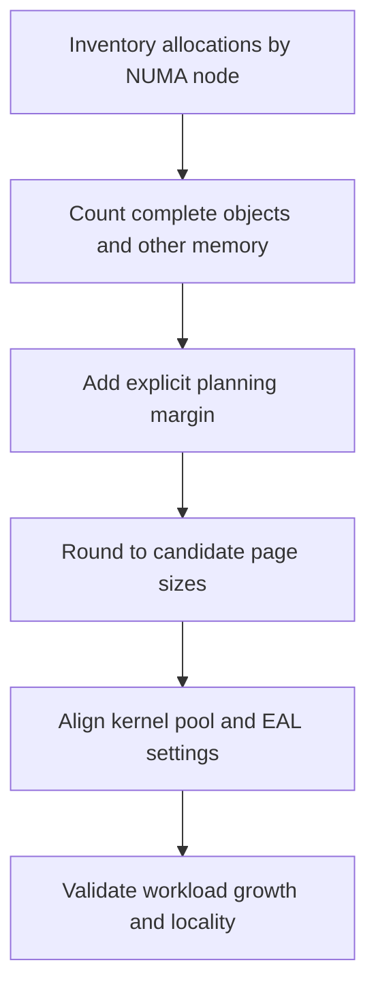

# Size DPDK Huge Pages Per NUMA Socket Without Wasting Memory

Author: [nawazdhandala](https://www.github.com/nawazdhandala)

Tags: DPDK, HugePages, Performance

Description: Build a per-node DPDK memory budget from object footprints and overhead, round it to page sizes, and align reservation with EAL preallocation and limits.

Reserving a large global huge-page pool can still leave a DPDK application short of usable memory. The pages may be on the wrong NUMA node, belong to a size the application does not use, or be unavailable to its process. Meanwhile, that reservation removes ordinary memory from other work.

A better capacity plan starts with the application's allocation locations and byte requirements, then translates those requirements into page counts. This guide uses **DPDK v24.11** semantics and a hypothetical two-node workload. The example numbers are planning inputs, not benchmark results or universal DPDK defaults.

## Map allocation locations before counting pages

NUMA describes memory locality within the machine. DPDK uses socket identifiers in several allocation interfaces and options; verify their relationship to the operating system's NUMA nodes. Do not substitute motherboard socket numbering or assume one physical package always equals one NUMA node.

On Linux, inspect the node CPU lists:

```bash
for file in /sys/devices/system/node/node[0-9]*/cpulist; do
    [ -r "$file" ] || continue
    printf '%s: ' "$file"
    cat "$file"
done
```

The [Linux node ABI](https://raw.githubusercontent.com/torvalds/linux/v6.12/Documentation/ABI/stable/sysfs-devices-node) defines these lists. Compare them with the application's worker placement, device locality, and the socket identifiers passed when creating pools. A CPU list alone does not tell you where every application object will be allocated.

Create a small inventory: pool name, allocation node, object count, effective object size, and supporting allocations. Shared pools should appear once, even if many workers use them. Separate independent process instances unless they deliberately share the same backing through a coordinated design.

## Budget complete objects and supporting allocations

Packet length is not the full size of a packet-buffer object. DPDK's [mbuf design](https://raw.githubusercontent.com/DPDK/dpdk/v24.11/doc/guides/prog_guide/mbuf_lib.rst) includes metadata and packet-data storage, with room before the data and possible multi-segment packets.

Mempool layout adds its own considerations. The [mempool guide](https://raw.githubusercontent.com/DPDK/dpdk/v24.11/doc/guides/prog_guide/mempool_lib.rst) describes alignment, padding, debug cookies, and per-core caches. Cached objects remain part of the pool's population; do not count their complete payload twice merely because they are temporarily held in caches.

Use the application's actual build and pool flags to determine footprint. The [rte_mempool_calc_obj_size API](https://raw.githubusercontent.com/DPDK/dpdk/v24.11/lib/mempool/rte_mempool.h) calculates per-object layout, but it does not turn object count into a complete application budget by itself. Include pool structures, rings, tables, driver allocations, alignment losses, and application state separately.

For this worked example, suppose the planning inventory is:

| Node | Objects | Effective bytes per object | Other allocation budget |
| --- | ---: | ---: | ---: |
| 0 | 262144 | 2560 | 384 MiB |
| 1 | 131072 | 2560 | 192 MiB |

The 2560-byte figure is an assumed effective footprint for the example, not the size of every mbuf. The “other” column is also an explicit assumption that must be replaced with your application's inventory.

## Round a byte budget to candidate page sizes

Save the inventory and a chosen 25% planning margin as `budget.json`:

```json
[
  {"node": 0, "objects": 262144, "object_bytes": 2560, "other_mib": 384, "margin_percent": 25},
  {"node": 1, "objects": 131072, "object_bytes": 2560, "other_mib": 192, "margin_percent": 25}
]
```

Save this arithmetic helper as `budget.py`:

```python
import json
import sys

rows = json.load(open(sys.argv[1], encoding='utf-8'))
print('node\tbase_MiB\tbudget_MiB\t2MiB_pages\t1GiB_pages')
for row in rows:
    values = [row[k] for k in ('node', 'objects', 'object_bytes', 'other_mib', 'margin_percent')]
    if any(type(v) is not int or v < 0 for v in values) or row['object_bytes'] == 0:
        raise SystemExit('Use nonnegative integers and a positive object_bytes')
    base = row['objects'] * row['object_bytes'] + row['other_mib'] * 1024**2
    budget = (base * (100 + row['margin_percent']) + 99) // 100
    small = (budget + 2 * 1024**2 - 1) // (2 * 1024**2)
    large = (budget + 1024**3 - 1) // 1024**3
    print(f"{row['node']}\t{base / 1024**2:.2f}\t{budget / 1024**2:.2f}\t{small}\t{large}")
```

Run:

```bash
python3 budget.py budget.json
```

It calculates the base budget, applies the margin using integer arithmetic, and rounds upward to whole pages. Expected results are:

| Node | Base MiB | Budget MiB | 2 MiB pages | 1 GiB pages |
| --- | ---: | ---: | ---: | ---: |
| 0 | 1024 | 1280 | 640 | 2 |
| 1 | 512 | 640 | 320 | 1 |

With 2 MiB pages, these particular budgets fit exactly. With 1 GiB pages, node 0 needs 2 GiB and node 1 needs 1 GiB, leaving 768 MiB and 384 MiB respectively beyond the calculated budgets. Larger pages may still have advantages, but the extra reserved capacity should be an explicit tradeoff.

This is a capacity estimate, not a proof that a mempool can be populated. Allocation shape, contiguous-I/O-address requirements, and driver constraints can make an apparently sufficient byte total unusable. Validate the actual application layout after sizing.

## Separate kernel reservation from EAL preallocation

The kernel pool supplies backing shared among eligible consumers. EAL preallocation obtains memory for a process. The [v24.11 memory guide](https://raw.githubusercontent.com/DPDK/dpdk/v24.11/doc/guides/prog_guide/env_abstraction_layer.rst) explains that dynamic mode can grow as allocations occur, while memory requested through startup preallocation remains retained by the application.

For the example, a possible EAL argument fragment is:

```text
--socket-mem 1024,512 --socket-limit 1280,640
```

This preallocates the example's base amounts and allows growth up to the selected per-node budgets in non-legacy mode. It is a fragment to incorporate into the application's real launch configuration, not a complete runnable command.

The [v24.11 option definitions](https://raw.githubusercontent.com/DPDK/dpdk/v24.11/doc/guides/linux_gsg/linux_eal_parameters.rst) distinguish preallocation from the limit. In particular, a zero entry in `--socket-limit` disables that node's limit; it does not prohibit allocation there. Confirm node indexing and mode before adapting the fragment.

A per-process cap also does not reserve capacity against another process. Account for other consumers and concurrent instances in the node's total plan.

## Apply targets only on a prepared node

The following commands are scoped to a dedicated staging worker with node IDs 0 and 1, no active huge-page consumers, and current 2 MiB pools no larger than these approved targets. Check those prerequisites and record existing pool counts before proceeding. From the DPDK v24.11 source tree:

```bash
sudo python3 usertools/dpdk-hugepages.py --node 0 --pagesize 2M --reserve 1280M
sudo python3 usertools/dpdk-hugepages.py --node 1 --pagesize 2M --reserve 640M
```

The [tagged helper source](https://raw.githubusercontent.com/DPDK/dpdk/v24.11/usertools/dpdk-hugepages.py) converts these quantities to 640 and 320 pages, writes target counts, and reads the result back. These are replacement targets, not increments. On a shared worker, incorporate existing consumers into a maintenance plan instead of issuing these example values.

The commands do not configure the application's hugetlbfs mounts or permissions. Verify those separately. If physical allocation cannot reach the target, investigate fragmentation and the node's available memory; do not assume a larger requested number will fix it. The [Linux HugeTLB guide](https://www.kernel.org/doc/html/v6.12/admin-guide/mm/hugetlbpage.html) describes allocation constraints and per-node pool controls.



## Validate peak behavior before calling the plan complete

Exercise the traffic pattern that drives the largest pool population, queue occupancy, and application state. Compare per-node usage with the budget, confirm allocation locality, and record failed allocation counts. Check latency and throughput as well as successful startup.

If usage grows beyond the initial model, identify the missing allocation category before increasing every pool. If a large part stays unused, verify whether it is required for bursts, retained startup allocation, or simply over-reservation. Keep ordinary-memory headroom for the host and other services in the same capacity review.

The budget helper produced the expected table and rejected an invalid object size. DPDK's reservation function was tested against ordinary temporary files to verify target-count conversion and rejection of non-page-multiple sizes. No Linux pool was changed and no DPDK workload or benchmark was run.
