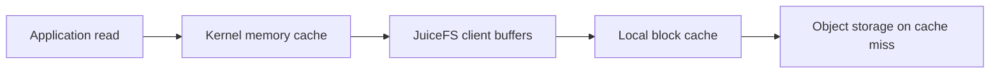

# Size and Place JuiceFS Local Cache Without Crowding Out the Host

Author: [nawazdhandala](https://www.github.com/nawazdhandala)

Tags: JuiceFS, Storage, Performance

Description: Choose a cache device and capacity for JuiceFS, understand free-space limits, and measure repeated reads without confusing disk cache with memory or write staging.

A larger JuiceFS cache is useful only when it holds data that the workload will read again and the cache device can serve it efficiently. Giving a client most of the root filesystem can instead turn a performance setting into a host outage.

This guide uses **JuiceFS Community Edition 1.4.2** and begins with a single Linux client using normal synchronous uploads. It focuses on `--cache-dir`, `--cache-size`, and `--free-space-ratio`. Writeback staging needs a separate durability budget and should not be enabled just to improve a read-cache experiment.

## Identify which cache you are sizing

JuiceFS has several layers that can make a repeated read faster. The kernel can retain file data in memory, the client has read/write buffers, and its local disk cache stores object blocks. These consume different resources.



`--cache-size` describes the local read-object cache. It is not a total process-memory limit, a filesystem quota, or a cap on all pending writeback data. `--buffer-size` controls a different in-memory resource. [Pinned mount options and configuration](https://github.com/juicedata/juicefs/blob/v1.4.2/cmd/mount.go).

That distinction matters when troubleshooting: high resident memory is not automatically fixed by shrinking disk cache, and a full staging directory is not simply disposable read data.

## Choose the device before choosing the number

Prefer a dedicated local device with enough throughput and latency performance for the workload. Confirm that the configured path is on that device after reboot. A missing data-disk mount can leave the same pathname on the root filesystem, silently changing your capacity assumptions.

Avoid placing cache inside the JuiceFS mount itself. Also avoid sharing a heavily used device with databases or other latency-sensitive services unless the combined capacity and I/O budget has been measured.

The pinned guide recommends a dedicated high-performance disk. It also notes that cached blocks are stored without compression or encryption by the cache layer. Protect directory permissions and consider host-volume encryption where required; object-storage encryption does not automatically protect these local copies. [JuiceFS cache placement and contents](https://github.com/juicedata/juicefs/blob/v1.4.2/docs/en/guide/cache.md#client-read-cache).

Small files can consume many local filesystem entries. Check available inodes as well as bytes. An inode is the filesystem's record for a file; a device can have free space but be unable to create another cache file when that record capacity is exhausted.

## Build a capacity budget with explicit headroom

Start with the usable filesystem capacity, then subtract other consumers, the free-space reserve, and an uncertainty allowance. Only the remainder is available for a read-cache target.

For example, suppose the filesystem reports 500 GiB, other users need up to 100 GiB, you reserve 20% of total capacity, and you keep another 50 GiB for growth and accounting differences. The resulting read-cache budget is 250 GiB:

```python
capacity_gib = 500
other_peak_gib = 100
free_ratio = 0.20
extra_headroom_gib = 50
budget_gib = capacity_gib * (1 - free_ratio) - other_peak_gib - extra_headroom_gib
if budget_gib <= 0:
    raise SystemExit("No safe read-cache budget remains")
print(f"Read-cache planning budget: {budget_gib:.0f} GiB")
```

This is a planning calculation, not the client's allocation algorithm. A commercial disk's advertised capacity is not the same as the filesystem's usable GiB. Use observed values and expected peak usage, not today's quiet-host usage.

Also measure the working set: the data repeatedly accessed within the useful reuse window. If jobs reread 40 GiB, a 250 GiB cache may add little benefit. If jobs scan new terabytes once, enlarging cache may mainly increase writes to the local disk.

## Understand the two limits

In this release, `--cache-size` accepts an unsuffixed MiB value or supported size suffixes. `--free-space-ratio` sets a minimum free-space ratio used by the cache manager. Both constrain caching; reaching a free-space threshold can reduce useful cache capacity before the configured size is reached.

Actual on-disk use can differ from the tracked object sizes, so neither setting is an exact byte reservation for other applications. The implementation also considers available inodes. When multiple cache directories are supplied, the configured read-cache size is divided among them rather than assigned in full to every directory. [Pinned disk-cache implementation](https://github.com/juicedata/juicefs/blob/v1.4.2/pkg/chunk/disk_cache.go).

Two directories on the same device do not provide twice the capacity or independent performance. Multiple clients sharing a filesystem also need a combined budget; a per-client flag does not reserve space against another process.

## Try an explicit single-device configuration

Provision a writable cache directory on the verified cache device and an empty mount point. Replace the metadata endpoint and password-file path with an existing tested volume configuration:

```bash
export META_PASSWORD_FILE=/etc/juicefs/meta-password
juicefs mount \
  --cache-dir /srv/juicefs-cache \
  --cache-size 256000 \
  --free-space-ratio 0.20 \
  rediss://juicefs@metadata.example.internal:6379/1 \
  /mnt/jfs
```

Here, 256000 MiB equals 250 GiB. The mount runs in the foreground; this example does not enable writeback. The Redis connection uses TLS and requires appropriate certificate trust. These options configure the client, not a shared volume-wide cache policy. [Metadata authentication guidance](https://github.com/juicedata/juicefs/blob/v1.4.2/docs/en/reference/how_to_set_up_metadata_engine.md).

Use the normal service configuration for a persistent deployment after the experiment. Do not start this command over an already-mounted directory or alongside an existing mount owner.

## Inspect the backing filesystem without filling it

This Python 3 probe reads filesystem accounting for an existing cache directory. It creates no files and does not inspect cached content:

```python
import os
from pathlib import Path

path = Path("/srv/juicefs-cache").resolve(strict=True)
s = os.statvfs(path)
gib = 1024 ** 3
print(f"Path: {path}")
print(f"Filesystem capacity: {s.f_blocks * s.f_frsize / gib:.1f} GiB")
print(f"Available to ordinary users: {s.f_bavail * s.f_frsize / gib:.1f} GiB")
print(f"Available file entries: {s.f_favail}")
```

These numbers describe the whole backing filesystem, not just JuiceFS. Compare them with cache metrics and other disk consumers. Filesystem accounting can differ for privileged users or quota configurations. [Python statvfs fields](https://docs.python.org/3/library/os.html#os.statvfs).

Record baseline application latency, object-download traffic, local-disk latency, available bytes, and inodes. Run a representative job once and repeat it. Do not clear shared caches or drop host page cache in production to manufacture a cold run; use an isolated test client when you need that comparison.

## Tune one bottleneck at a time

A faster second run may come from kernel memory rather than the disk cache. Correlate application improvements with client cache behavior and object traffic before attributing the gain to a capacity change.

If the cache fills and evicts repeatedly while useful data is reread, consider a larger measured working-set budget. If local disk latency rises during sequential reads, test device throughput and whether caching those reads is useful. If object traffic remains high, inspect access patterns before increasing capacity or prefetch concurrency.

Use client metrics together with host disk and filesystem metrics, keeping labels specific enough to distinguish mounts. [JuiceFS monitoring guidance](https://github.com/juicedata/juicefs/blob/v1.4.2/docs/en/administration/monitoring.md).

The arithmetic and read-only filesystem probe were tested locally, and the mount flags were verified against JuiceFS 1.4.2 help and source. No FUSE mount, cache-eviction experiment, disk-filling test, or performance benchmark was run here. Choose the final capacity from your own isolated workload measurements.
