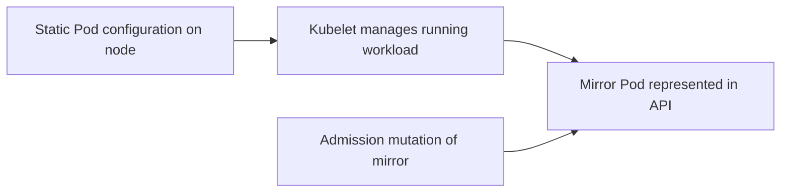

# Skip Static Mirror Pods in Kubernetes Mutating Webhooks

Author: [nawazdhandala](https://www.github.com/nawazdhandala)

Tags: Kubernetes, Automation, Security

Description: Exclude static mirror Pods from mutation, identify their real source of truth, and distinguish ineffective changes from valid admission targets.

A Pod visible through the Kubernetes API is not always controlled by the API object you are looking at. Static Pods are managed by the kubelet on a node. Their mirror Pods provide an API-visible representation, but editing that representation is not how you change the running static workload.

A mutating webhook that injects a container into every visible Pod can therefore target the wrong object. It may interfere with mirror creation without changing the node's actual workload. The right response is to recognize these objects and leave them outside the mutation contract.

This example targets **Kubernetes v1.35.0** and a webhook that supplies optional defaults during Pod creation. It is not a way to enforce host-level controls on static Pods.

## Follow the real source of truth



There is intentionally no arrow from the mirror object back to the static configuration. Change the node's reviewed static Pod configuration to alter that workload. Deleting a mirror object through the API does not stop the underlying static Pod; the kubelet attempts to recreate its representation. Kubernetes explains this separation in the [static Pod guide](https://kubernetes.io/docs/tasks/configure-pod-container/static-pod/).

Do not confuse these mirror Pods with normal Pods created by a Deployment or StatefulSet. A controller-created Pod is still an ordinary API-backed workload and can be an appropriate Pod CREATE mutation target. An owner reference alone is not a reason to skip mutation.

## Recognize the mirror annotation

Mirror Pods carry `kubernetes.io/config.mirror`. The v1.35.0 kubelet [mirror client implementation](https://github.com/kubernetes/kubernetes/blob/v1.35.0/pkg/kubelet/pod/mirror_client.go) copies the static Pod and adds this marker when creating the API representation.

Check for the annotation key's presence, not a specific hash value. The value changes with the underlying configuration and is not a fixed string to embed in a webhook. Namespace and Pod naming conventions are weaker signals: static workloads need not all share one namespace or name prefix.

Kubernetes' [webhook good practices](https://kubernetes.io/docs/concepts/cluster-administration/admission-webhooks-good-practices/#dont-change-immutable-objects) recommend avoiding mutations whose changes cannot affect the actual object. Skipping mirror requests before calling the webhook also avoids introducing an unnecessary availability dependency into mirror creation.

## Filter matching requests before the HTTP call

Merge this fragment into the relevant `webhooks[]` entry of your `MutatingWebhookConfiguration`:

```yaml
rules:
  - operations: ["CREATE"]
    apiGroups: [""]
    apiVersions: ["v1"]
    resources: ["pods"]
    scope: Namespaced
matchConditions:
  - name: not-a-static-mirror
    expression: >
      object != null &&
      (!has(object.metadata.annotations) ||
       !("kubernetes.io/config.mirror" in object.metadata.annotations))
```

This is not a full registration: retain the working endpoint, TLS trust, review versions, selectors, and other settings. If existing `matchConditions` are present, add this condition rather than discarding them.

CEL, the Common Expression Language, evaluates the incoming object. For an ordinary Pod with no annotations, the condition is true. If the mirror key is present, even with an empty value, the condition is false and the webhook is skipped. The null guard makes the intended input contract explicit, although the rules here only select CREATE requests.

The API server evaluates match conditions before calling the remote webhook. They are supported in the pinned Kubernetes version; the [admission matching documentation](https://kubernetes.io/docs/reference/access-authn-authz/extensible-admission-controllers/#matching-requests-matchconditions) describes false results and error handling. Keep an equivalent early guard in the handler if multiple registrations share the same endpoint or the handler may receive requests through another path.

## Do not turn a skip marker into an enforcement bypass

An annotation is object metadata, not proof of a trusted creator. For this optional-defaulting webhook, skipping the marker is acceptable because the mutation is not the sole enforcement mechanism for a security rule.

If you enforce a mandatory policy, review who can submit objects with this annotation and how the relevant admission controls treat them. NodeRestriction applies particular checks to node identities, but its presence does not establish a universal rule for every user. Inspect the [v1.35.0 NodeRestriction implementation](https://github.com/kubernetes/kubernetes/blob/v1.35.0/plugin/pkg/admission/noderestriction/admission.go) and your authorization model rather than assuming a reserved-looking annotation is unforgeable.

Keep security requirements on ordinary workloads in appropriate independent validation, and enforce static workload requirements in the node configuration process. Do not claim that a remote mutator can retroactively fix a static Pod already running from local configuration.

## Inventory existing mirror representations safely

With read access to Pods, save an inventory without modifying workloads:

```bash
kubectl get pods --all-namespaces -o json > pods.json
```

This uses documented [`kubectl get` options](https://kubernetes.io/docs/reference/kubectl/generated/kubectl_get/). Run the following Python 3.11 script beside that file:

```python
import json

with open("pods.json") as stream:
    inventory = json.load(stream)

for pod in inventory["items"]:
    metadata = pod["metadata"]
    annotations = metadata.get("annotations") or {}
    if "kubernetes.io/config.mirror" in annotations:
        print(
            metadata["namespace"],
            metadata["name"],
            pod.get("spec", {}).get("nodeName", "<unknown>"),
            sep="\t",
        )
```

Expect one tab-separated row per mirror representation: namespace, Pod name, and node. An empty result only means the saved inventory contains no marked objects. It does not prove that no static Pod runs on any node; an unsuccessful mirror creation can leave the workload absent from this inventory.

Use the node column to locate the owning configuration through your approved infrastructure inventory. Avoid editing control-plane static manifests as an exploratory step.

## Separate mirror objects from other unsuitable mutation targets

The same question helps with other resources: will this admitted change affect the real source of truth, and is the field legally mutable in this operation?

| Situation | Appropriate response |
|---|---|
| Static mirror Pod | Skip mutation; change the node-owned configuration through its rollout process |
| Ordinary new Pod | Mutate only the fields your contract owns |
| Existing Pod needing a new container layout | Review the owning template and replacement workflow |
| Immutable ConfigMap needing different data | Use a replacement/versioning workflow rather than changing immutable data |

Pod updates allow only particular changes; a CREATE injector should not casually extend to UPDATE. The [Pod update restrictions](https://kubernetes.io/docs/concepts/workloads/pods/#pod-update-and-replacement) describe that boundary. Similarly, immutable ConfigMaps protect their data, not every conceivable metadata change; see the [ConfigMap immutability documentation](https://kubernetes.io/docs/concepts/configuration/configmap/#immutable-configmaps).

Keep registration rules specific to the operations and resources the handler understands. A broad wildcard rule does not make an unsupported object meaningfully mutable.

## Verify both the skip and the remaining coverage

Test absent annotations, empty annotations, unrelated annotations, and mirror markers with empty and nonempty values. Ordinary fixtures should still match; marked fixtures should not. Test the handler guard separately from the registration filter if you implement both.

In staging, confirm that actual mirror creation succeeds without this webhook invocation and that ordinary application creation still receives its expected mutation. Do not use successful API mutation of a mirror as proof that a node workload changed. The useful outcome is an accurate API representation, an independent static workload lifecycle, and unchanged coverage for the objects the webhook really owns.
