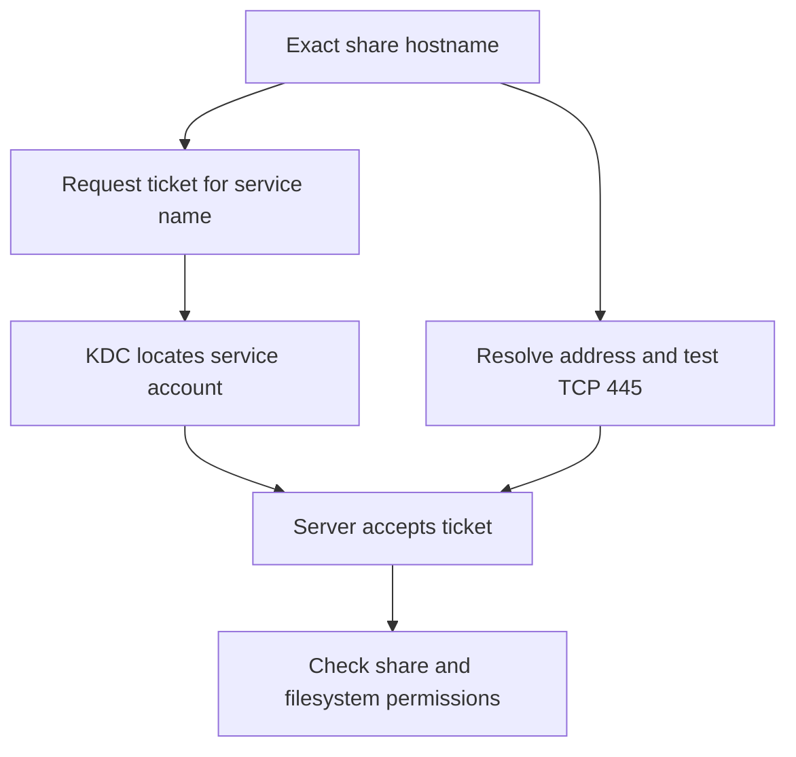

# SMB Works by IP but Not Hostname: Trace DNS and Kerberos

Author: [nawazdhandala](https://www.github.com/nawazdhandala)

Tags: SMB, Kerberos, Troubleshooting

Description: Diagnose hostname-only SMB failures by checking the selected address, service identity, ticket ownership, and actual authentication evidence.

A user can open `\\192.0.2.10\Projects`, but `\\files.example.com\Projects` fails. That comparison is useful, but it does not prove DNS is broken. Changing the address format can also change the authentication path.

This walkthrough targets domain-joined Windows clients accessing an Active Directory-backed SMB file server. SMB means Server Message Block, the file-sharing protocol. The examples use Windows Server 2025 command documentation and Windows PowerShell syntax. Replace the documentation addresses, names, domain, and share with your environment's values. Linux clients, appliances, and managed cloud file services need their own identity configuration procedures.

## Understand what the hostname adds

DNS finds an address. Kerberos authenticates a service identity through tickets issued by a domain controller's Key Distribution Center, or KDC. A service principal name, or SPN, identifies the service for that ticket; SMB commonly uses a name such as `cifs/files.example.com`.

By default, Windows does not attempt Kerberos when the target hostname is an IP address. Special IP-based SPN configuration exists, so IP access is not an absolute proof of NTLM. NTLM is another Windows authentication mechanism that may be available under the client's and server's policies. Confirm what happened instead of assuming it. [Kerberos over IP behavior](https://learn.microsoft.com/en-us/windows-server/security/kerberos/configuring-kerberos-over-ip).



A hostname can resolve correctly while its service identity points to the wrong account. Conversely, a valid ticket does not establish that the user may open the requested share. Microsoft's troubleshooting guidance distinguishes SMB negotiation, session authentication, and connecting to the share. [SMB failure stages](https://learn.microsoft.com/en-us/troubleshoot/windows-server/networking/negotiate-session-setup-tree-connect-fails).

## Capture one controlled reproduction

Record the exact share path, client, user, server, timestamp, and error text. Compare the IP path, the server's real fully qualified name, and the alias separately. A fully qualified name includes the DNS domain; a short name may be expanded differently on different clients.

Use a disposable test sign-in or test client where possible. Existing sessions and saved credentials can make the IP and hostname attempts use different identities. Inspect established connections:

```powershell
Get-SmbConnection |
    Select-Object ServerName, ShareName, UserName, Credential, Dialect, NumOpens
```

This reads the client's SMB connection inventory. It helps identify the account and existing open connections, but these columns do not prove Kerberos or NTLM was used. A failed new connection may not appear at all. Use an appropriately authorized Windows session if access is denied. [Get-SmbConnection](https://learn.microsoft.com/en-us/powershell/module/smbshare/get-smbconnection?view=windowsserver2025-ps).

Avoid deleting every mapped drive or purging every ticket on a working desktop to make the test “clean.” Those actions can interrupt unrelated work. Reproduce in a fresh test context and preserve the original evidence.

## Check where the name actually sends the client

On the affected Windows client, run:

```powershell
Resolve-DnsName -Name 'files.example.com' -Type A -DnsOnly
Resolve-DnsName -Name 'files.example.com' -Type AAAA -DnsOnly
Test-NetConnection -ComputerName 'files.example.com' -Port 445 -InformationLevel Detailed
Test-NetConnection -ComputerName '192.0.2.10' -Port 445 -InformationLevel Detailed
```

The DNS queries show IPv4 and IPv6 records without falling back to LLMNR or NetBIOS name resolution. An absent AAAA record can be normal in an IPv4-only design. Investigate unexpected records, old targets, and alias chains rather than treating every missing address family as a fault. [Resolve-DnsName](https://learn.microsoft.com/en-us/powershell/module/dnsclient/resolve-dnsname?view=windowsserver2025-ps).

Compare `RemoteAddress`, `SourceAddress`, and `TcpTestSucceeded` in the connection results. A successful TCP test demonstrates reachability to that selected address and port, not SMB authentication or access to the share. If the hostname selects another server or an unreachable IPv6 address, resolve that discrepancy before editing SPNs. [Test-NetConnection](https://learn.microsoft.com/en-us/powershell/module/nettcpip/test-netconnection?view=windowsserver2025-ps).

Repeat from the failing client, not only an administrator's workstation. Their resolvers, routes, and cached state may differ. If the real server name works but only the alias fails, preserve that distinction for the identity checks.

## Ask for the exact service ticket

In the same user logon context as the reproduction, inspect cached tickets and request the named service:

```powershell
klist tickets
klist get cifs/files.example.com
```

`klist get` is an active diagnostic: it requests a ticket and can add it to the cache. It does not alter SPNs in Active Directory. Keep the output and error code. A successful request proves that a ticket was obtainable, not that the target server accepted it or that the share authorized the user. [Windows klist reference](https://learn.microsoft.com/en-us/windows-server/administration/windows-commands/klist).

Do not silently switch to a different elevated account and interpret its ticket cache as the failing user's cache. Service processes can also run under a different logon session. If ticket acquisition fails, involve the identity administrator with the requested service name, user context, and time; domain-controller reachability and time synchronization also belong in that investigation.

## Check SPN ownership before changing it

From an elevated prompt on an authorized administrative Windows host with `setspn` available, query the forest for the exact alias and inspect the intended server account:

```powershell
setspn -F -Q cifs/files.example.com
setspn -F -Q HOST/files.example.com
setspn -L EXAMPLE\FS01
```

These commands query directory records. Replace `EXAMPLE\FS01` with the actual account responsible for serving this identity. It might be a cluster identity or appliance account rather than an individual machine.

Do not conclude that a missing explicit `cifs` record always means Kerberos must fail. Windows recognizes service-class mappings under `HOST`, including CIFS. Investigate both mappings and the actual ticket result. Multiple owners or an owner unrelated to the serving identity require directory review. [SPN query syntax and HOST mappings](https://learn.microsoft.com/en-us/windows-server/administration/windows-commands/setspn).

A common migration mistake is moving the DNS record to a replacement server while leaving the name's identity on the old account. The KDC and network can then agree on different servers. Preserve the old registration evidence and determine the intended owner before making changes; blindly adding another SPN can create a duplicate.

## Repair the supported alias configuration

For a standalone domain member file server, Microsoft recommends configuring an alternate computer name with `netdom computername` instead of treating a DNS CNAME alone as the complete configuration. Have the file-server and directory owners confirm that the alias is unclaimed and belongs to that computer before applying the documented procedure. [SMB alias guidance](https://learn.microsoft.com/en-us/troubleshoot/windows-server/networking/dns-cname-alias-cannot-access-smb-file-server-share).

The read-only inspection below lists registered names for the chosen domain computer:

```powershell
netdom computername FS01.example.com /enumerate:ALLNAMES
```

It requires the Windows AD DS tools or appropriate Remote Server Administration Tools and an elevated administrative prompt. This is not a general fix for a clustered name, NAS identity, or managed file service; use that product's supported naming workflow. [Netdom computername](https://learn.microsoft.com/en-us/windows-server/administration/windows-commands/netdom-computername).

Keep signing, encryption, and name validation requirements intact. Enabling NTLM or weakening server hardening can hide the identity error without correcting it.

## Prove the repaired authentication path

Repeat the same hostname access from a fresh controlled client context. Correlate server Security events with the test account, time, and available client identifiers. Where auditing is enabled, successful logon event 4624 includes authentication-package information; inspect relevant failure events as well. Do not label a connection Kerberos merely because a ticket exists in the client's cache. Microsoft's log-analysis procedure correlates client, server, and domain-controller evidence. [Kerberos log analysis](https://learn.microsoft.com/en-us/troubleshoot/windows-server/windows-security/kerberos-authentication-log-analysis-test-scenario).

If authentication succeeds but opening the share still fails, investigate the share name, share permissions, filesystem permissions, and required SMB features. Stop changing DNS once the evidence points to authorization.

The examples here passed local PowerShell syntax checks and documentation review; no Windows domain or SMB session was exercised. A successful repair record should show the intended address, correct service identity, accepted authentication, and authorized access through the hostname users actually depend on.
