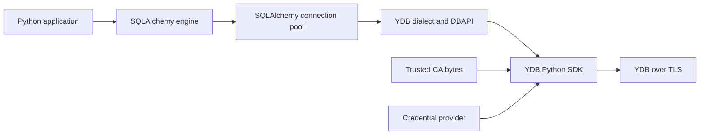

# Connect SQLAlchemy 2.0 to YDB with Explicit TLS and Credentials

Author: [nawazdhandala](https://www.github.com/nawazdhandala)

Tags: Python, Database, SQLAlchemy, Security

Description: Configure a YDB SQLAlchemy engine with the correct URL, explicit TLS trust, file-loaded credentials, bounded pooling, and a read-only connection probe.

A SQLAlchemy engine can be created successfully without connecting to a database. That is useful for configuration, but it also means a printed engine object is weak evidence that your YDB connection works. The URL might load the right dialect while the database path, TLS settings, or credentials are still wrong.

Build the configuration explicitly, then test the first connection and a small query as separate steps. This guide uses SQLAlchemy 2.0's synchronous API and avoids putting credentials in the URL.

## Pin the packages you are actually reviewing

The example was locally checked with Python 3.14.10 and these versions:

```text
SQLAlchemy==2.0.46
ydb-sqlalchemy==0.1.24
ydb-dbapi==0.1.24
ydb==3.35.0
```

Install them in a project environment using the accompanying [requirements.txt](./requirements.txt):

```bash
python -m venv .venv
. .venv/bin/activate
python -m pip install -r requirements.txt
```

These are a reviewed combination, not a claim that they are the latest releases. For a deployment lock file, also lock transitive dependencies for your platform. The YDB dialect's [tagged README](https://github.com/ydb-platform/ydb-sqlalchemy/blob/0.1.24/README.md) identifies its SQLAlchemy integration and connection conventions.

A dialect translates SQLAlchemy's database abstractions into the behavior of a particular backend. Here it sits above YDB's Python DBAPI adapter, which in turn uses the native SDK. Installing only SQLAlchemy does not install a YDB connection implementation.



## Understand what the URL specifies

The synchronous dialect name is `yql+ydb`. A typical local-development URL is `yql+ydb://localhost:2136/local`. It identifies the dialect, hostname, port, and database. It is not itself a `grpc://` or `grpcs://` endpoint string.

For a remote deployment, construct the URL rather than assembling it from unchecked text:

```python
from sqlalchemy import URL

url = URL.create(
    'yql+ydb',
    host='REPLACE_WITH_YDB_HOST',
    port=2135,
    database='Root/REPLACE_WITH_DATABASE',
)
```

Use the port supplied by the deployment owner. The database argument here excludes the leading slash used in the actual YDB database path. The tagged [dialect implementation](https://github.com/ydb-platform/ydb-sqlalchemy/blob/0.1.24/ydb_sqlalchemy/sqlalchemy/__init__.py) restores that leading slash when it builds DBAPI arguments.

For a cloud deployment, preserve the complete supplied database path rather than replacing it with a short display name. The engine helper below accepts the full path beginning with `/` and handles URL construction for you.

SQLAlchemy's [engine documentation](https://docs.sqlalchemy.org/en/20/core/engines.html) explains `URL.create` and `connect_args`. The first describes the database location; the second supplies additional driver arguments.

## Make TLS and credential choices explicit

The accompanying [engine_config.py](./engine_config.py) reads the CA file as bytes and the access-token file as text. Its central configuration is:

```python
return create_engine(
    url,
    connect_args={
        'protocol': 'grpcs',
        'root_certificates': root_certificates,
        'credentials': {'token': token},
    },
    poolclass=QueuePool,
    pool_size=4,
    max_overflow=0,
    pool_timeout=5,
    echo=False,
    hide_parameters=True,
)
```

`grpcs` explicitly selects the encrypted endpoint. The trusted certificate authority, or CA, lets the client authenticate the server's certificate chain. The token identifies the client to the database. These solve different problems: a valid token does not fix an untrusted server certificate.

The DBAPI adapter's [versioned connection implementation](https://github.com/ydb-platform/ydb-python-dbapi/blob/0.1.24/ydb_dbapi/connections.py) accepts `protocol`, credentials, and root certificate bytes and forwards them into the SDK's driver configuration. Do not guess a separate `yql+grpcs` dialect name.

The helper rejects an empty credential file, empty CA file, and missing database path. Those checks catch simple configuration mistakes; they do not validate certificate contents or token expiry. Do not solve a certificate error by removing trust verification.

For public CA trust, use a deliberate trust configuration appropriate to your SDK and deployment instead of blindly copying this internal-CA example. For a different authentication method, use the dialect's documented credential dictionary or SDK credential object. The [authentication examples](https://github.com/ydb-platform/ydb-sqlalchemy/blob/0.1.24/README.md#authentication) cover those alternatives. Do not supply several conflicting identities.

## Create once, borrow briefly, and dispose at shutdown

This example shows how to call the helper. All configuration values are placeholders except the illustrative port:

```python
from engine_config import build_engine, check_connection

engine = build_engine(
    host='REPLACE_WITH_YDB_HOST',
    port=2135,
    database='/Root/REPLACE_WITH_DATABASE',
    ca_file='/run/certs/ydb-root.pem',
    token_file='/run/secrets/ydb-access-token',
)
try:
    check_connection(engine)
finally:
    engine.dispose()
```

For this short diagnostic program, disposal belongs in `finally`. In a web service, retain the engine for the worker's lifetime, borrow a connection for each unit of work, and dispose during shutdown. SQLAlchemy documents these lifecycle distinctions in its [connection guide](https://docs.sqlalchemy.org/en/20/core/connections.html).

The probe uses `text('SELECT 1 AS probe')` and `scalar_one()`, then verifies that the result equals `1`. The connection context closes the borrowed connection even on failure. A successful probe establishes query execution under this configuration; it does not establish access to application tables or prove migration compatibility.

## Treat pooling as more than one layer

The illustrative SQLAlchemy pool permits four persistent DBAPI connections and no overflow. Its five-second `pool_timeout` limits waiting for a pooled connection; it is not a deadline for a query or the whole request. See SQLAlchemy's [pooling reference](https://docs.sqlalchemy.org/en/20/core/pooling.html).

There is also SDK session management underneath. In the reviewed DBAPI release, a connection without an externally supplied session pool constructs its own SDK driver and a session pool with size five. Therefore, four outer connections must not be described as a guaranteed four-session server limit. Review both layers before raising concurrency.

Multiply worker processes and replicas into the capacity budget. An engine created independently in each worker represents another set of resources. Do not share a live pooled connection across independent concurrent operations.

## Plan credential refresh rather than assuming it

This helper reads the token file once when building the engine. Replacing the file later does not update the token string already captured in its configuration. Use a supported refreshing credential provider where appropriate, or design a controlled engine replacement that lets active work finish before retiring the old engine.

Likewise, reading CA bytes once means later file changes do not magically replace those bytes. Test trust rotation and credential expiry as separate cases. Keep tokens out of exception reports and application logs; hiding SQL parameters is helpful but is not a complete secret-redaction policy.

During review, an SQLAlchemy connection event intercepted the final arguments before the DBAPI network call. The tests confirmed the host, port, restored database path, `grpcs` protocol, CA bytes, credential dictionary, and invalid-input checks. They used dummy files and never contacted YDB. A real TLS handshake, authentication exchange, and query remain required deployment checks.
