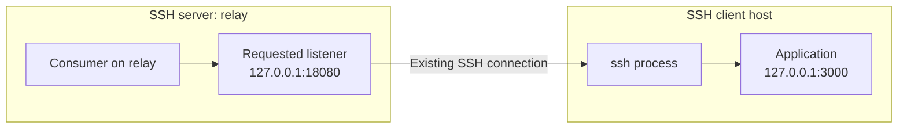

# SSH Remote Port Forwarding Failed: Bind Conflicts, GatewayPorts, and Policy

Author: [nawazdhandala](https://www.github.com/nawazdhandala)

Tags: SSH, OpenSSH, Remote Port Forwarding, GatewayPorts, Troubleshooting

Description: Diagnose SSH remote forwarding failures by separating server bind conflicts, requested listen addresses, forwarding permissions, and client-side destination failures.

An SSH login can succeed while its reverse tunnel fails. The message `remote port forwarding failed for listen port 18080` means the server rejected that forwarding request. It does not identify the cause: policy denial and socket setup failure produce the same client warning. This guide covers static TCP `-R` forwarding, checked against OpenSSH portable 9.9p1 and the OpenBSD 7.6 manuals; consult your packaged version for differences. [OpenSSH failure handling](https://github.com/openssh/openssh-portable/blob/V_9_9_P1/ssh.c#L1820), [server request handling](https://github.com/openssh/openssh-portable/blob/V_9_9_P1/serverloop.c#L703).

## Put each endpoint on the right host

For this example, the SSH client runs beside an application listening on port 3000:

```bash
ssh -vvv -N -S none \
  -o ExitOnForwardFailure=yes -o ForkAfterAuthentication=no \
  -R 127.0.0.1:18080:127.0.0.1:3000 tunnel@relay.example.net
```

Replace the account and relay with your intended endpoint. The requested listener is on the relay. The final connection to `127.0.0.1:3000` originates on the SSH client host. If the target were a hostname, the client would resolve it. [Remote forwarding syntax](https://man.openbsd.org/OpenBSD-7.6/ssh.1#R).



`-N` requests no remote command. `-S none` disables connection sharing for this attempt; it does not remove listeners belonging to an existing master. `ForkAfterAuthentication=no` keeps the attempt in the foreground even if configuration normally backgrounds it. Verify the server's bind policy below before assuming the requested loopback address is the actual listener.

## Account for every requested forward

Inspect the same invocation with `-G` replacing `-vvv`. It prints effective client configuration and exits. Look for every `remoteforward`, `localforward`, and `dynamicforward`, plus `hostname`, `user`, `port`, and `controlpath`. Existing configuration can add forwards beyond the command line. Configuration evaluation can execute existing `Match exec` commands, so review those when inspecting unfamiliar configurations. [Client configuration](https://man.openbsd.org/OpenBSD-7.6/ssh_config.5#Match).

Correlate the warning's port with that complete list. Two forwards with different targets can still compete for one server listen address and port. An existing multiplexed connection may already own the listener; an identical request through that master can also reuse an existing forward. The fresh connection above removes reuse from the experiment, but can consequently reveal contention with the old connection. [Multiplexed forwarding handling](https://github.com/openssh/openssh-portable/blob/V_9_9_P1/mux.c#L718).

## Inspect the listener on the server

On the Linux relay, inspect only the failed port:

```bash
ss -ltnp 'sport = :18080'
```

This selects listening TCP sockets with that local port. Process details may be unavailable to your account; ask the service owner to identify the listener when needed. Inspect the address column for IPv4, IPv6, loopback, and wildcard binds. [iproute2 socket inspection](https://github.com/iproute2/iproute2/blob/main/man/man8/ss.8).

Use server logs from the failed attempt to distinguish:

- **Address already in use:** identify the owning service or tunnel. Choose another permitted port or coordinate removal of a confirmed obsolete forward; do not kill unknown listeners.
- **Address unavailable:** a requested non-loopback address must be bindable on the server, in the daemon's network namespace. A public NAT address need not exist on the server's interfaces.
- **Permission denied:** check server privileges and host security policy. Privileged ports can require additional authority on the server; running the client with elevated privileges does not grant it. Use an approved high port for diagnosis.

A missing listener after failure does not prove permission denial. Address resolution, family availability, and socket errors can also prevent setup. OpenSSH can report success when one address-family listener succeeds despite another failing, so verify the actual sockets. Client `-4` does not configure the server's `AddressFamily`. [OpenSSH listener implementation](https://github.com/openssh/openssh-portable/blob/V_9_9_P1/channels.c#L3597).

## Interpret GatewayPorts precisely

The relevant `GatewayPorts` setting is in the server configuration:

| Server value | Effect on remote TCP listeners |
|---|---|
| `no` | Confines listeners to loopback; explicit `127.0.0.1` or `::1` selects that loopback family. |
| `yes` | Forces wildcard binding, including when the client requested loopback. |
| `clientspecified` | Honors the client's chosen address; an omitted address requests loopback. |

These are binding rules, not forwarding authorization. In particular, `GatewayPorts no` does not disable a normal loopback reverse tunnel. A non-loopback request can be reduced to loopback rather than rejected solely because this value is `no`. [GatewayPorts documentation](https://man.openbsd.org/OpenBSD-7.6/sshd_config.5#GatewayPorts), [address selection implementation](https://github.com/openssh/openssh-portable/blob/V_9_9_P1/channels.c#L3530).

Changing the value to `yes` can expose the service through additional interfaces and introduce wildcard conflicts. For an intentionally shared service, have the owner approve the specific address, access policy, and firewall rules; retain loopback for relay-local consumers.

## Check authorization and the exact listen token

Ask the daemon owner for the effective configuration for this account and connection, including `Include` files, applicable `Match` blocks, and service launch options. A global setting alone is insufficient.

`AllowTcpForwarding` must allow `remote` forwarding, or both directions with `yes`/`all`. `DisableForwarding yes` overrides forwarding allowances. `PermitListen` must permit the requested listen address and port. The server checks forwarding permission before attempting to bind. [Server permission checks](https://github.com/openssh/openssh-portable/blob/V_9_9_P1/serverloop.c#L712).

The listen token matters:

```text
-R 18080:127.0.0.1:3000            requests localhost:18080
-R 127.0.0.1:18080:127.0.0.1:3000  requests 127.0.0.1:18080
```

Thus `PermitListen 127.0.0.1:18080` does not authorize the first spelling. Align the request with the intended allowance instead of broadening it to `any`. [PermitListen semantics](https://man.openbsd.org/OpenBSD-7.6/sshd_config.5#PermitListen).

Also inspect restrictions on the authentication credential actually accepted. `no-port-forwarding` denies forwarding; `restrict` disables it unless `port-forwarding` re-enables that capability. A key's `permitlisten` can narrow allowed listeners further. Re-enabling forwarding on a key does not override server restrictions. [Authorized-key options](https://man.openbsd.org/OpenBSD-7.6/sshd.8#AUTHORIZED_KEYS_FILE_FORMAT).

Server `PermitOpen` and key `permitopen` govern destinations for client-local forwarding, not this remote listener. Client `PermitRemoteOpen` governs destinations for remote SOCKS forwarding, not the fixed target of this static `-R` example. [Key destination restrictions](https://man.openbsd.org/OpenBSD-7.6/sshd.8#permitopen), [PermitRemoteOpen](https://man.openbsd.org/OpenBSD-7.6/ssh_config.5#PermitRemoteOpen).

## Verify the application after setup succeeds

`ExitOnForwardFailure=yes` exits when requested forwarding setup fails. It does not test whether the final application accepts connections. Once the expected listener exists, check the application from the SSH client host, then exercise the tunnel from an intended consumer on the relay. A refused connection to port 3000 belongs to that later stage; changing listener policy will not repair it. [ExitOnForwardFailure behavior](https://man.openbsd.org/OpenBSD-7.6/ssh_config.5#ExitOnForwardFailure).
