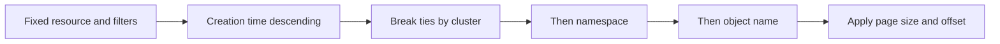

# Build Stable Multi-Field Sorts for Clusterpedia Pagination

Author: [nawazdhandala](https://www.github.com/nawazdhandala)

Tags: Kubernetes, Multi-Cluster, Database

Description: Preserve Clusterpedia sort precedence with explicit URL parameters, add identity tie-breakers, and understand what stable ordering cannot guarantee.

A paginated list can repeat or omit objects when its order is ambiguous. Sorting by creation time alone is not enough: multiple objects can share that timestamp, and the database still needs a way to order the ties.

Clusterpedia adds another detail worth checking. In **v0.9.0**, the multi-field sorting shortcut expressed as a label-selector set does not reliably preserve the sequence you typed. For pagination where field precedence matters, use the explicit `orderby` URL parameter and keep it unchanged across requests.

This guide targets the **v0.9.0 internal storage backend**. Local tests exercised the actual API-option conversion code. A separate SQLite fixture illustrates ordering and offset behavior; it is not a Clusterpedia database integration test.

## Define the ordering contract before choosing syntax

Suppose you need the newest Pods across selected members. Start with a fixed resource endpoint, then choose a primary key and tie-breakers:

| Position | Field | Direction | Purpose |
| --- | --- | --- | --- |
| 1 | `created_at` | Descending | Newest objects first |
| 2 | `cluster` | Ascending | Separate member clusters |
| 3 | `namespace` | Ascending | Separate namespaces within a member |
| 4 | `name` | Ascending | Resolve remaining ties for Pods |

For one resource endpoint, cluster, namespace, and name identify the current object slot. A name can later refer to a recreated object, so retain the object's UID when reconciling identities between observations.

Do not blindly reuse this key for a mixed-resource collection. Two different resource types can have the same cluster, namespace, and name. The tie-breakers must be unique within the actual result domain, using fields supported by that endpoint and storage layer.



This represents precedence: later fields decide order only when earlier values tie. The [Clusterpedia sorting documentation](https://clusterpedia.io/docs/usage/search/multi-cluster/#sorting-by-multiple-fields) lists the internal-storage fields, including `cluster`, `namespace`, `name`, `created_at`, and `resource_version`.

## Avoid unordered selector sets for precedence

The documented selector form looks convenient:

```text
search.clusterpedia.io/orderby in (created_at_desc,cluster,namespace,name)
```

Treat this as an explanation of the pitfall, not the recommended pagination command. In the tagged [API conversion implementation](https://github.com/clusterpedia-io/clusterpedia/blob/v0.9.0/staging/src/github.com/clusterpedia-io/api/clusterpedia/v1beta1/conversion.go), selector requirements are read with `Values().UnsortedList()` before being converted to ordering fields.

The underlying Kubernetes [set implementation](https://github.com/kubernetes/apimachinery/blob/v0.31.2/pkg/util/sets/string.go) does not promise an ordered result for that method. A selector set expresses membership, which is different from the precedence needed by a multi-column sort.

A local test ran the same label-derived conversion one hundred times and observed four order sequences. The corresponding direct `OrderBy` option preserved the intended sequence in one hundred conversions. These are parser-level results; they do not measure database execution or imply that every installation will exhibit exactly four sequences.

Single-field sorting does not have the same precedence ambiguity, but use one consistent URL-based approach for a paginated client. Do not combine a competing sort selector with the explicit parameter.

## Send one explicit ordered query

Use an ordinary hosting-cluster context with the full Clusterpedia API prefix. Replace `HOST_CONTEXT` and the illustrative member names. The Pod resource must already be synchronized.

```bash
kubectl --context HOST_CONTEXT get \
  --raw='/apis/clusterpedia.io/v1beta1/resources/api/v1/pods?clusters=member-a,member-b&limit=20&withContinue=true&orderby=created_at%20desc,cluster,namespace,name'
```

The `%20` encodes the space in `created_at desc`. For the URL form, direction is written as a space followed by `desc`; `_desc` belongs to the selector shortcut. The surrounding single quotes protect the entire URL from shell interpretation.

This raw request returns one page and, when supplied by the server, its next offset. Request the next page with the same endpoint, clusters, page size, and `orderby` value, adding the returned `continue` parameter. Do not change directions midway through an existing sequence.

The [internal-storage query construction](https://github.com/clusterpedia-io/clusterpedia/blob/v0.9.0/pkg/storage/internalstorage/util.go) adds ordering fields in their supplied sequence and does not set a default order for performance reasons. An unspecified order should therefore never be the foundation of a stable paginated view.

## Encode query parameters rather than assembling them casually

For a small Python3 client helper, build the URL from a fixed ordering policy:

```python
from urllib.parse import urlencode

params = {
    "clusters": "member-a,member-b",
    "limit": 20,
    "withContinue": "true",
    "orderby": "created_at desc,cluster,namespace,name",
}
path = "/apis/clusterpedia.io/v1beta1/resources/api/v1/pods"
print(path + "?" + urlencode(params))
```

This prints an encoded path for the same query. It makes the space and comma handling explicit and avoids accidental changes to the field sequence. It does not send a request or authenticate to the hosting API.

If a UI allows sorting choices, map them to a small reviewed set of supported field/direction combinations. Do not pass arbitrary database expressions from a text box into `orderby`. Also reset the page offset when the user changes a filter or sort. An offset belongs to its original query, not to every possible ordering of the data.

## Test ties, not just a happy-path list

A useful acceptance fixture should include Pods from two members with the same namespace and name, plus several objects with identical creation timestamps. Insert or synchronize them in different orders, then check that the explicit full key produces the same identity sequence.

Compare a complete small result with the concatenation of its pages while the fixture is unchanged. Check actual identities, not just counts: two pages can have the expected combined count while repeating one object and missing another.

For the local illustration, two SQLite tables received identical rows in opposite insertion orders. Ordering by creation time plus cluster, namespace, and name produced the same sequence in both. Paging that unchanged sequence reproduced the complete result. This verifies the fixture's ordering contract, not the SQL emitted by Clusterpedia.

If a timestamp is absent or null in another resource domain, decide where those rows should appear and test your actual backend. Avoid assuming PostgreSQL and MySQL have identical null ordering or collation rules. Names are a practical tie-breaker for the scoped Pod example, not a universal database portability guarantee.

## Stable order still is not a snapshot

Offset pagination over changing data can skip rows even with a complete sort key. For example, after reading the first two rows, deleting the first row shifts the remaining rows left. Continuing at offset two now starts later in the original sequence.

The SQLite fixture reproduced that shift: a row not present in the first page was skipped after an earlier row was deleted. Adding more tie-breakers cannot prevent this because the dataset itself changed.

For a browsing interface, document that pages reflect a changing stored view. For a completeness-sensitive export, define a reconciliation or snapshot strategy appropriate to your system, retain UIDs, and detect repeated or missing identities. Avoid presenting `resource_version` as a fleet-wide transaction boundary; it is not a substitute for a cross-cluster snapshot contract.

Keep four pieces of evidence together: the resource endpoint, filters, exact ordered field list, and page offsets. That makes unexpected results reproducible and separates an ordering defect from synchronization delay, concurrent writes, or a change in the query itself.
