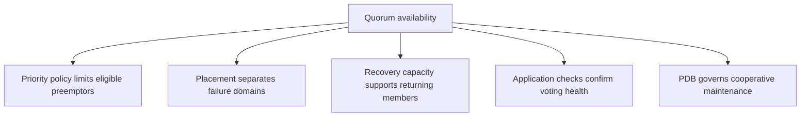

# Protect Stateful Quorums When Preemption Can Violate a PDB

Author: [nawazdhandala](https://www.github.com/nawazdhandala)

Tags: Kubernetes, High Availability, StatefulSet

Description: Protect quorum-based services with reviewed priorities, failure-domain placement, recovery headroom, and application health checks beyond disruption budgets.

A three-member stateful service has a disruption budget requiring two healthy Pods. One member is already unavailable. A higher-priority workload then preempts another member, leaving the service without a majority. The budget described the desired availability, but it did not make the scheduler incapable of violating it.

Protecting a quorum requires several layers: sensible priorities, controlled access to those priorities, placement across failure domains, and capacity for a recovering member. A PodDisruptionBudget (PDB) still helps with cooperative maintenance, but it is not the entire availability design.

This article uses **Kubernetes 1.34.0** scheduling and policy semantics. Its majority examples resemble systems such as **etcd 3.6**; apply your actual database's voting and membership rules rather than assuming every stateful service uses the same quorum model.

## Count voting members, not just replicas

For a fixed majority-voting membership of three, two voters must communicate to make progress. With five voters, three are required. The [etcd failure-tolerance FAQ](https://etcd.io/docs/v3.6/faq/#what-is-failure-tolerance) explains this majority relationship and why adding a fourth member does not increase tolerated failures over a three-member cluster.

A StatefulSet replica count is not proof of voting membership. A new process might still be joining, restoring data, or catching up. A Pod can be running while its database member cannot participate effectively. Conversely, a readiness probe may reflect client-serving policy rather than the precise voting state.

| Three-voter scenario | Available voters | Remaining margin before majority loss |
|---|---:|---:|
| All healthy and communicating | 3 | One voter |
| One voter unavailable | 2 | None |
| Another voter removed during recovery | 1 | Majority already lost |

Count network partitions and storage failures as well as terminated Pods. Two Pods displayed as ready do not establish that they can communicate with each other across a broken network path.

## Keep a budget, but describe its boundary

For an existing three-voter service whose Pods carry the exact label `app: ledger-quorum`, this example requires two healthy selected Pods for the budget calculation:

```yaml
apiVersion: policy/v1
kind: PodDisruptionBudget
metadata:
  name: ledger-quorum
  namespace: stateful-test
spec:
  minAvailable: 2
  selector:
    matchLabels:
      app: ledger-quorum
```

This is a policy example, not a database deployment. The namespace and workload must already exist. Verify that the selector matches only the intended members, and that the application's readiness signal is useful for maintenance decisions. The [PDB configuration guide](https://kubernetes.io/docs/tasks/run-application/configure-pdb/) explains how selection and availability affect the budget.

Use an integer here to make the three-member example explicit. Revisit the budget when membership changes; do not leave `minAvailable: 2` unchanged after expanding a majority-voting cluster to five members.

The [default preemption implementation](https://github.com/kubernetes/kubernetes/blob/v1.34.0/pkg/scheduler/framework/plugins/defaultpreemption/default_preemption.go) tries to preserve PDB-violating victims, but the preference can lose to scheduling feasibility. Setting `minAvailable: 3` does not create preemption immunity; it mainly makes cooperative disruptions more restrictive.

## Place the service above work that should yield

Review the numeric priorities of every admitted member and the workloads that can compete for the same nodes. Ordinary batch work should not outrank a service whose interruption affects many clients merely because a team chose a larger number.

A controlled priority hierarchy can prevent lower-priority workloads from selecting these members as victims under the default scheduler. Equal-priority Pods are also outside the ordinary lower-priority victim set. Higher-priority workloads remain a risk, including legitimate system workloads.

Restrict who may use elevated classes, not only who may create them. A tenant able to reference an existing high-priority class can undermine the intended hierarchy. Pair admission controls with resource quotas where appropriate; Kubernetes documents [PriorityClass-scoped quotas](https://kubernetes.io/docs/concepts/policy/resource-quotas/#resource-quota-per-priorityclass).

`preemptionPolicy: Never` does not make a database member unpreemptable. It controls whether that Pod initiates preemption against others. Review it on competing work that should wait for capacity rather than treating it as a protective flag for the quorum members.

## Separate correlated failures

Three voting Pods on one node have three identities but one obvious node-failure domain. Three nodes sharing a single zone can still fail together. Choose the failure domains according to the outage you intend to survive, then verify the actual placement.



Hard anti-affinity can enforce separation, but it can also leave a replacement pending when there is no eligible spare domain. Topology spread has different balancing semantics. Kubernetes' [placement documentation](https://kubernetes.io/docs/concepts/scheduling-eviction/assign-pod-node/#inter-pod-affinity-and-anti-affinity) describes those constraints; test the rule against a failed-node scenario, not just an initially healthy cluster.

Avoid widening placement by changing labels that do not reflect physical reality. A mislabeled node does not provide independent power, networking, or storage simply because the scheduler sees a different domain value.

## Budget for recovery, not just steady state

A replacement may require a node in the volume's supported zone, sufficient requested memory, image availability, and time to recover its data. Free CPU elsewhere in the cluster may not help.

The [StatefulSet documentation](https://kubernetes.io/docs/concepts/workloads/controllers/statefulset/) describes stable identity and storage relationships. Those properties help preserve a member's identity, but they do not guarantee immediate storage attachment, successful database recovery, or restored quorum participation.

Reserve enough suitable capacity to recover without displacing another essential member. Also verify the capacity and health of shared dependencies such as storage controllers, DNS, and the network. A member cannot rejoin safely if the dependency needed for its recovery is itself repeatedly preempted.

## Inspect both Kubernetes and application health

These read-only commands provide the Kubernetes view. Replace context, namespace, and selector with your environment:

```bash
kubectl --context staging -n stateful-test get pods -l app=ledger-quorum \
  -o custom-columns='NAME:.metadata.name,UID:.metadata.uid,NODE:.spec.nodeName,PRIORITY:.spec.priority'
kubectl --context staging -n stateful-test get pdb ledger-quorum -o yaml
kubectl --context staging get nodes -L topology.kubernetes.io/zone
```

Join the node names to failure domains and inspect the PDB's selected count and healthy count. Then use the database's documented membership and health tools to confirm the voting set, communication, and recovery progress. Do not infer application quorum solely from the PDB's `currentHealthy` field.

Rehearse one unavailable member in an isolated staging deployment. Confirm that routine competing work cannot preempt the remaining members under the approved priority policy, and that recovery capacity exists. Include the case where storage or a zone is unavailable. Avoid forcing membership changes or rebuilding members merely to make a dashboard green.

The PDB example passed Kubernetes 1.34.0 schema validation, shell syntax was checked, and quorum arithmetic and source behavior were reviewed. No live quorum, preemption, database recovery, or failure-domain test was performed. Treat a lost member as consumed failure margin and defer additional planned disruption until application-level health confirms that margin has returned.
