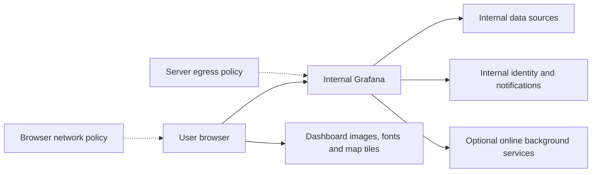

# Stop Grafana Internet Requests in an Air-Gapped Network

Author: [nawazdhandala](https://www.github.com/nawazdhandala)

Tags: Air-Gapped, Grafana, Monitoring, Networking

Description: Disable Grafana's optional online features, inspect server and browser traffic, and verify dashboards work with only approved internal destinations.

A firewall can prevent Grafana from reaching the Internet while Grafana continues trying to reach it. Those failed attempts can leave repeated errors, delayed plugin startup, or missing dashboard resources. The useful goal is therefore twofold: enforce your network boundary and remove the unwanted dependencies that keep hitting it.

This guide checks settings against **Grafana 13.3.1**. Apply them to a staging instance first and compare with your installed release. There is no single setting that makes every plugin, dashboard, authentication provider, and notification integration operate offline.

## Separate the server from the browser

Grafana has at least two relevant network viewpoints. The server runs queries, loads plugins, and performs background work. The browser displays dashboards and may fetch resources referenced by panels. A server-side firewall does not control a user's browser on another machine.



Start with a destination register. For each connection, record its source, destination, reason, owner, and offline replacement. Classify a destination by its actual routing and ownership rather than assuming every private IP is approved or every public-looking hostname leaves the organization.

| Traffic to investigate | Typical initiating component | Desired decision |
| --- | --- | --- |
| Version checks and usage reporting | Grafana server | Disable optional online work |
| Plugin downloads and verification-key retrieval | Server or deployment startup process | Stage artifacts; use reviewed offline verification |
| Fonts, logos, images, and map tiles | Browser or renderer | Serve internally or remove the dependency |
| Queries and authentication | Server and sometimes browser | Keep approved internal services reachable |
| Notifications and image rendering | Server and supporting services | Test the entire internal delivery path |

## Disable the built-in optional requests

Merge this fragment into the active configuration for the reviewed release. For a Linux package installation that usually means `/etc/grafana/grafana.ini`; containers commonly receive equivalent configuration through mounted files or environment variables. Preserve unrelated authentication, database, and security settings.

```ini
[analytics]
reporting_enabled = false
check_for_updates = false
check_for_plugin_updates = false

[plugins]
preinstall_disabled = true
public_key_retrieval_disabled = true
public_key_retrieval_on_startup = false
plugin_admin_enabled = false

[security]
disable_gravatar = true

[news]
news_feed_enabled = false

[server]
cdn_url =
```

The analytics settings disable usage reporting and version checks. The plugin settings disable automatic preinstallation and remote verification-key retrieval, and hide plugin installation controls. Gravatar profile images and the news section are disabled; the empty CDN URL avoids configuring an external content delivery network for Grafana assets. These keys are present in the [tagged Grafana 13.3.1 defaults](https://github.com/grafana/grafana/blob/v13.3.1/conf/defaults.ini).

Disabling public-key retrieval preserves plugin signature verification using Grafana's embedded key. Merely setting `public_key_retrieval_on_startup = false` leaves periodic retrieval possible when retrieval is otherwise enabled. Review the [configuration reference](https://grafana.com/docs/grafana/latest/setup-grafana/configure-grafana/#public_key_retrieval_disabled) and test each approved plugin with the exact Grafana build you deploy. Do not resolve signature failures by allowing unsigned plugins.

This fragment is a baseline for optional built-in behavior. Hiding plugin administration controls is not a network enforcement mechanism, and it does not prove the catalog UI or a third-party plugin cannot issue requests.

## Audit configuration outside this file

A correct file can be overridden by another configuration layer. For example, `GF_ANALYTICS_REPORTING_ENABLED=true` in the deployment environment defeats the corresponding file setting. Inspect the effective deployment definition, service environment, startup arguments, and mounted configuration. Avoid dumping complete environment variables into a ticket: they can contain credentials.

Check these sources separately:

- **Startup installation:** remove public plugin URLs and unversioned plugin installation lists from Helm values, container entrypoints, and initialization Jobs. Pre-stage approved plugin files or images.
- **Optional analytics integrations:** review any configured Google Analytics, RudderStack, Application Insights, or other analytics destinations. The basic reporting switch does not document a universal off switch for separately configured integrations.
- **Authentication:** inspect login, token, discovery, and key endpoints. A locally hosted Grafana instance can still depend on a hosted identity provider.
- **Data sources and notifications:** replace required hosted endpoints with approved internal services, including authentication and certificate trust.
- **Edition-specific services:** check license-related behavior and enabled features in your actual edition. Do not apply an Enterprise-only setting to an open-source deployment and assume it enforces a policy.

For Kubernetes, include sidecars and init containers in the audit. A container downloading dashboards can make public requests before Grafana starts. Changing Grafana's settings cannot stop a different process from doing that work.

## Review dashboard resources

Open representative dashboards with a clean browser profile. Include panels that show images, custom HTML, maps, and third-party visualizations. Check exported dashboard definitions for external resource URLs, then confirm behavior in the browser: URLs assembled by plugin code may not be obvious in dashboard JSON.

Map tiles deserve particular attention. A map may display correctly on a connected workstation because its background layer comes from a public provider. Configure an approved internal tile service or a suitable local layer. Grafana documents configurable map layers in its [Geomap guide](https://grafana.com/docs/grafana/latest/visualizations/panels-visualizations/visualizations/geomap/). Do not bulk-copy third-party map data without checking its licensing and distribution terms.

Repeat the review in any image-rendering service used for reports or alert screenshots. The renderer is another browser with its own network access, caches, and certificate store. A working dashboard on your laptop does not prove screenshots work inside the isolated environment.

## Capture browser evidence without exposing full URLs

In Chrome DevTools, open Network before loading Grafana, enable Preserve log, and disable cache while DevTools is open. Exercise fresh login, dashboard loading, refresh, time-range changes, and relevant plugin pages. Use the request initiator information to trace unexpected destinations to a panel or script. Chrome's [network inspection guide](https://developer.chrome.com/docs/devtools/network/) explains these controls.

Export a sanitized HAR file named `grafana-session.har` using the [Network export controls](https://developer.chrome.com/docs/devtools/network/reference/#save-as-har). HAR means HTTP Archive: a structured record of browser requests. Even a sanitized export can contain application data or URLs with sensitive parameters, so keep it in the approved review location.

This Python 3 script prints only destination hostnames and counts. Replace the example allowlist with your approved browser destinations:

```python
import json
from collections import Counter
from urllib.parse import urlsplit

approved = {"grafana.internal.example", "login.internal.example"}
with open("grafana-session.har", encoding="utf-8") as stream:
    capture = json.load(stream)

hosts = Counter()
for entry in capture["log"]["entries"]:
    url = urlsplit(entry["request"]["url"])
    if url.scheme in {"http", "https", "ws", "wss"} and url.hostname:
        hosts[url.hostname.lower().rstrip(".")] += 1

for host, count in sorted(hosts.items()):
    verdict = "approved" if host in approved else "REVIEW"
    print(f"{verdict:8} {count:5} {host}")
```

The script uses Python's standard [URL parser](https://docs.python.org/3/library/urllib.parse.html). `REVIEW` means the hostname is absent from your explicit list; it does not automatically mean the request crossed the Internet. Conversely, an approved hostname could redirect to another destination, so inspect all captured requests.

A HAR captures browser activity within its recording scope. It does not prove the absence of server traffic, DNS queries, or requests from another browser process.

## Verify enforcement and useful operation together

Apply narrowly scoped staging egress controls that allow required internal DNS, databases, data sources, identity endpoints, and notification services. Use your platform's supported enforcement and logging facilities; do not blindly disconnect production. Grafana's [security guidance](https://grafana.com/docs/grafana/latest/setup-grafana/configure-security/) also describes network restrictions as a control separate from application configuration.

Correlate server or workload flow logs, resolver logs, browser evidence, and Grafana errors. Restart staging, replace a test instance with empty caches, and repeat ordinary use. Continue observation through the scheduled background operations relevant to your deployment; a quiet five-minute sample is not evidence about a daily task.

Pass the rehearsal only when required dashboards and queries work, login and internal notifications succeed, and unexplained external attempts are resolved. Retain denied attempts as findings even when the firewall blocked them. Record the tested release, plugin inventory, configuration, observation window, and destination list so upgrades can repeat the same assessment.
