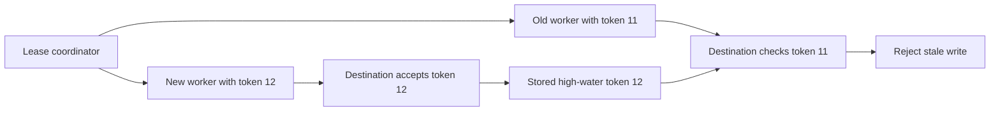

# Stop Overlapping Cloud Jobs with Leases and Fencing Tokens

Author: [nawazdhandala](https://www.github.com/nawazdhandala)

Tags: Cloud Automation, Distributed Coordination, Reliability

Description: Coordinate scheduled jobs per resource, understand expired-worker risks, and test a destination that rejects stale fencing tokens before accepting writes.

A scheduled job normally finishes in two minutes. Today it takes twelve, so the next scheduled run begins while the first is still active. Both workers discover the same resource and try to change it.

Preventing overlap at the scheduler helps, but it does not cover manual runs, another scheduler, or a paused worker that resumes after losing ownership. A complete design needs coordination around the resource and a clear rule for rejecting stale work at the destination.

## Start with the resource being protected

Choose a canonical coordination key that includes account, Region, resource type, and immutable resource identity. Two jobs modifying the same resource must use the same key, even when they have different names or schedules.

Do not include the current run ID in the key: that would give every run its own independent lock. Keep the run ID as ownership metadata instead. Conversely, avoid one global lock if unrelated resources can safely proceed independently.

Scheduler controls reduce unnecessary contention. For example, Kubernetes `concurrencyPolicy: Forbid` prevents overlapping Jobs from the same CronJob, but not Jobs from different CronJobs. It also does not establish ownership for other tools that modify the resource. See the [CronJob concurrency rules](https://kubernetes.io/docs/concepts/workloads/controllers/cron-jobs/#concurrency-policy).

## A lease expires; a worker may not

A lease is temporary permission to act as the owner. A coordinator grants it for a bounded period and requires renewal. If renewal fails, the worker should stop starting new operations.

The difficult case is a paused worker. It can stop communicating long enough for its lease to expire, then resume with old local knowledge. Its process may still be alive, and a previously submitted cloud API request may still complete.

| Time | Worker A | Worker B |
| --- | --- | --- |
| First grant | Receives token 11 | Waiting |
| Lease expires | Paused or disconnected | Receives token 12 |
| New owner publishes | Still paused | Destination records token 12 |
| Old worker resumes | Tries token 11 | Continues current work |

The lease coordinator can correctly recognize B as the owner while A still sends a request. This is why extending a timeout alone is not a correctness proof. AWS discusses paused leaders and lease subtleties in its [leader-election guidance](https://aws.amazon.com/builders-library/leader-election-in-distributed-systems/).

## Fence stale requests at the destination

A fencing token is an increasing generation number issued by a trusted coordinator. A destination records the newest accepted token and rejects older generations. Merely logging the token does nothing; the destination must check it as part of the protected write.



Redis's distributed-lock documentation explicitly recommends fencing tokens and warns against assuming a lock remains valid merely because its holder is alive. See its [consistency discussion](https://redis.io/docs/latest/develop/clients/patterns/distributed-locks/#disclaimer-about-consistency).

The destination's high-water mark is essential. A newer lease existing somewhere else does not automatically update that mark. Once token 12 is installed or accepted at the destination, token 11 must no longer be accepted there. If your requirement is to reject every request after lease expiry, even before a newer token arrives, you need additional atomic ownership validation at the destination.

## Run a small destination-side experiment

This Python 3.11 example uses SQLite to demonstrate one protected publication per token. It is a local model, not a distributed lease implementation. Tokens 11 and 12 represent grants from an external trusted coordinator; the program does not allocate leases or simulate their expiry.

Save it as `fence.py` and run `python fence.py`. It uses only the standard library and creates an in-memory database. Python documents the connection, parameter substitution, and transaction interfaces in [sqlite3](https://docs.python.org/3.11/library/sqlite3.html).

```python
import sqlite3


def publish_once(connection, resource_id, fencing_token, payload):
    if type(fencing_token) is not int or fencing_token < 1:
        raise ValueError('Expected a positive fencing token')
    with connection:
        result = connection.execute(
            'UPDATE targets SET token = ?, payload = ? '
            'WHERE resource_id = ? AND token < ?',
            (fencing_token, payload, resource_id, fencing_token),
        )
    return result.rowcount == 1


if __name__ == '__main__':
    db = sqlite3.connect(':memory:')
    db.execute('CREATE TABLE targets ('
               'resource_id TEXT PRIMARY KEY, '
               'token INTEGER NOT NULL, payload TEXT NOT NULL)')
    db.execute('INSERT INTO targets VALUES (?, ?, ?)',
               ('preview-481-g3', 0, 'initial'))
    db.commit()
    # Tokens represent grants from a separate trusted coordinator.
    print('New worker:', publish_once(db, 'preview-481-g3', 12, 'new'))
    print('Old worker:', publish_once(db, 'preview-481-g3', 11, 'stale'))
    print('Same token:', publish_once(db, 'preview-481-g3', 12, 'repeated'))
    print('Stored:', db.execute('SELECT token, payload FROM targets').fetchone())
    db.close()
```

Expected output is `True` for the new worker, `False` for the old worker, `False` for the repeated token, and stored state `(12, 'new')`.

The comparison and data change happen in one SQL update. A read followed by an unconditional update would leave a race. The strict `<` rule deliberately permits only one publication for each token. If your workflow needs multiple writes under one lease, define an additional operation sequence and deduplication rule; do not casually change the comparison without deciding what same-token retries mean.

A `False` result does not distinguish an already-applied retry from a conflicting publication or missing resource. Production code needs a durable operation receipt or a verified state comparison to classify those cases. The example preserves the important safety property without pretending to implement full retry semantics.

## Make coordinator state durable

The coordinator must grant ownership atomically and issue increasing tokens for each protected resource. Renewals and releases must match the current owner and generation, so an old worker cannot release a newer worker's lease.

Preserve the generation counter across release, expiry, and restart. Deleting the lease row and restarting at token 1 can make valid future work look stale, or break safety if the destination also forgets its high-water mark. Restoring coordinator and destination backups requires a reviewed strategy that prevents token reuse.

Do not use asynchronous garbage collection as the lease clock. DynamoDB TTL, for example, typically deletes expired items within days; an expired row may remain present and writable. Lease acquisition must evaluate its own expiry and ownership conditions rather than wait for physical deletion. See [DynamoDB TTL behavior](https://docs.aws.amazon.com/amazondynamodb/latest/developerguide/TTL.html).

Choose a lease implementation with documented clock and failure assumptions. Arbitrary worker wall clocks are not a substitute for a sound coordination protocol.

## Recognize where cloud APIs cannot enforce your token

A generic cloud API usually does not accept your custom fencing token. Checking a lease in DynamoDB and then calling that API leaves a gap in which ownership can change. Storing the token in a tag does not make the later API action conditional on it.

For those operations, investigate service-supported conditional updates, idempotency mechanisms, or a trusted execution service that enforces the required ordering through completion. A gateway that checks a token and then launches uncontrolled asynchronous requests still has an in-flight-operation problem.

When strict exclusion cannot be enforced, prefer idempotent desired-state reconciliation and explicitly handle stale results. For irreversible actions, stop for reconciliation when ownership or completion is uncertain. Do not label a best-effort lease as a hard safety boundary.

## Test the paused-worker case

Test two workers targeting the same resource, independent workers targeting different resources, failed renewal, stale release, and restart after coordinator failure. Most importantly, pause A, let B acquire a newer generation and publish, then resume A and verify rejection at the actual destination.

The local example passed ten target-level scenarios, including stale and repeated tokens, independent resources, increasing generations, absent targets, and invalid token inputs. It did not test a real lease coordinator or cloud API. Those tests belong in staging, where you can verify both coordination behavior and the destination's enforcement before trusting the mechanism with consequential changes.
