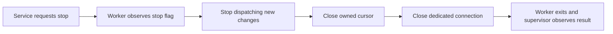

# Stop RethinkDB Changefeeds Without Leaking Cursors or Connections

Author: [nawazdhandala](https://www.github.com/nawazdhandala)

Tags: RethinkDB, Python, Reliability

Description: Give a RethinkDB changefeed a clear shutdown owner, poll idle cursors safely, and close both cursor and connection even when processing or cleanup fails.

A service receives a shutdown request, but its changefeed worker is waiting for the next update. The table is quiet, so the worker never checks the shutdown flag. A forced process exit eventually clears the socket, but the service has lost control over when processing stops and whether cleanup finishes.

Another leak is less visible: a request creates a feed, the user leaves the page, and nobody closes the cursor. Repeating that sequence leaves subscriptions alive after their consumers disappear.

Clean shutdown starts with ownership. One worker should own the feed's cursor and know whether it also owns the connection. This tutorial uses a dedicated synchronous Python worker with driver `rethinkdb==2.4.10.post1` on Python 3.11. Local tests use simulated driver objects; no live database shutdown was performed.

## Separate the three resources

A cursor is the client object that consumes a query result. A connection is the transport used to talk to RethinkDB. A worker is the application task or thread processing the result. Stopping one does not automatically establish that all three have stopped correctly.

RethinkDB documents that [closing a cursor](https://rethinkdb.com/api/python/close-cursor/) cancels its associated query and releases request resources. [Closing a connection](https://rethinkdb.com/api/python/close/) releases connection resources and has a separate policy for waiting on outstanding writes issued without waiting for replies.

For a feed-only worker, a dedicated connection makes the ownership boundary simple. The worker may close that connection when it exits without disrupting unrelated database operations. For a shared connection, the feed owner should close its cursor, while the shared connection's manager controls the transport lifetime.



The arrow from cursor to connection describes the cleanup order, not a claim that cursor cleanup always succeeds. The connection still needs its cleanup attempt when the cursor raises an exception.

## Make an idle cursor check for shutdown

A plain `for change in cursor` loop is convenient, but an idle feed can wait indefinitely. The Python driver's [`next` method](https://rethinkdb.com/api/python/next/) accepts a numeric `wait` value in seconds. If no item arrives within that wait, it raises `ReqlTimeoutError`.

Use that timeout as an opportunity to inspect a stop flag. A timeout here means that this particular wait did not yield a result; it does not by itself prove that the database is unhealthy. Reconnecting after every quiet second would turn a normal idle table into a connection storm.

Use a `threading.Event` supplied by your service supervisor. Python's [Event documentation](https://docs.python.org/3.11/library/threading.html#event-objects) describes the `set` and `is_set` operations. The supervisor sets the flag; the worker remains the only owner performing database operations and cleanup.

## Keep the cleanup path inside the worker

Install the pinned driver with `python -m pip install rethinkdb==2.4.10.post1` in an isolated environment. Save this module as `worker.py`:

```python
from rethinkdb import RethinkDB
from rethinkdb.errors import ReqlTimeoutError, ReqlCursorEmpty

r = RethinkDB()


def run_feed(options, stop, handle, driver=r):
    if stop.is_set():
        return
    conn = None
    cursor = None
    try:
        conn = driver.connect(**options)
        if stop.is_set():
            return
        cursor = driver.table("items").changes().run(conn)
        while not stop.is_set():
            try:
                change = cursor.next(wait=1)
            except ReqlTimeoutError:
                continue
            except ReqlCursorEmpty as error:
                raise RuntimeError("Changefeed ended unexpectedly") from error
            if stop.is_set():
                break
            if "error" in change:
                raise RuntimeError(change["error"])
            handle(change)
    finally:
        try:
            if cursor is not None:
                cursor.close()
        finally:
            if conn is not None:
                # This connection is dedicated to reads; no pending writes.
                conn.close(noreply_wait=False)
```

Call `run_feed(options, stop, handle)` from a worker with its own `Event`. The `options` dictionary contains your approved [connection configuration](https://rethinkdb.com/api/python/connect/), including the database that contains the existing `items` table, credentials, and TLS settings as appropriate. Supply credentials through your normal secret mechanism. The optional `driver` argument supports local testing; ordinary callers omit it.

`handle` is a synchronous application callback. It should finish promptly and must have its own timeout policy for any remote work. A callback that hangs for several minutes cannot be rescued by the cursor's one-second polling interval.

The worker checks the stop flag before connecting, after connecting, before waiting, and again before dispatching a received notification. That final check matters when a shutdown request arrives while a read is completing. The example prioritizes stopping dispatch over processing a just-received item.

This choice is appropriate for a replaceable cache or UI subscription. It is not an exactly-once processing guarantee. If every event triggers a business action, design durable work tracking and reconciliation separately; closing a cursor does not acknowledge or persist application work.

## Understand the nested finally blocks

The outer `finally` runs when the loop stops, the callback fails, query creation fails, or an exception escapes. The inner `finally` attempts connection closure even if cursor closure raises. If cleanup also fails, Python preserves exception context; your top-level error reporting should retain the traceback rather than logging only the last message.

The connection is explicitly dedicated to reads, so the example uses `noreply_wait=False`. This avoids waiting for a class of writes that the worker never submits. Do not copy that policy onto a connection used for outstanding writes: the [connection close reference](https://rethinkdb.com/api/python/close/) warns that immediate closure can abort noreply writes.

A query-creation failure can occur before a cursor exists. Initializing both variables to `None` allows the same cleanup path to handle partial startup. A stop request that arrives during connection creation also results in closing the newly created connection rather than starting a subscription anyway.

The sample deliberately has no reconnect loop. A supervisor that supports restarts must check the stop state before scheduling another attempt. Otherwise, a shutdown-induced error can accidentally start the replacement worker you are trying to prevent.

## Set a realistic shutdown budget

The one-second cursor wait is a responsiveness mechanism, not a one-second end-to-end shutdown guarantee. Connection establishment, initial query execution, a running callback, socket writes during cleanup, and operating-system scheduling can all add delay. Test those phases separately.

When integrating Unix signals, install handlers in the main thread and let the service's lifecycle mechanism request worker cancellation. Python's [signal documentation](https://docs.python.org/3.11/library/signal.html) explains that handlers run in the main interpreter thread. Do not assume a signal directly interrupts the database operation in a separate worker thread.

A supervisor should stop accepting new subscriptions, request existing workers to stop, and wait for their results within its grace period. Python's [thread documentation](https://docs.python.org/3.11/library/threading.html) also warns that daemon threads can be stopped abruptly. Making a worker a daemon does not replace cleanup.

## Verify repeated start and stop cycles

The local tests covered an idle read timeout followed by stopping, a stop request just before dispatch, a callback exception, failed query creation, cursor-close failure, and an already-stopped worker. They verified that the connection-close attempt still happened and that cursor cleanup preceded it when a cursor existed.

Those are control-flow tests. A staging check must also observe real resources:

| Scenario | Evidence to collect |
|---|---|
| Quiet table, then shutdown | Worker exits without needing a new row update |
| Busy table, then shutdown | No new callback starts after the worker observes stop |
| Callback failure | Error is reported and owned resources are closed |
| Repeated subscriber creation | Active worker and connection counts return to baseline |
| Unreachable server during shutdown | Actual exit duration and cleanup failures are recorded |

Run repeated cycles in a dedicated test environment and compare against a warmed-up baseline. A stable count is more useful than assuming every temporary socket disappears instantly. Record active subscriptions, cleanup failures, and shutdown duration alongside the worker's exit result.

A clean lifecycle makes the end of a subscription observable: dispatch stops, cleanup is attempted in order, and the supervisor learns whether the worker exited successfully. That is the behavior to verify before relying on graceful shutdown during a deployment.
