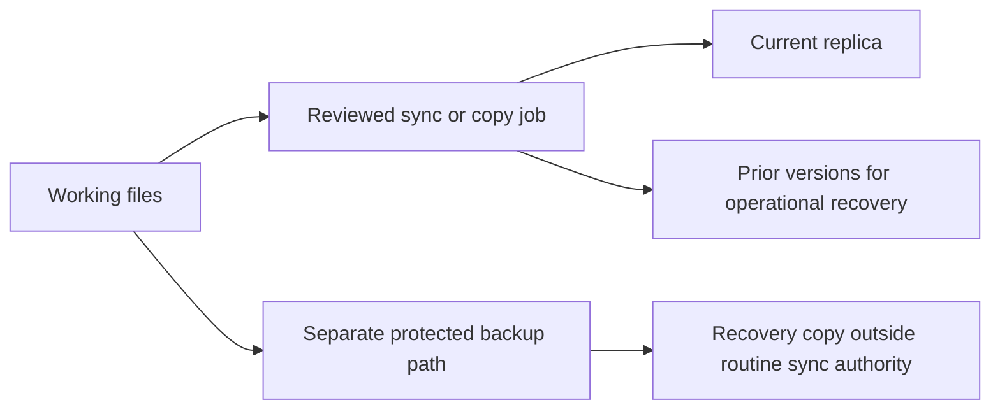

# Stop File Sync from Spreading Deletions and Damaged Files

Author: [nawazdhandala](https://www.github.com/nawazdhandala)

Tags: File Storage, Ransomware Protection, Backup

Description: Limit destructive synchronization, preserve replaced files, and rehearse recovery with a tested rclone lab while keeping an independent protected copy.

A sync job sees a missing source file and removes the destination copy. Another job sees changed bytes and transfers them to a second site. Both jobs may be functioning correctly while spreading an accidental deletion or a damaged file.

Synchronization aims to make selected locations agree. Recovery requires access to a suitable earlier state. Design these as separate responsibilities, then test what happens when files disappear, change unexpectedly, or arrive from a compromised device.

## Identify what your sync job is allowed to do

Start with the direction, source, destination, filters, and credentials for every job. A one-way mirror, a one-way copy, and a two-way sync have different behavior. Avoid a diagram that simply labels every arrow “backup.”

Rclone's `sync` changes the destination to match the source, including deletion when necessary. Its `copy` command does not remove destination files just because they are absent from the source. However, copy can still replace an existing destination file with changed source content. Replacing sync with copy addresses one failure mode; it does not make changed content trustworthy. [rclone sync](https://rclone.org/commands/rclone_sync/), [rclone copy](https://rclone.org/commands/rclone_copy/).

Record the intended behavior explicitly:

| Source event | Required destination behavior | Evidence to retain |
| --- | --- | --- |
| New file | Copy after normal checks | New path and transfer result |
| Intentional edit | Update current copy and retain prior version | Recoverable old content |
| Accidental deletion | Hold or retain destination copy | Alert and retained path |
| Unexpected mass changes | Pause further propagation | Job state and change evidence |
| Source unavailable | Fail without treating absence as an empty tree | Error, mount identity, job result |

A disconnected mount can leave an ordinary local directory visible at the same path. Build a preflight check for the expected source identity and marker, not just whether the directory exists. Make the marker specific to the dataset and review what happens if it is missing.

## Rehearse replacement and deletion in disposable directories

This lab uses rclone **1.72.0**, Bash, and Python 3.11 on a Unix-like system. It creates two tiny source files inside a unique temporary directory. The only deletion removes one of those generated files. No remote storage or existing user data is involved. The pinned binary is available from the [official release](https://github.com/rclone/rclone/releases/tag/v1.72.0).

The lab first previews a destructive mirror, verifies that the preview changed nothing, and then uses copy with an archive directory for replaced files:

```bash
set -euo pipefail
umask 077
SYNC_LAB=$(mktemp -d "${TMPDIR:-/tmp}/sync-protection.XXXXXX")
export SYNC_LAB
mkdir "$SYNC_LAB/source" "$SYNC_LAB/current" "$SYNC_LAB/history"
printf 'original report\n' > "$SYNC_LAB/source/report.txt"
printf 'keep this record\n' > "$SYNC_LAB/source/record.txt"
rclone copy "$SYNC_LAB/source" "$SYNC_LAB/current"
printf 'changed content for the drill\n' > "$SYNC_LAB/source/report.txt"
rm "$SYNC_LAB/source/record.txt"
rclone sync "$SYNC_LAB/source" "$SYNC_LAB/current" \
  --checksum --dry-run --log-level INFO
python3.11 - <<'PYTEST'
import os
from pathlib import Path
root = Path(os.environ['SYNC_LAB'])
assert (root / 'current/report.txt').read_text() == 'original report\n'
assert (root / 'current/record.txt').read_text() == 'keep this record\n'
PYTEST
rclone copy "$SYNC_LAB/source" "$SYNC_LAB/current" \
  --checksum --backup-dir "$SYNC_LAB/history/run-001" --log-level INFO
python3.11 - <<'PY'
import os
from pathlib import Path
root = Path(os.environ['SYNC_LAB'])
assert (root / 'current/record.txt').read_text() == 'keep this record\n'
assert (root / 'current/report.txt').read_text() == 'changed content for the drill\n'
assert (root / 'history/run-001/report.txt').read_text() == 'original report\n'
print('Deleted source record retained; overwritten report archived')
print(f'Disposable fixture retained at {root}')
PY
```

The preview should mention a skipped copy and a skipped deletion. Dry-run summaries can describe planned deletions; read them with the dry-run notices rather than assuming the files were removed. The assertions immediately afterward verify that both destination originals remain.

The final checks demonstrate two separate protections: `record.txt` remains because copy does not propagate the source deletion, and the old `report.txt` exists in `history/run-001` because replacement was archived. The current report contains the changed drill text. Inspect the retained temporary directory and remove it through your normal lab cleanup process afterward.

This complete example ran locally with rclone 1.72.0 and Python 3.11.13. It is a behavior test using harmless text, not a ransomware simulation, cloud test, or backup-security certification.

## Give each run its own history location

Rclone's `--backup-dir` moves files that would be overwritten or deleted into a separate hierarchy. It must use the same remote as the destination, with the required server-side move or copy support. Reusing an archive path can overwrite an earlier archived file with the same name. The archive must also avoid overlapping the destination unless excluded appropriately. [rclone 1.72.0 option documentation](https://raw.githubusercontent.com/rclone/rclone/v1.72.0/docs/content/docs.md).

The lab uses `run-001` only inside a new fixture. A real scheduled job needs a unique run identifier, protected logs, and an explicit retention policy. Do not reuse a daily folder for multiple runs unless the resulting version behavior is exactly what you intend.

Most importantly, an archive writable by the sync account is not independent protection from compromise of that account. It helps with accidental changes and operational recovery, but an attacker with broader access may destroy both current files and history.



## Use limits as brakes, not transactions

For jobs that genuinely require mirroring, rclone's `--max-delete` limits deletions and stops the operation with a fatal error when the limit is exceeded. A separate local fixture verified that `--max-delete 0` prevented removal of an extra destination file and returned failure. [rclone deletion limits](https://rclone.org/docs/#max-delete-int).

A limit does not roll back earlier transfers or certify the proposed changes. A job may have already updated other files before stopping. It also does not detect malicious replacements that involve no deletion. Monitor additions, replacements, deletions, bytes changed, and job errors separately.

Choose thresholds from normal workload evidence and route violations to an accountable operator. Do not automatically rerun a rejected job with a higher limit. Repeated failures should hold the schedule until someone determines whether the source, mount, filters, or data changed legitimately.

A dry run also has a time boundary: the source may change between preview and execution. For sensitive jobs, use a consistent source view or coordinate writers so the approved plan remains meaningful.

## Understand which device keeps versions

Two-way synchronization needs special care because an edit may originate at any peer. Syncthing's versioning is configured per folder and per device, defaults to no versioning, and archives changes received from other devices. It cannot archive the old version of a file changed locally on that same device. Its default archive location is within the shared folder's storage. [Syncthing file versioning](https://docs.syncthing.net/users/versioning.html).

Test both directions: change a file on device A and inspect retained versions on B, then reverse the roles. Test local deletion, remote deletion, replacement, and retention cleanup. Do not infer that turning on versioning on one laptop protects every edit made there.

Use a separate backup mechanism for recovery requirements that exceed those versioning semantics. The Syncthing FAQ explicitly distinguishes synchronization from a suitable backup solution. [Syncthing backup FAQ](https://docs.syncthing.net/users/faq.html#is-syncthing-my-ideal-backup-application).

## Pause propagation before restoring

When unexpected changes appear, pause the affected scheduled jobs or peers through the supported administration path and preserve their logs. Coordinate with the incident owner before reconnecting devices. Identify which copy contains the required earlier state, and restore into a separate inspection location first.

Check file contents, permissions, and application behavior. Then decide which copy becomes authoritative and how other peers will be reconciled. Simply dropping recovered files into an active two-way sync can create new conflicts or immediately propagate another unwanted state.

Rehearse that sequence with the team that operates the jobs. A passing exercise should show that propagation stopped, a known earlier version remained accessible, recovery was verified, and synchronization resumed with a deliberate direction. Keeping every copy identical is useful only while the state being copied is one you intend to keep.
