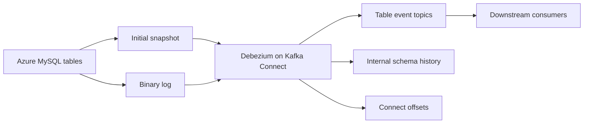

# Stream Azure MySQL Changes with Debezium and Data-Out Replication

Author: [nawazdhandala](https://www.github.com/nawazdhandala)

Tags: Azure, MySQL, Debezium, Kafka

Description: Configure Debezium to snapshot and stream Azure MySQL binlogs with verified TLS, retained recovery state, explicit snapshot constraints, and a practical CDC smoke test.

Change data capture, or CDC, turns database changes into events that other systems can consume. Debezium's MySQL connector first captures table state when configured to do so, then reads the binary log for subsequent changes.

Azure MySQL is the source in this arrangement. Debezium connects as a binlog reader; you do not configure an Azure data-in replication channel or turn Kafka into a MySQL replica.

## Check the source is eligible

Azure exposes its binary log through data-out replication. The current documentation explicitly says that data-out replication is unsupported when Azure authentication is configured on the server. Check that prerequisite before designing the pipeline; do not silently change your organization's authentication model to accommodate an example. See [Azure data-out replication](https://learn.microsoft.com/en-us/azure/mysql/flexible-server/concepts-data-out-replication).

This walkthrough uses **Debezium 3.3.2.Final**, **Kafka Connect 4.1.0**, and **MySQL 8.0.46** as a scoped example. Debezium's [3.3.2 release notes](https://debezium.io/releases/3.3/release-notes.html) identify Kafka 4.1.0 as the tested platform, and the [3.3 compatibility page](https://debezium.io/releases/3.3/) lists MySQL 8.0 support. These pins describe the example, not the newest available releases. Review your approved release combination before deployment.

Prepare an existing secured Kafka Connect cluster with the MySQL connector plugin installed on every worker. It needs private DNS resolution and a permitted route to Azure MySQL on port 3306, plus connectivity to Kafka. Azure's [source configuration guide](https://learn.microsoft.com/en-us/azure/mysql/flexible-server/how-to-data-out-replication) describes the network and binlog requirements.



Offsets record reading progress. Schema history records the table definitions needed to interpret older log events. Both are operational state, not disposable caches.

## Inspect logging and preserve the recovery window

Run this read-only query through an approved SQL session:

```sql
SELECT @@GLOBAL.log_bin AS binary_logging,
       @@GLOBAL.binlog_format AS binlog_format,
       @@GLOBAL.binlog_row_image AS row_image,
       @@GLOBAL.binlog_row_value_options AS row_value_options,
       @@GLOBAL.binlog_expire_logs_seconds AS retention_seconds;
```

For this configuration, expect binary logging enabled, `ROW` format, `FULL` row images, and an empty row-value-options string rather than partial JSON values. These requirements are documented in the [tagged Debezium MySQL setup material](https://github.com/debezium/debezium/blob/v3.3.2.Final/documentation/modules/ROOT/partials/modules/all-connectors/shared-mariadb-mysql.adoc).

Choose log retention longer than the longest expected snapshot, connector outage, and recovery delay, with operational margin. Azure documents that a zero retention setting can remove logs as soon as service handles are released. It also states that accelerated logs cause `binlog_expire_logs_seconds` to be disregarded. This example therefore assumes **accelerated logs are disabled**; do not infer a retention guarantee from that parameter on another configuration. See [Azure binlog retention behavior](https://learn.microsoft.com/en-us/azure/mysql/flexible-server/concepts-server-parameters#binlog_expire_logs_seconds).

Configure required changes through Azure's supported server-parameter controls, then verify the running values. Monitor storage growth as well as retained log availability. A durable Kafka offset cannot recover a source log that has already been deleted.

## Prepare snapshot permissions and a schema freeze

Create a dedicated `cdc_reader` account through your credential-management process. It needs SELECT access to captured tables and the replication-client, replication-reader, and database-discovery privileges appropriate to this connector. The documented MySQL privilege names include `REPLICATION CLIENT`, `REPLICATION SLAVE`, and `SHOW DATABASES`. Restrict its network reachability and require encrypted connections.

The example uses `snapshot.locking.mode=none` only for **InnoDB tables with schema changes frozen throughout the initial snapshot**. Coordinate migrations and deployment jobs so that the freeze is real. Do not select this mode merely to suppress a permissions error. With other locking modes, review the additional RELOAD or LOCK TABLES requirements.

The [snapshot-locking property documentation](https://github.com/debezium/debezium/blob/v3.3.2.Final/documentation/modules/ROOT/partials/modules/all-connectors/ref-mariadb-mysql-adv-connector-cfg-props.adoc) explains the restriction. The [snapshot implementation](https://github.com/debezium/debezium/blob/v3.3.2.Final/debezium-connector-binlog/src/main/java/io/debezium/connector/binlog/BinlogSnapshotChangeEventSource.java) conditions its locking paths on the selected strategy. Rehearse the actual permissions before the production snapshot window.

## Keep secrets outside the connector document

On every worker, enable Kafka's file configuration provider in the worker configuration:

```properties
config.providers=file
config.providers.file.class=org.apache.kafka.common.config.provider.FileConfigProvider
config.providers.file.param.allowed.paths=/run/secrets/mysql-cdc.properties
```

Mount that protected properties file on every worker with the keys `dbPassword`, `dbTrustPassword`, `kafkaJaas`, and `kafkaTrustPassword`. The values come from your secret-management system. `kafkaJaas` must contain the complete approved SCRAM login configuration for the Kafka principal, not just its password. Kafka documents the substitution syntax in [configuration providers](https://kafka.apache.org/41/configuration/configuration-providers/) and the authentication settings in [SASL configuration](https://kafka.apache.org/41/security/authentication-using-sasl/).

Provision the referenced truststores separately. The database truststore contains approved Azure MySQL certificate authorities; the Kafka truststore contains your broker authorities. They are Java truststores, not PEM files renamed with a `.jks` extension.

## Configure the connector and schema-history clients

Create `appdb.orders` and a small `appdb.cdc_probe` test table before starting the snapshot. Both need suitable primary keys. Replace the server hostname, broker addresses, paths, and connector identifiers below. Choose a replication server ID unused by other readers of this source.

```json
{
  "name": "azure-mysql-orders",
  "config": {
    "connector.class": "io.debezium.connector.mysql.MySqlConnector",
    "tasks.max": "1",
    "database.hostname": "REPLACE_SERVER.mysql.database.azure.com",
    "database.port": "3306",
    "database.user": "cdc_reader",
    "database.password": "${file:/run/secrets/mysql-cdc.properties:dbPassword}",
    "database.server.id": "184054",
    "database.ssl.mode": "verify_identity",
    "database.ssl.truststore": "/etc/cdc/azure-mysql-trust.jks",
    "database.ssl.truststore.password": "${file:/run/secrets/mysql-cdc.properties:dbTrustPassword}",
    "topic.prefix": "azure_mysql_orders",
    "database.include.list": "appdb",
    "table.include.list": "appdb\\.orders,appdb\\.cdc_probe",
    "snapshot.mode": "initial",
    "snapshot.locking.mode": "none",
    "schema.history.internal.store.only.captured.tables.ddl": "true",
    "schema.history.internal.kafka.bootstrap.servers": "REPLACE_BROKER1:9093,REPLACE_BROKER2:9093",
    "schema.history.internal.kafka.topic": "schema-history.azure-mysql-orders",
    "schema.history.internal.producer.security.protocol": "SASL_SSL",
    "schema.history.internal.producer.sasl.mechanism": "SCRAM-SHA-512",
    "schema.history.internal.producer.sasl.jaas.config": "${file:/run/secrets/mysql-cdc.properties:kafkaJaas}",
    "schema.history.internal.producer.ssl.truststore.location": "/etc/cdc/kafka-trust.jks",
    "schema.history.internal.producer.ssl.truststore.password": "${file:/run/secrets/mysql-cdc.properties:kafkaTrustPassword}",
    "schema.history.internal.producer.ssl.endpoint.identification.algorithm": "https",
    "schema.history.internal.consumer.security.protocol": "SASL_SSL",
    "schema.history.internal.consumer.sasl.mechanism": "SCRAM-SHA-512",
    "schema.history.internal.consumer.sasl.jaas.config": "${file:/run/secrets/mysql-cdc.properties:kafkaJaas}",
    "schema.history.internal.consumer.ssl.truststore.location": "/etc/cdc/kafka-trust.jks",
    "schema.history.internal.consumer.ssl.truststore.password": "${file:/run/secrets/mysql-cdc.properties:kafkaTrustPassword}",
    "schema.history.internal.consumer.ssl.endpoint.identification.algorithm": "https"
  }
}
```

Database `verify_identity` validates the certificate chain and hostname. The inclusion lists select the intended database and tables; dots in table patterns are escaped because these are regular expressions. See the [required connector properties](https://github.com/debezium/debezium/blob/v3.3.2.Final/documentation/modules/ROOT/partials/modules/all-connectors/ref-mariadb-mysql-rqd-connector-cfg-props.adoc) and [MySQL TLS properties](https://debezium.io/documentation/reference/3.3/connectors/mysql.html#mysql-property-database-ssl-mode).

The history producer and consumer are separate clients. Their security settings do not replace the worker's secured configuration for event production, offsets, and internal topics. The prefixed settings are documented in [schema-history client pass-through configuration](https://github.com/debezium/debezium/blob/v3.3.2.Final/documentation/modules/ROOT/partials/modules/all-connectors/ref-connector-pass-through-database-history-properties-for-configuring-producer-and-consumer-clients.adoc).

Precreate the history topic with one partition, durable replication, and retention that preserves its required history. Grant the connector principal the necessary topic access. Preserve Connect's offset topic too. The [state-storage guide](https://debezium.io/documentation/reference/3.3/configuration/storage.html) explains their separate roles. Storing only captured-table history narrows this example, but adding tables later needs a reviewed snapshot/history procedure.

Submit the document through your authenticated connector-management interface. Validate it with the installed connector version before starting the capture; local JSON parsing cannot establish connectivity or permissions.

## Prove snapshot, streaming, and restart behavior

Use a staging probe table with `id BIGINT PRIMARY KEY` and `note VARCHAR(64)`. Seed one identifiable row before the snapshot. After snapshot completion, insert another unique row, update its note, and delete that same row. Confirm the probe topic contains the expected snapshot and change events, including their source metadata. With the default topic naming, it is `azure_mysql_orders.appdb.cdc_probe`.

Then restart the connector within the retention window and make another controlled change. Confirm progress resumes from retained state and that the consumer handles possible replay safely. A RUNNING connector status alone does not prove events reached the downstream system.

If recovery reports missing binlogs or schema history, preserve evidence and plan reconciliation or a new snapshot. Do not delete offsets or invent a newer log position to silence the error; that can hide lost changes. Keep source-log retention, connector lag, task failures, Kafka delivery, and downstream freshness visible as separate operational checks.
