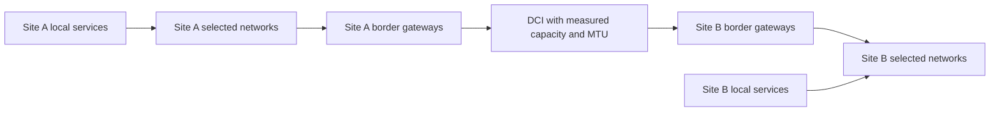

# Bound the Failure Domain When Stretching VXLAN Between Data Centers

Author: [nawazdhandala](https://www.github.com/nawazdhandala)

Tags: VXLAN, Networking, Reliability

Description: Limit cross-site VXLAN risk with explicit network membership, BUM budgets, end-to-end MTU checks, and staged partition and recovery tests.

A stretched subnet makes two data centers look close to an application. It does not make them share the same latency, capacity, or failure behavior. If an application depends on broadcasts, a remote gateway, or storage across the interconnect, a site partition can expose dependencies that normal connectivity tests never exercised.

You cannot stretch Layer 2 while promising complete failure independence. You can limit which networks share failures, constrain their traffic, and define what each site must do when the connection disappears. Treat those as acceptance criteria before enabling the first production VNI.

This is a design and test plan. It includes bounded Linux probes and a documented Cisco NX-OS 10.4(x) inspection command, but it is not a complete Multi-Site configuration or a claim of live validation.

## Start with the smallest stretch requirement

A VNI is the identifier for a VXLAN virtual network. A Data Center Interconnect, or DCI, carries traffic between sites. Before extending a VNI, record the application requirement that demands the same subnet in both places.

Distinguish “the application needs to reach the other site” from “the application needs the same Layer 2 network.” Routed connectivity may satisfy the first requirement without extending broadcasts. For the second, identify the specific migration, addressing, or discovery constraint and who owns its eventual removal.

Use a small inventory rather than an unrestricted extension policy:

| Network | Cross-site behavior | Owner's acceptance condition |
| --- | --- | --- |
| Application migration subnet | Selected Layer 2 extension | Only the approved VNI and endpoints appear remotely |
| Database management subnet | Routed reachability | Local management remains available during a DCI outage |
| Backup network | Routed transfer with a capacity budget | Backup traffic cannot exhaust application bandwidth |
| Site infrastructure | Local unless separately justified | Local DNS and access paths work without the other site |

These are example decisions, not universal classifications. An application owner might legitimately choose differently, but the dependency should be visible.

## Put an explicit boundary between fabrics

EVPN, Ethernet VPN, supplies control-plane information for the overlay. Interconnecting two sites does not require treating every leaf as part of one unrestricted overlay. RFC 8365 describes DCI arrangements using gateways, providing a standards basis for separating internal fabric operation from inter-site connectivity. [RFC 8365, section 10](https://www.rfc-editor.org/rfc/rfc8365.html#section-10)



The local-services arrows represent dependencies that remain inside their respective sites. Border gateways represent a redundant pair or another supported resilient arrangement, not a recommendation for a single device.

For Cisco's NX-OS 10.4(x) Multi-Site model, the documentation distinguishes separate overlay domains joined by border gateways from directly joining overlays. It also requires appropriate fabric/DCI link tracking to control route reorigination during link isolation. Apply the exact release and hardware guidance, rather than copying a generic inter-site BGP configuration. [Cisco Multi-Site guide](https://www.cisco.com/c/en/us/td/docs/dcn/nx-os/nexus9000/104x/configuration/vxlan/cisco-nexus-9000-series-nx-os-vxlan-configuration-guide-release-104x/m_configuring_multisite_93x.html)

A border boundary reduces exposure only if policy is enforced there. Review exported networks, imported routes, forwarding paths, and alternate links that could bypass the intended boundary.

## Give flooded traffic a budget

BUM means broadcast, unknown unicast, and multicast. Unknown unicast is a frame whose destination MAC address is not yet known in the relevant forwarding table. Stretching a broadcast domain makes some of that traffic a DCI capacity concern, even when steady-state application traffic is modest.

Measure traffic per extended VNI during normal operation and a controlled cold start. Include DHCP, address resolution, and application discovery. Record packet rates as well as bandwidth; a large number of small frames can create a different load from a few large transfers.

Budget for the remaining DCI capacity after a link failure. If normal operation uses two links, do not choose a flood allowance that only works while both are healthy. Also distinguish a configured policing percentage from an application requirement expressed in Mbps.

The NX-OS 10.4(x) guide documents platform-specific percentage calculations based on tracked DCI uplink bandwidth and provides this read-only inspection command:

```text
slot 1 show hardware vxlan storm-control
```

Run it only on a supported NX-OS platform where the documented hardware command applies. Compare installed values with the configured policy and available tracked capacity. It is not a Linux shell command or a portable switch command. [Cisco storm-control verification](https://www.cisco.com/c/en/us/td/docs/dcn/nx-os/nexus9000/104x/configuration/vxlan/cisco-nexus-9000-series-nx-os-vxlan-configuration-guide-release-104x/m_configuring_multisite_93x.html)

A low limit can break legitimate startup traffic. Use bounded staging tests to find a value that preserves required behavior while containing an abnormal burst. A threshold alarm should identify both the affected site boundary and the applications that might be losing packets.

## Validate the DCI packet-size contract

Maximum Transmission Unit, or MTU, is the largest packet an interface or path accepts without fragmentation at the relevant layer. Specify whether the provider's number describes IP packets or Ethernet frames; they are not interchangeable.

For an untagged inner Ethernet frame carrying a 1500-byte IP packet, ordinary VXLAN over IPv4 needs a 1550-byte outer IP packet: 1500 + 14 bytes of inner Ethernet + 8 VXLAN + 8 UDP + 20 IPv4. Outer Ethernet framing is additional. Encryption or another tunnel can add further overhead. [RFC 7348, frame format and infrastructure requirements](https://www.rfc-editor.org/rfc/rfc7348.html)

These Linux iputils 20240905 examples send only three probes each. Replace the documentation address with an approved remote underlay test endpoint and the tenant address with a staging host. The underlay test source must follow the actual DCI path and support the requested packet size.

```bash
# 1522-byte payload + 8-byte ICMP + 20-byte IPv4 = 1550 bytes.
ping -4 -c 3 -W 2 -M do -s 1522 192.0.2.20

# A 1500-byte tenant IPv4 packet across the selected stretched network.
ping -4 -c 3 -W 2 -M do -s 1472 10.20.0.12
```

The `-M do` option uses don't-fragment behavior subject to the kernel's path-MTU checks. A local “message too long” error is different from a remote timeout. A timeout can also reflect filtering; it does not independently identify an MTU fault. [iputils 20240905 ping documentation](https://raw.githubusercontent.com/iputils/iputils/20240905/doc/ping.xml)

A successful tenant ping does not prove the outer packet avoided fragmentation. Confirm encapsulated packet sizes and fragmentation behavior with approved captures or device counters. Repeat in both directions and on the surviving path after a planned link failure.

## Test partition behavior before calling the design resilient

Schedule failure injection in staging with independent management access. Record a baseline first, then change one failure condition at a time.

| Test | Evidence to collect | Pass condition to agree in advance |
| --- | --- | --- |
| One DCI link fails | Loss interval, surviving-path load, MTU result | Required flows recover within the agreed interval |
| One border loses its fabric side | Advertised routes and forwarding path | Isolated border does not keep attracting unreachable traffic |
| Sites become partitioned | Local transactions and dependency failures | Each site follows its documented application role |
| Site reconnects | Route churn, duplicate addressing, application state | Recovery completes without an uncontrolled second writer |

Do not substitute a BGP-established timer for application recovery. Measure when a fresh transaction succeeds and when existing sessions recover or fail. These can be different events.

VXLAN does not provide database quorum, fencing, or write ownership. Those decisions belong to the application and storage design. During a partition, explicitly verify which side may continue writing and how the other side is prevented from conflicting. Network reachability returning is not permission to resume both writers.

Approve the stretch only when the evidence covers membership, flood limits, packet size, and failure behavior. Keep the approved scope beside the operational runbook so that adding another VNI or another site triggers a new review of the shared risk.
