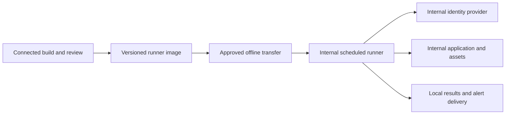

# How to Run Synthetic Browser Monitoring in an Air-Gapped Network

Author: [nawazdhandala](https://www.github.com/nawazdhandala)

Tags: Air-Gapped, Monitoring, Playwright, Kubernetes

Description: Package a browser monitor for offline use, test fresh internal sign-in, detect external application assets, and separate runner failures from application failures.

Synthetic browser monitoring runs a scripted user journey on a schedule. It can tell you that an application loads, accepts a login, and displays useful information. In an air-gapped network, that journey must work without downloading a browser, fetching a public font, or redirecting to an unreachable identity service.

Build the runner before disconnecting, then test it from the network where it will operate. This example uses **Playwright 1.64.1** and its matching Ubuntu Noble container image. It illustrates a standalone runner; scheduling it and delivering its results to your monitoring platform are separate deployment tasks.

## Package the complete runner

The runner needs more than your test script:

| Artifact | Why it must be available locally |
| --- | --- |
| Playwright package and locked dependencies | Execute the test without contacting npm |
| Matching browser binaries and system libraries | Launch Chromium without runtime downloads |
| Test files and configuration | Reproduce the same journey after replacement |
| Internal CA trust configuration | Validate application and identity-service certificates |
| Runtime credentials | Authenticate through the approved internal path |

A certificate authority, or CA, is the trusted issuer used to verify certificates. Configure trust for the browser and for any separate Node.js HTTPS clients you use. They may use different trust mechanisms. Setting a CA variable for a download tool does not establish that Chromium trusts your application.



Playwright's image supplies browser binaries and their operating-system dependencies, but the project still needs the Playwright npm package. Keep the image and package versions aligned, as required by the [official Docker guide](https://playwright.dev/docs/docker). Browser revisions are tied to Playwright releases; see the [browser installation documentation](https://playwright.dev/docs/browsers).

On a connected preparation machine, create a new project using an approved Node.js release supported by this Playwright version:

```bash
mkdir offline-browser-monitor
cd offline-browser-monitor
npm init -y
npm install --save-dev --save-exact @playwright/test@1.64.1
mkdir tests
```

Retain `package.json` and `package-lock.json`. The lockfile fixes dependency resolution; rebuilding should use it rather than selecting fresh versions.

## Define a fresh, read-only journey

Save this example as `tests/internal-app.spec.js`. It assumes a same-page username/password login followed by an `Operations overview` heading. Replace the three accessible labels and destination hostname to match your application. This is an application-specific template, not a universal SSO script.

The scheduler should supply `APP_ORIGIN`, `MONITOR_USERNAME`, and `MONITOR_PASSWORD` securely. Use a dedicated account with permission only to view the rehearsal page. If your identity policy requires another authentication flow, implement that approved flow instead of weakening the policy for this example.

```javascript
const { test, expect } = require('@playwright/test');

test.use({ serviceWorkers: 'block' });

test('fresh login and internal overview', async ({ page, context }) => {
  const origin = process.env.APP_ORIGIN;
  const username = process.env.MONITOR_USERNAME;
  const password = process.env.MONITOR_PASSWORD;
  if (!origin || !username || !password) {
    throw new Error('Required monitor environment variables are missing');
  }

  const approved = new Set([
    new URL(origin).origin,
    'https://login.internal.example',
  ]);
  const unexpected = new Set();
  const failures = new Set();
  context.on('request', request => {
    const url = new URL(request.url());
    if (['http:', 'https:'].includes(url.protocol) &&
        !approved.has(url.origin)) {
      unexpected.add(url.origin);
    }
  });
  page.on('requestfailed', request => {
    failures.add(`transport: ${new URL(request.url()).origin}`);
  });
  page.on('response', response => {
    if (response.status() >= 400) {
      failures.add(`HTTP ${response.status()}: ${new URL(response.url()).origin}`);
    }
  });

  const response = await page.goto(new URL('/login', origin).href);
  expect(response && response.ok()).toBeTruthy();
  await page.getByLabel('Username', { exact: true }).fill(username);
  await page.getByLabel('Password', { exact: true }).fill(password);
  await page.getByRole('button', { name: 'Sign in', exact: true }).click();
  await expect(page.getByRole('heading', {
    name: 'Operations overview', exact: true,
  })).toBeVisible();
  await page.evaluate(() => document.fonts.ready.then(() => undefined));
  expect([...unexpected], 'Unapproved HTTP origins').toEqual([]);
  expect([...failures], 'Failed page resources').toEqual([]);
});
```

The example records origins rather than full URLs to avoid putting query-string credentials in ordinary failure messages. Playwright's [context request events](https://playwright.dev/docs/api/class-browsercontext#browser-context-event-request) cover HTTP requests within the context. HTTP error responses need their own check: a response such as 404 is not the same as a transport failure, as the [page event reference](https://playwright.dev/docs/api/class-page#page-event-requestfailed) explains.

The heading assertion proves only that this page state appeared. Extend it with a read-only assertion on meaningful application data. Add explicit steps for lazy-loaded panels and images, and separate checks for WebSocket functionality if used. Requests made after the final assertion are outside this test's observation window.

Service workers are browser background scripts that can intercept requests. This initial dependency audit blocks them so a cached application shell does not hide missing resources. If your application requires service workers, add a separate normal-mode journey; this audit is not a substitute for testing that behavior. Playwright documents the related visibility limits in its [network guide](https://playwright.dev/docs/network#missing-network-events-and-service-workers).

## Build once on the connected side

Use this `Dockerfile` in the project directory. Before approving the image, add your environment's reviewed browser trust setup and verify it against a staging certificate. Do not use `ignoreHTTPSErrors` as a replacement for trust.

```dockerfile
FROM mcr.microsoft.com/playwright:v1.64.1-noble
WORKDIR /monitor
COPY package.json package-lock.json ./
RUN npm ci --ignore-scripts --no-audit --no-fund
COPY --chown=pwuser:pwuser tests ./tests
USER pwuser
CMD ["node", "node_modules/@playwright/test/cli.js", "test", "--workers=1", "--retries=0", "--reporter=line", "--output=/tmp/playwright-results"]
```

This image targets controlled internal applications. Review the browser sandbox, container permissions, and your runtime's security policy before using a browser runner against untrusted content. Keep credentials and saved browser sessions outside the build context.

Build for the actual runner architecture, review the resulting image, and save it:

```bash
docker build -t offline-browser-monitor:pw1.64.1-r1 .
docker image save --output offline-browser-monitor.tar \
  offline-browser-monitor:pw1.64.1-r1
shasum -a 256 offline-browser-monitor.tar > runner.sha256
```

On the offline Docker host, verify the approved checksum and load the image:

```bash
shasum -a 256 -c runner.sha256
docker image load --input offline-browser-monitor.tar
```

These commands use Docker's documented [save](https://docs.docker.com/reference/cli/docker/image/save/) and [load](https://docs.docker.com/reference/cli/docker/image/load/) archive workflow. For Kubernetes, import the approved image into an internal registry instead and configure node trust and pull credentials. Do not assume a Docker archive can be consumed directly by every container runtime.

## Rehearse before scheduling

After securely supplying the environment variables, run on a staging host with approved internal access and controlled public egress:

```bash
docker run --rm --init --pull=never --shm-size=1g \
  --env APP_ORIGIN --env MONITOR_USERNAME --env MONITOR_PASSWORD \
  offline-browser-monitor:pw1.64.1-r1
```

`--pull=never` requires the local image; environment options pass existing values without embedding passwords in the command. The shared-memory allocation is a starting point to measure under your workload. See Docker's [run reference](https://docs.docker.com/reference/cli/docker/container/run/) for these options. The test runner's [CLI](https://playwright.dev/docs/test-cli) reports failures through its exit status.

Test from a replacement runner with no previous browser profile. A saved authenticated session can conceal a broken identity provider; Playwright's [authentication guide](https://playwright.dev/docs/auth) explains session reuse and the sensitivity of stored authentication state. Keep a fresh-sign-in check even if other journeys reuse sessions for efficiency.

The acceptance test should prove that the browser starts without downloads, signs in, renders the required page, and produces an internally delivered failure notification when a controlled staging dependency is unavailable. Correlate test output with network logs: event listeners provide evidence, not a network boundary.

Finally, schedule one run at a time with bounded execution time and monitor missed runs. Distinguish a browser-launch failure from a login failure or an application assertion failure. A missing heartbeat means the monitoring process itself needs attention; it should not silently become a green application status.
