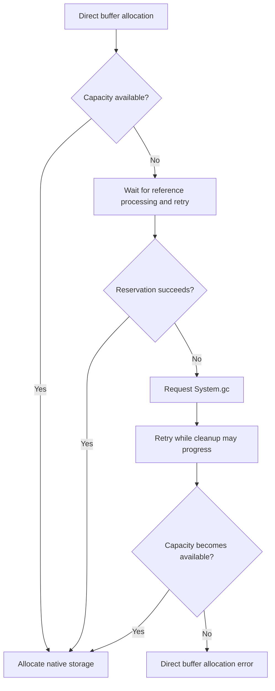

# Avoid System.gc() Full Collections Without Breaking Direct Buffers

Author: [nawazdhandala](https://www.github.com/nawazdhandala)

Tags: Java, Garbage Collection, Troubleshooting

Description: Diagnose explicit G1 collections, compare concurrent and disabled explicit GC, and reproduce the direct-buffer cleanup risk before changing JVM flags.

A G1 log entry containing `Pause Full (System.gc())` suggests an explicit collection request. It is tempting to suppress every request with one JVM option. That can remove the visible pause while exposing a different failure: direct-buffer allocation runs out of space even though the Java heap looks mostly empty.

The important distinction is between removing an unnecessary caller and disabling a mechanism used by the runtime itself. This guide uses Azul Zulu OpenJDK 21.0.13.1+2 with G1. Its small local tests demonstrate the behavior; they do not establish a production latency improvement or guarantee that every buffer-using application behaves identically.

## Identify what requested collection

`System.gc()` asks the runtime to make an effort to reclaim unused objects. Java does not promise that every object will be reclaimed or that cleanup will finish by a particular deadline. See the [System.gc API contract](https://docs.oracle.com/en/java/javase/21/docs/api/java.base/java/lang/System.html#gc()).

Start with the collection cause in existing GC logs. In the local default-G1 test, one explicit call produced:

```text
GC(0) Pause Full (System.gc()) 2M->1M(128M) 1.471ms
```

The small duration belongs to this tiny lab. It is not an estimate for a large application heap. A completed pause line and its matching `gc,start` line describe the same collection, so do not count them as two Full GCs.

The cause identifies an explicit request, not the application stack that made it. Search application code and dependency configuration for periodic collection calls, diagnostic endpoints and cleanup helpers. Correlate timestamps with those actions. If needed, capture a short, controlled profiling recording with the relevant event and stack settings verified for your JDK. Do not infer the caller solely from the text `System.gc()`.

Remove or reconfigure an unnecessary caller where possible. That is narrower than changing the policy for every explicit request in the process.

## Compare the two JVM policies

For the pinned G1 runtime, two options have different purposes:

| Option | Intended behavior | Important limitation |
|---|---|---|
| `-XX:+ExplicitGCInvokesConcurrent` | Handles explicit requests through concurrent G1 collection | Concurrent collection still includes pauses and consumes CPU |
| `-XX:+DisableExplicitGC` | Ignores `System.gc()` requests | Also suppresses requests made during direct-buffer allocation pressure |

The [Java 21 launcher reference](https://docs.oracle.com/en/java/javase/21/docs/specs/man/java.html) documents these options and scopes `ExplicitGCInvokesConcurrent` to G1. Test them separately. Enabling the concurrent option does not restore requests that the disabling option suppresses.

Disabling explicit GC does not disable ordinary automatic garbage collection. Objects can still be discovered and cleaned during normal GC activity. The risk is timing: a workload that allocates little Java heap but rapidly replaces direct buffers may need cleanup before ordinary heap pressure triggers collection.

## Understand the direct-memory path

A direct `ByteBuffer` owns memory outside the Java heap, while its Java wrapper remains a heap object. When the wrapper becomes unreachable, reference processing and cleanup can release its native allocation. Unreachable does not mean already discovered or already released.

In the [tagged OpenJDK 21 Bits implementation](https://raw.githubusercontent.com/openjdk/jdk21u/jdk-21.0.13%2B8/src/java.base/share/classes/java/nio/Bits.java), a failed direct-memory reservation waits for reference processing, retries, requests `System.gc()`, then retries with backoff before throwing an error. Suppressing that request can remove a useful opportunity to discover unreachable wrappers.



This diagram summarizes the reservation path. It does not imply that GC can reclaim a buffer still held by application code. A retained buffer, an intentionally large pool and delayed cleanup require different fixes.

## Reproduce the distinction in a bounded lab

Use a separate development process with JDK 21 and the companion `DirectLab.java`. Its `explicit` mode calls `System.gc()` once. Its `direct` mode allocates forty 1 MiB direct buffers, one at a time, without retaining them after the helper returns. It prints allocation progress and the direct buffer pool's reported capacity.

```bash
# Replace this with the selected JDK installation.
JDK21=/path/to/jdk-21.0.13.1
"$JDK21/bin/javac" DirectLab.java
mkdir -p direct-lab

"$JDK21/bin/java" -Xms128m -Xmx128m -XX:+UseG1GC \
  -XX:MaxDirectMemorySize=8m \
  '-Xlog:gc*:file=direct-lab/default.log:time,uptime,level,tags' \
  -cp . DirectLab direct

"$JDK21/bin/java" -Xms128m -Xmx128m -XX:+UseG1GC \
  -XX:MaxDirectMemorySize=8m -XX:+ExplicitGCInvokesConcurrent \
  '-Xlog:gc*:file=direct-lab/concurrent.log:time,uptime,level,tags' \
  -cp . DirectLab direct

"$JDK21/bin/java" -Xms128m -Xmx128m -XX:+UseG1GC \
  -XX:MaxDirectMemorySize=8m -XX:+DisableExplicitGC \
  '-Xlog:gc*:file=direct-lab/disabled.log:time,uptime,level,tags' \
  -cp . DirectLab direct
```

Run these independently; the third is deliberately a failure demonstration. On the tested macOS ARM64 runtime, the first two completed forty allocations. The disabled run completed eight, then failed to reserve another 1 MiB with 8 MiB already allocated. Its nonzero exit is expected in this observed case, not an instruction to ignore failures in a service.

These results depend on collection timing. A different runtime, extra allocation or background activity may allow ordinary GC to clean buffers before the limit is reached. The lesson is that disabling explicit requests can expose a cleanup dependency, not that failure must always occur at allocation nine.

Separately rerunning all three policies with `DirectLab explicit` showed a Full GC under defaults, a concurrent-start young pause followed by a concurrent marking cycle with the concurrent policy, and no explicit collection with suppression. Those runs verified policy behavior without conflating it with direct-memory pressure.

## Measure the right memory

Observe both Java heap and direct-buffer usage during a service test. The companion uses the documented [BufferPoolMXBean interface](https://docs.oracle.com/en/java/javase/21/docs/api/java.management/java/lang/management/BufferPoolMXBean.html). Its `getTotalCapacity()` and `getMemoryUsed()` values are estimates and can differ because of allocation details. Neither is a complete process-memory measurement.

The direct-buffer limit constrains aggregate buffer capacity in this implementation. Raising `-Xmx` does not change an explicitly configured `MaxDirectMemorySize`. Raising the direct limit may postpone failure but also increases potential native-memory consumption; check the container or host budget first.

Exercise connection churn, large transfers, cancelled requests and idle periods with little heap allocation. Record direct-buffer counts, capacity, allocation failures, request latency and GC causes. A steady heap graph alone cannot validate the change.

## Choose and roll out the narrowest fix

If application code explicitly collects after every batch, remove that call and test its original cleanup assumptions. If G1 must continue accepting requests but Full GC pauses are problematic, evaluate concurrent explicit collection first. If a framework owns pooled buffers, follow its documented release lifecycle and verify that buffers stop being retained; a GC flag cannot repair a missing release.

Use suppression only after representative tests establish that cleanup remains reliable under direct-memory pressure. Keep the previous JVM arguments ready, deploy a limited canary, and watch both latency and allocation errors. Roll back by restarting with the known configuration if direct-memory failures appear. Success means the service meets its latency target while retaining reliable resource cleanup, not merely that one log message disappeared.
