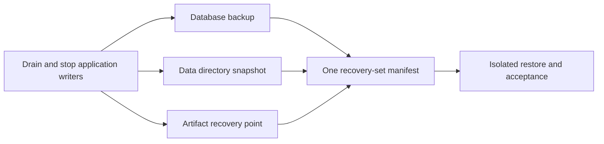

# Back Up and Restore TeamCity Database, Data, and Artifacts

Author: [nawazdhandala](https://www.github.com/nawazdhandala)

Tags: CI/CD, Backup, DevOps

Description: Build a coordinated TeamCity recovery set covering the external database, data directory, artifact storage, encryption keys, and isolated restore tests.

A TeamCity backup archive can restore projects and build history while leaving every release package unavailable. A database snapshot can be internally consistent while disagreeing with files copied an hour later. Successful backup jobs are useful evidence, but they are not yet proof of a recoverable service.

Treat recovery as a coordinated set of application state. This article focuses on TeamCity with an external database and either local or external artifact storage. The procedures follow TeamCity's 2026.2 documentation; PostgreSQL command examples are explicitly scoped to its version 16 client tools. They were source-reviewed, not executed against a live TeamCity database.

## Define the recovery set

Start by locating the actual data directory from TeamCity's Global Settings or startup log. Do not assume that it is the default `.BuildServer` directory. It is separate from the TeamCity installation directory, and important state lives in both the data directory and the external database. [TeamCity data directory](https://www.jetbrains.com/help/teamcity/teamcity-data-directory.html)

| Component | What you need to recover | Common omission |
| --- | --- | --- |
| External database | Build history, users, permissions, and operational records | Restoring a different timestamp from the files |
| Data directory | Configuration, secure values, plugin state, drivers, and local metadata | Saving only project Kotlin settings |
| Artifact locations | Release files, logs, and hidden build data as required | Assuming the TeamCity ZIP contains packages |
| External artifact store | Recoverable objects plus their TeamCity mappings | Retaining objects but losing the mapping files |
| Runtime environment | Exact TeamCity release, Java, startup settings, plugins, and trust | Restoring files into an incompatible installation |
| Secret dependencies | Required encryption key and protected connection credentials | Creating a new key that cannot decrypt old values |

TeamCity's built-in backup excludes build artifacts and application-level customizations such as installation configuration changes. Its selectable scopes also affect whether build logs and other data are included. Record the chosen scopes rather than describing every archive as “full.” [TeamCity backup contents](https://www.jetbrains.com/help/teamcity/teamcity-data-backup.html)

Keep encryption material in an approved recovery system with separate access controls. Record the key identifier and retrieval procedure in the backup manifest, not the raw key. An encrypted backup is not useful if its only decryption key was stored on the failed server.

## Choose one restore route for each backup format

There are two useful routes:

1. A TeamCity-generated archive restored through TeamCity's UI or `maintainDB`.
2. A native database backup restored with database tools, paired with a synchronized filesystem backup.

Do not feed a PostgreSQL custom-format dump to `maintainDB` or treat a TeamCity ZIP as a native database archive. Write the intended restore tool beside each file in your recovery manifest. JetBrains distinguishes manual recovery from restoration of its own backup format. [Manual backup and restore](https://www.jetbrains.com/help/teamcity/manual-backup-and-restore.html)

A useful manifest includes a recovery-set ID, exact TeamCity version, database engine and version, backup start and finish times, data-directory snapshot ID, every artifact location, object-store recovery references, checksums, and key-retrieval references. It should also explain any deliberately excluded data.

## Capture one coherent point

For the simplest consistency model, plan a maintenance window, drain builds, stop the TeamCity services that write this deployment's state, and capture the database and file stores before allowing writes again. Include all nodes in a multi-node installation, and coordinate any independent artifact cleanup process.

JetBrains recommends stopping the server for a consistent manual backup. It notes that a live backup can capture changing queue, build, or configuration state inconsistently. Its documented live-copy order starts with the database, then the data directory, but that order is not a replacement for rehearsing application-level consistency. [Manual backup consistency](https://www.jetbrains.com/help/teamcity/manual-backup-and-restore.html)



For a large artifact store, pre-copying unchanged files can reduce the maintenance window. The final synchronization still needs the agreed consistency boundary. Do not mix a new database with an old artifact copy simply because both backup jobs report success.

For PostgreSQL 16, a custom-format dump can be created with the following command after an administrator configures the named libpq service and protected authentication:

```bash
pg_dump --dbname='service=teamcity_backup' \
  --format=custom \
  --file='/secure-backup/recovery-001/teamcity.dump'
```

Use a new destination file in a restricted directory. `teamcity_backup` is a placeholder for your configured connection, not a built-in service name. PostgreSQL documents that `pg_dump` captures a consistent database snapshot, but it does not capture TeamCity's filesystem or cluster-wide objects such as roles. Have the database administrator include the required role and ownership prerequisites in the recovery procedure. [PostgreSQL 16 pg_dump](https://www.postgresql.org/docs/16/app-pgdump.html)

## Check the files before attempting recovery

For a native PostgreSQL archive, this read-only inspection lists its table of contents without connecting to a destination database:

```bash
pg_restore --list '/secure-backup/recovery-001/teamcity.dump'
```

A readable list is a useful format check, not proof that every table will restore or that the application will start. Use compatible client tools and an approved database restore procedure for the real rehearsal. [PostgreSQL 16 pg_restore](https://www.postgresql.org/docs/16/app-pgrestore.html)

For a TeamCity ZIP, this Python 3.11 example checks archive structure and member CRC values without extracting files:

```python
from pathlib import Path
from zipfile import ZipFile

backup = Path("/secure-backup/recovery-001/teamcity.zip")
with ZipFile(backup) as archive:
    if not archive.infolist():
        raise SystemExit("Backup ZIP is empty")
    if archive.testzip() is not None:
        raise SystemExit("Backup ZIP integrity check failed")
print("ZIP members passed integrity checks")
```

Replace the path with the actual TeamCity-generated archive. CRC checks detect certain corruption; they do not authenticate the backup, verify TeamCity scopes, or compare it with the database and artifacts. Preserve separately recorded cryptographic checksums as part of transport verification. [Python zipfile](https://docs.python.org/3.11/library/zipfile.html)

## Restore into isolated destinations

Use a clean data directory, a separate empty database, and separate artifact storage. Start with the same TeamCity version as the backup source so recovery is not combined with an upgrade. Keep the test instance unable to reach production deployment endpoints, production agents, notification destinations, or writable production artifact storage.

Before first startup, follow the copied-server checklist: review the server identity and URL, cloud integrations, cleanup, plugins, and other outbound effects. Network isolation provides an initial boundary while you inspect restored settings. A clone can otherwise trigger real external actions using restored credentials. [TeamCity copied-server checklist](https://www.jetbrains.com/help/teamcity/how-to.html#Copied+Server+Checklist)

For a **TeamCity-generated backup**, the following documented command shape targets a new external database. Run it only after installing the matching TeamCity release, preparing the empty target data directory, supplying the required JDBC driver, and checking that the target properties point to the isolated database:

```bash
/opt/teamcity-restore/bin/maintainDB.sh restore \
  -A /srv/teamcity-restore-data \
  -F /secure-backup/recovery-001/teamcity.zip \
  -T /secure-config/teamcity-restore-database.properties
```

These paths are placeholders. This command writes restored data; it is not a validation-only invocation. For a native database backup, use its database-specific restore route instead. [TeamCity restore procedure](https://www.jetbrains.com/help/teamcity/restoring-teamcity-data-from-backup.html)

Restore the matching artifact files and local artifact mapping metadata before starting TeamCity. Even with external artifact storage, local mappings matter. TeamCity starts metadata reindexing on a restored server, so starting before the artifact recovery is complete can cause missing-data problems. [Artifact restore ordering](https://www.jetbrains.com/help/teamcity/restoring-teamcity-data-from-backup.html)

## Prove the service can do useful work

Verify representative old and recent build records, user permissions, build logs, and the exact release artifacts recorded in the manifest. Compare package checksums. Check that secure references resolve under the restored encryption configuration without printing their values.

Only then allow a dedicated test agent and controlled test destinations. Run a small build that downloads a retained dependency, publishes a new artifact, and reads it back. Keep normal triggers and production integrations blocked until the recovery owner approves the transition.

Record the actual recovery point and elapsed restoration time, including artifact transfer and indexing. A monthly restore rehearsal that reveals a missing key or broken mapping is more useful than a dashboard showing thousands of untested successful backups.
