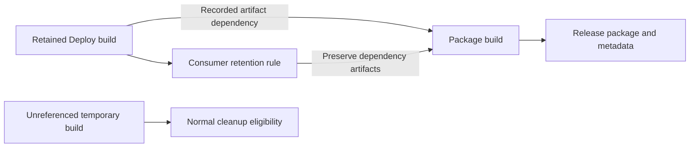

# Preserve Build-Chain Artifacts with TeamCity Clean-Up Rules

Author: [nawazdhandala](https://www.github.com/nawazdhandala)

Tags: CI/CD, DevOps

Description: Design TeamCity retention around downstream consumers, dependency protection, release keep rules, and a staging rehearsal before deleting build data.

A deployment rollback fails because its package has disappeared. The producer build still appears in TeamCity, complete with a successful status and a useful log. That is not a contradiction: build history and artifact retention are different decisions.

The safest way to design clean-up rules is to start with the consumers. Identify which deployed releases, pending approvals, and investigations still need an upstream output. Then decide how to preserve those relationships while deleting disposable data.

This walkthrough uses the TeamCity 2026.2 clean-up documentation and Kotlin DSL API. Its numbers are an illustrative staging policy, not universal production retention periods. No clean-up operation was executed for this article.

## Inventory what must remain usable

For one release chain, record the exact producer build and the artifacts required to repeat a test or deployment. Include the package, checksum or signature, and any deployment metadata needed to interpret it. A build number alone is not a recoverable release.

| Consumer | Reason to retain its input | Evidence to record |
| --- | --- | --- |
| Current production deployment | Roll forward or investigate | Producer build ID and package digest |
| Previous approved deployment | Rollback within the agreed window | Same package still downloadable |
| Awaiting approval | Approval can take longer than normal build retention | Actual dependency and expected approval deadline |
| Failed diagnostic run | Understand a recent regression | Required reports and logs, not necessarily every binary |
| Disposable branch build | Short-lived feedback | No remaining release obligation |

Separate an operational rollback window from a compliance archive. If a release must survive removal of the TeamCity installation, keeping a build in TeamCity is not enough. An independently retained release copy needs its own integrity checks and retrieval rehearsal.

## Protect the dependency from the consumer side

Suppose Deploy consumes artifacts from Package. Configure dependency preservation on Deploy, the consumer whose retained runs justify keeping Package's inputs. In a base rule, **Prevent clean-up** protects dependency builds and their artifacts. Snapshot relationships can preserve producer history even when its artifacts are not protected, which explains the missing-package scenario. [TeamCity dependency clean-up behavior](https://www.jetbrains.com/help/teamcity/teamcity-data-clean-up.html#Base+Rule+Behavior+for+Dependency+Builds)



That protection is grounded in dependencies TeamCity knows about. If a script downloads a package from an arbitrary URL, do not assume TeamCity has recorded the producer relationship. Prefer declared artifact dependencies and inspect the Dependencies tab of a representative consumer build. [Artifact dependencies](https://www.jetbrains.com/help/teamcity/artifact-dependencies.html)

Also inspect the whole chain. A packaging stage may consume generated files from another configuration. Record which links need protection instead of assuming a single release label explains every upstream retention decision.

## Start with a conservative base rule

A base rule defines ordinary cleanup behavior. The following fragment belongs inside the consumer's existing `BuildType` block. It is intended for a disposable staging configuration first:

```kotlin
cleanup {
    baseRule {
        artifacts(days = 30, builds = 10)
        history(days = 90, builds = 30)
        preventDependencyCleanup = true
    }
}
```

The artifact threshold is shorter than the history threshold so routine diagnostics can outlive large packages. This example does not configure the Everything level, which also removes statistics. The methods and dependency flag are documented in the [Cleanup DSL API](https://www.jetbrains.com/help/teamcity/kotlin-dsl-documentation/root/cleanup/).

Do not read `days = 30, builds = 10` as “delete when either limit is reached.” For base rules, both configured conditions participate in the retention boundary. The day calculation is anchored to the last successful build rather than simply today's date. Review actual history before estimating disk savings from those numbers. [Base rule semantics](https://www.jetbrains.com/help/teamcity/teamcity-data-clean-up.html#Base+Rule)

The thresholds are only a starting point. A low-frequency release project and a configuration that builds hundreds of times daily need different policies. Decide whether a failed build's logs are needed for a week, a month, or through the next incident review, then size retention accordingly.

## Add an explicit release keep rule

A keep rule describes exceptions that survive ordinary cleanup. Extend the same `cleanup` block with this example:

```kotlin
keepRule {
    id = "KeepApprovedReleaseInputs"
    keepAtLeast = builds(10)
    applyToBuilds {
        withTags = anyOf("approved-release")
        withStatus = successful()
        inPersonalBuilds = nonPersonal()
    }
    dataToKeep = everything()
    applyPerEachBranch = false
    preserveArtifactsDependencies = true
}
```

This selects up to the ten most recent matching successful, non-personal builds across the selected branches as one set, keeping their data and protecting their artifact dependencies. Other rules and pins can preserve additional builds: ten is not a global maximum. The field names come from the [KeepRule API](https://www.jetbrains.com/help/teamcity/kotlin-dsl-documentation/root/cleanup/keep-rule/) and [KeepRuleFilters API](https://www.jetbrains.com/help/teamcity/kotlin-dsl-documentation/root/cleanup/keep-rule/keep-rule-filters/).

`preserveArtifactsDependencies` is the important connection between keeping the consumer and keeping its inputs. Preserving a release label or its statistics alone does not express that same requirement. [Dependency preservation property](https://www.jetbrains.com/help/teamcity/kotlin-dsl-documentation/root/cleanup/keep-rule/preserve-artifacts-dependencies.html)

Apply the label through your release approval process. If nobody owns tagging, the rule can be syntactically correct and protect nothing. If every build receives the label, the policy no longer communicates an approval decision. Record who may add or remove it.

Pinning is useful for an exceptional incident or release. TeamCity provides a pin action and can extend it to preceding snapshot dependencies. Review that scope when using it; a pin is not an external backup or protection from every possible storage action. [Build pinning](https://www.jetbrains.com/help/teamcity/build-actions.html#Pin+Build)

## Inspect inheritance before saving changes

Review the effective rules on both producer and consumer. A parent project's rule may be inherited or overridden. Adding a local base rule can change behavior that previously came from the parent, so compare the entire effective policy rather than just the new lines.

Do not remove a base rule assuming this disables cleanup. TeamCity warns that data not covered by keep rules becomes eligible when no base rule is configured. [Clean-up rule interaction](https://www.jetbrains.com/help/teamcity/teamcity-data-clean-up.html#Clean-up+Rules)

For code-managed projects, generate the DSL from a staging configuration and review it using the API version shipped with your server. A balanced Kotlin fragment is not proof that the resulting retention policy preserves your actual releases.

## Rehearse deletion using disposable data

Build a small staging history with known marker files and checksums. Use a separate test server when you need to run server-wide clean-up manually; that action is not a harmless preview. Ensure the disposable fixture crosses the configured thresholds and is not accidentally protected by unrelated inherited rules.

| Fixture | Expected observation after cleanup |
| --- | --- |
| Retained consumer with dependency preservation | Original producer artifacts remain downloadable |
| Approved release matched by the keep rule | Its selected data and required dependency inputs remain |
| Old unreferenced disposable build | Eligible data disappears according to the configured levels |
| Retained producer history without artifact protection | History alone is not accepted as evidence that its package survives |

After the run, download the same original producer artifact and compare its checksum. Do not substitute a newly rebuilt package. Exercise the downstream staging deployment against that retained input, and keep the test result with the policy review.

For unexpectedly retained builds, TeamCity supports the `diagnostics:cleanup` tag. During cleanup it writes a report under hidden `.teamcity/cleanup/` artifacts and removes the tag afterward. This is a diagnostic of a cleanup run, not a dry-run deletion simulator. [Cleanup diagnostics](https://www.jetbrains.com/help/teamcity/teamcity-data-clean-up.html#Cleanup+Diagnostics)

## Monitor the policy after rollout

Introduce the policy to a small project first. Watch artifact availability, disk growth, cleanup duration, and the count of pinned or release-tagged builds. Unexpected retention deserves investigation before removing protections; it may represent a live dependency.

Coordinate any independent object-storage lifecycle policy with TeamCity retention. TeamCity cannot preserve a file deleted outside its control. Keep a recovery path for storage mistakes and test it separately from normal retention.

A useful policy can answer two questions for every important package: which retained consumer still needs it, and what verified process will keep it available until that obligation ends?
