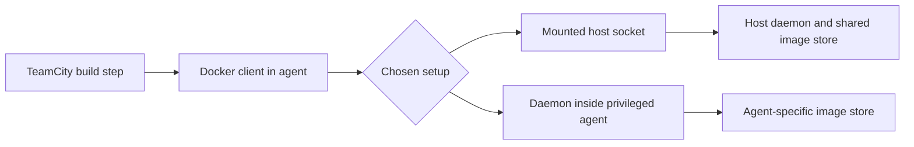

# Docker Builds on TeamCity: Host Socket vs. Docker-in-Docker

Author: [nawazdhandala](https://www.github.com/nawazdhandala)

Tags: Docker, CI/CD, DevOps

Description: Choose a Docker setup for TeamCity agents by understanding daemon access, workspace paths, cache ownership, credentials, and isolation limits.

A TeamCity agent can have a working Docker command without having a usable Docker server. The command is a client; the daemon is the service that creates containers and stores images. Before changing an agent image, decide which daemon each build should control.

Two common arrangements are mounting the host's Docker socket into the agent and starting a Docker daemon inside the agent container. The second is usually called Docker-in-Docker, or DinD. Both can build images, but they create different operational problems. Neither arrangement below is a safe boundary for running arbitrary untrusted pull requests alongside sensitive workloads.

## Follow the request to the daemon

The socket is a local communication endpoint, usually `/var/run/docker.sock`. Mounting it gives the agent a connection to the host daemon. DinD instead gives the agent its own daemon and image store.



This distinction matters when investigating a missing image: an image pulled into the host daemon is not automatically present in the DinD daemon. Similarly, removing a container from one daemon does not clean up the other.

| Decision | Host socket | Docker-in-Docker |
| --- | --- | --- |
| Image cache | Shared with that host daemon | Separate for each nested daemon |
| Workspace mounts | Must resolve on the host | Resolve inside the agent's daemon environment |
| Cleanup responsibility | Must account for every daemon user | Can be assigned to one agent's store |
| Main privilege concern | Build controls the host daemon | Agent needs privileged container access |
| Useful starting point | Dedicated VM for trusted builds | Dedicated VM where separate Docker state is useful |

Docker documents why daemon access is security-sensitive: a client can request containers that mount host files. Treat access to the socket as a powerful administrative capability, even when the agent itself appears containerized. [Docker Engine security](https://docs.docker.com/engine/security/)

## Prepare a disposable Linux staging host

The following are alternative launch examples, not commands to run together on an existing production worker. Use a dedicated Linux virtual machine with Docker installed, sufficient disk space, and permission to create privileged workloads. Choose an agent release compatible with your TeamCity server and CPU architecture.

Replace the image placeholder with a reviewed digest for that release. A digest identifies specific image content; it does not make an unsupported release safe. For the DinD example, resolve the digest specifically from the release's **linux-sudo variant**. Do not reuse a digest from a different variant simply because its repository name matches.

Create the configuration directory through your normal host provisioning process. For the host-socket example, also provision the five `/opt/buildagent` directories shown below. These must be dedicated to this agent. Ensure the agent can reach your TeamCity HTTPS URL and already trusts its certificate authority. Neither script installs certificate trust or registers an agent automatically with an approved pool.

The launch settings follow the [JetBrains agent image instructions at commit 2ff7c4a](https://github.com/JetBrains/teamcity-docker-images/blob/2ff7c4a1cc8c5bc10f7b52ded42f85d5bf1615ff/dockerhub/teamcity-agent/README.md). They are source-reviewed examples; no TeamCity or Docker deployment was executed for this article.

## Option one: connect to the host socket

Run this on the prepared staging host after replacing both placeholders:

```bash
#!/bin/sh
set -eu
AGENT_IMAGE='jetbrains/teamcity-agent@sha256:REPLACE_WITH_REVIEWED_DIGEST'
SERVER_URL='https://teamcity.example.internal'

docker run -d --name tc-agent-socket \
  -e SERVER_URL="$SERVER_URL" \
  -u 0 \
  -v /srv/teamcity/socket-conf:/data/teamcity_agent/conf \
  -v /var/run/docker.sock:/var/run/docker.sock \
  -v /opt/buildagent/work:/opt/buildagent/work \
  -v /opt/buildagent/temp:/opt/buildagent/temp \
  -v /opt/buildagent/tools:/opt/buildagent/tools \
  -v /opt/buildagent/plugins:/opt/buildagent/plugins \
  -v /opt/buildagent/system:/opt/buildagent/system \
  "$AGENT_IMAGE"
```

The expected initial result is a container ID. That proves only that Docker accepted the launch, not that TeamCity can schedule a build. The explicit root user follows this documented setup and is another reason to dedicate the machine to trusted build work.

Keep those workspace paths identical on both sides of each mount. JetBrains requires these mappings for its container wrapper and documents collisions when several standard agent containers share them. Supporting multiple agents with that wrapper requires distinct installation paths inside custom images and matching host paths; merely changing the left-hand directory is insufficient. [Agent image workspace requirements](https://github.com/JetBrains/teamcity-docker-images/blob/2ff7c4a1cc8c5bc10f7b52ded42f85d5bf1615ff/dockerhub/teamcity-agent/README.md)

Why does this happen? Docker resolves bind-mount source paths on the daemon's machine, not the client's machine. A build can successfully send a build context to Docker yet fail later when a sibling container tries to mount the checkout directory. A successful image build therefore does not prove wrapper-based builds will work. [Docker bind mounts](https://docs.docker.com/engine/storage/bind-mounts/)

## Option two: start a separate daemon inside the agent

On a separate prepared worker, substitute the reviewed linux-sudo image digest:

```bash
#!/bin/sh
set -eu
AGENT_IMAGE='jetbrains/teamcity-agent@sha256:REPLACE_WITH_LINUX_SUDO_DIGEST'
SERVER_URL='https://teamcity.example.internal'

docker run -d --name tc-agent-dind \
  -e SERVER_URL="$SERVER_URL" \
  -u 0 \
  -v /srv/teamcity/dind-conf:/data/teamcity_agent/conf \
  -v tc-agent-dind-store:/var/lib/docker \
  --privileged \
  -e DOCKER_IN_DOCKER=start \
  "$AGENT_IMAGE"
```

Here `DOCKER_IN_DOCKER=start` starts the nested daemon. Its store has a dedicated named volume, and there is no host-socket mount. Assign a different store to every independent daemon. These settings and the linux-sudo requirement are documented by [JetBrains](https://github.com/JetBrains/teamcity-docker-images/blob/2ff7c4a1cc8c5bc10f7b52ded42f85d5bf1615ff/dockerhub/teamcity-agent/README.md).

Separate storage is useful when you want to retire one worker's cache without affecting another. It also means cold workers must download their own images. Budget registry bandwidth and disk capacity accordingly. The privileged flag remains a major trust concession; a private image cache is not evidence of strong workload isolation.

Do not add an unauthenticated Docker TCP listener to make connectivity easier. If your design calls for a remote daemon, use a separately reviewed authenticated connection such as Docker's documented SSH or TLS arrangements. [Protect the Docker daemon socket](https://docs.docker.com/engine/security/protect-access/)

## Test the complete build path

After the agent starts, use a read-only diagnostic appropriate to the selected container:

```bash
docker exec tc-agent-socket docker version
# For the alternative setup:
# docker exec tc-agent-dind docker version
```

The expected output includes both client and server information. Client-only output or a connection error points to daemon access or startup, before you investigate TeamCity runner settings. This diagnostic uses the documented [Docker version command](https://docs.docker.com/reference/cli/docker/version/).

Then authorize the staging agent and run a small representative build. Give its output image a unique build-specific tag. Include the same container wrapper your real pipeline uses, and check that a file produced inside the build container becomes a TeamCity artifact. This exercises the workspace boundary that a simple Docker connection check misses.

Repeat once to observe cache reuse, then rehearse worker replacement with the intended cache-retention policy. Record which daemon owns the output and how long the cold build takes. Avoid broad daemon-wide cleanup during this test: on the socket setup it can affect unrelated work.

## Keep credentials and trust separate

Configure a project Docker registry connection and select it in the build's Docker Registry Connections feature. TeamCity documents login before the build and logout afterward. Keep passwords out of launch scripts and image layers. [TeamCity registry connections](https://www.jetbrains.com/help/teamcity/configuring-connections-to-docker.html)

A registry login does not install its certificate authority. Distinguish the agent's trust of the TeamCity server from the selected daemon's trust of the registry. When DinD pulls fail while host pulls succeed, compare these separate trust configurations before changing credentials.

Choose the host socket when shared daemon state and carefully aligned paths suit a dedicated trusted worker. Choose DinD when separate daemon state justifies its additional startup and storage management. For either design, make the trust boundary the worker you can replace, restrict the builds allowed onto it, and prove the actual artifact-producing pipeline before expanding its use.
