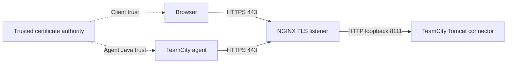

# Run TeamCity Behind NGINX with HTTPS and Working Agents

Author: [nawazdhandala](https://www.github.com/nawazdhandala)

Tags: CI/CD, Nginx, SSL, DevOps

Description: Configure TeamCity behind NGINX with HTTPS, WebSocket forwarding, Tomcat proxy settings, certificate trust, and practical agent acceptance checks.

Putting an HTTPS listener in front of TeamCity can make the login page work while leaving redirects, browser updates, or agent uploads broken. The browser sees the public HTTPS address; TeamCity may still think requests arrived at an internal HTTP port.

A working setup makes that public address consistent across NGINX, Tomcat, TeamCity's Server URL, and agent configuration. It also preserves the request headers and connection behavior TeamCity needs.

This example uses one TeamCity server, one NGINX proxy on the same host, and the public root URL `https://teamcity.example.internal/`. The hostname and certificate paths are placeholders. It follows TeamCity 2026.2 documentation and uses NGINX 1.30.7 for local configuration checks. A multi-node load balancer or a proxy on another machine needs a different upstream and trust design.

## Decide where HTTPS ends

TLS, the protocol behind HTTPS, terminates at NGINX. NGINX then forwards to a loopback-only Tomcat connector on port 8111. Loopback means the connection stays on the same machine.



The certificate must cover the public hostname and include the chain clients need. Browsers and agents must trust its issuing certificate authority. Keep the private key readable only by the appropriate NGINX service identity. NGINX documents both certificate-chain ordering and the distinction between public certificates and private keys. [NGINX HTTPS configuration](https://nginx.org/en/docs/http/configuring_https_servers.html)

If NGINX and TeamCity are in different containers, `127.0.0.1` usually refers to different network namespaces. Do not copy this upstream unchanged into that topology. Use the intended private route and decide whether it requires separately verified upstream TLS.

## Configure NGINX without changing the application path

Place this fragment inside the existing `http` context, such as through a file included there. Do not put the `map` directive inside `server` or `location`.

```nginx
map $http_upgrade $connection_upgrade {
    default upgrade;
    ''      close;
}

server {
    listen 443 ssl;
    server_name teamcity.example.internal;

    ssl_certificate     /etc/nginx/tls/teamcity-fullchain.pem;
    ssl_certificate_key /etc/nginx/tls/teamcity-key.pem;
    ssl_protocols TLSv1.2 TLSv1.3;

    client_max_body_size 2g;
    proxy_read_timeout 1200s;
    proxy_connect_timeout 240s;

    location / {
        proxy_pass http://127.0.0.1:8111;
        proxy_http_version 1.1;
        proxy_set_header Host $host;
        proxy_set_header X-Forwarded-Host $host;
        proxy_set_header X-Forwarded-Proto $scheme;
        proxy_set_header X-Forwarded-Port $server_port;
        proxy_set_header X-Forwarded-For $remote_addr;
        proxy_set_header Forwarded "";
        proxy_set_header Upgrade $http_upgrade;
        proxy_set_header Connection $connection_upgrade;
    }
}
```

The example keeps `/` on both sides. If your existing TeamCity deployment uses `/tc`, keep the same context externally and internally rather than casually stripping that prefix. TeamCity also needs unmodified `Origin`, `Referer`, and application-specific headers for normal security checks. Do not “fix” a cross-site request forgery error by removing those headers or disabling the check. [TeamCity proxy guidance](https://www.jetbrains.com/help/teamcity/configuring-proxy-server.html)

The forwarded scheme and host describe the client-facing request. The client address is overwritten with the directly connected peer rather than accepting a supplied forwarding chain. Clearing `Forwarded` avoids passing an untrusted alternative representation. This is a one-proxy boundary; if another trusted load balancer sits in front, design and test that trust chain explicitly.

The Upgrade and Connection settings enable WebSocket negotiation. WebSockets keep a connection open for interactive updates; forwarding ordinary HTTP successfully does not prove that upgrade negotiation works. The `map` sends `upgrade` only when requested. [NGINX WebSocket proxying](https://nginx.org/en/docs/http/websocket.html)

The 2 GiB body limit is an example capacity decision. Set it above your largest legitimate upload, or choose another reviewed policy. Account for request buffering and temporary-disk capacity as well as timeouts. Do not interpret a longer read timeout as a cure for a failing upstream. NGINX's [proxy module reference](https://nginx.org/en/docs/http/ngx_http_proxy_module.html) describes these separate behaviors.

This fragment does not configure HTTP-to-HTTPS redirection, other virtual hosts, or additional perimeter authentication. Route agents directly to the HTTPS URL rather than depending on a redirect through a browser-oriented login gateway.

## Tell Tomcat about the public URL

Back up the existing `<TeamCity Home>/conf/server.xml`, then edit the existing connector used by this proxy. Do not add a second connector on the same port. Preserve other required settings while applying the public URL attributes:

```xml
<Connector address="127.0.0.1"
           port="8111"
           protocol="org.apache.coyote.http11.Http11NioProtocol"
           connectionTimeout="60000"
           useBodyEncodingForURI="true"
           proxyName="teamcity.example.internal"
           proxyPort="443"
           scheme="https"
           secure="true" />
```

`proxyName`, `proxyPort`, `scheme`, and `secure` tell the application what clients used. They do not enable encryption on the loopback connector. The HTTPS connection remains the one between the client and NGINX. Tomcat documents these attributes in its [HTTP connector reference](https://tomcat.apache.org/tomcat-9.0-doc/config/http.html).

Use this connector exclusively for requests arriving through the intended public HTTPS endpoint. The loopback binding helps enforce the same-host arrangement. Apply the connector change through a planned TeamCity restart, then verify it did not expose an additional direct HTTP route. TeamCity recommends a dedicated connector with the appropriate public URL details. [TeamCity Tomcat configuration](https://www.jetbrains.com/help/teamcity/configuring-proxy-server.html#TeamCity+Tomcat+Configuration)

Set **Administration → Global Settings → Server URL** to `https://teamcity.example.internal/`. This value is used for links generated outside an incoming request, such as notifications; forwarded headers alone do not replace it. [Server URL settings](https://www.jetbrains.com/help/teamcity/configuring-server-url.html)

## Configure agents for the same address and trust

Update the agent's `conf/buildAgent.properties` entry, as documented in [agent configuration](https://www.jetbrains.com/help/teamcity/configure-agent-installation.html):

```properties
serverUrl=https://teamcity.example.internal/
```

Use the actual public URL and restart or replace the agent through its normal management process. DNS resolution, routing, and certificate trust must work from the agent machine, not just from an administrator's browser.

For an internal CA, install the appropriate trust through the documented trusted-certificate or Java trust configuration used by the agent. Confirm which Java runtime launches that agent; adding a certificate to an unrelated system JDK will not help. Keep hostname verification enabled. [TeamCity HTTPS client configuration](https://www.jetbrains.com/help/teamcity/using-https-to-access-teamcity-server.html)

Do not place an interactive authentication prompt in front of all TeamCity requests without a supported non-browser path for agents and automation. TeamCity's own authorization and the proxy's access controls must work together.

## Validate in layers before switching traffic

On the staging NGINX host, after the certificate files and enclosing configuration exist, run:

```bash
nginx -t
```

The expected result reports successful configuration testing. This checks syntax and attempts to open referenced files; it does not prove TeamCity's behavior. Reload through your service manager only after that check passes. [NGINX command-line checks](https://nginx.org/en/docs/switches.html)

Then work through these acceptance cases:

| Case | Expected outcome |
| --- | --- |
| Fresh browser sign-in | Trusted certificate and redirects to the public HTTPS hostname |
| Interactive page | WebSocket upgrade succeeds and live updates continue |
| Agent connection | Agent connects, remains authorized, and receives a build |
| Representative upload | Artifact larger than trivial test files uploads successfully |
| Artifact retrieval | Ordinary and hidden artifact paths are reachable with proper permissions |
| External links | Notifications and integration callbacks use the intended public URL |

If the browser works but agents fail, check agent DNS and Java trust before changing HTTP headers. If uploads return 413, inspect size limits at every intermediary. If a long request returns 504, correlate proxy and server logs to find the actual delay. A redirect to an internal hostname points back to the connector, forwarded host, or Server URL settings.

Keep the old routing configuration available during the cutover. Promote the tested proxy setup only after both browser and agent paths pass; they exercise different parts of the same service.
