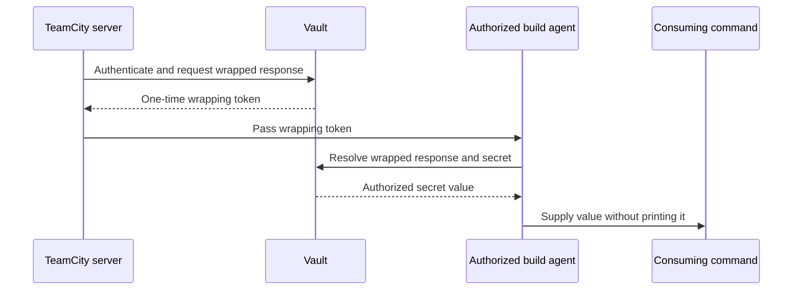

# Keep Secrets Out of TeamCity Kotlin DSL and Build Logs

Author: [nawazdhandala](https://www.github.com/nawazdhandala)

Tags: CI/CD, Security, DevOps

Description: Use TeamCity password references and HashiCorp Vault remote parameters without committing credentials, printing them, or confusing masking with isolation.

Marking a parameter as a password does not make it safe to paste the password into a Kotlin file. The repository still contains that literal value. Likewise, hiding a value in TeamCity's interface does not prevent a build script from sending it elsewhere.

A practical secrets design separates three questions: where the credential is stored, which builds may receive it, and how the consuming command handles it. TeamCity password references address the first question for server-managed values. HashiCorp Vault can provide a central source with separately managed access. Neither removes the need to trust the code that receives a secret.

The examples below target classic TeamCity configurations using the documented 2026.2-era remote-parameter API. They contain placeholders only. No TeamCity server or Vault connection was exercised for this article.

## Choose the storage path deliberately

| Need | Suitable mechanism | Value committed to settings |
| --- | --- | --- |
| Small project-specific credential managed in TeamCity | Password parameter with a server-side secure-value reference | Reference identifier |
| Secret managed centrally in Vault | Remote secret parameter and Vault connection | Connection ID and query path |
| Non-sensitive option such as deployment region | Ordinary parameter | Actual setting |

A hidden display setting is not a password type. TeamCity documents password masking as string replacement and warns that people who can alter build scripts can expose the value. Do not use masking as a security boundary between trusted and untrusted builds. [Typed parameter behavior](https://www.jetbrains.com/help/teamcity/typed-parameters.html)

## Use a reference in Kotlin, not a literal password

For a server-managed value, open the project's Actions menu and choose **Generate token for a secure value**. Enter the secret through that controlled interface and retain the generated reference. Place it in your versioned settings like this:

```kotlin
params {
    password(
        "env.REGISTRY_PASSWORD",
        "credentialsJSON:REPLACE_WITH_GENERATED_REFERENCE"
    )
}
```

This fragment belongs inside a project or build configuration's Kotlin DSL block. The reference is resolved by TeamCity; it is not the registry password and is not a TeamCity personal access token. Use the identifier generated for your project, not an invented identifier.

The `credentialsJSON:` form is for configuration files. Pasting the same string into a password field in the UI makes that string the password instead of resolving it. TeamCity's [secure settings and token documentation](https://www.jetbrains.com/help/teamcity/storing-project-settings-in-version-control.html#Managing+Tokens) describes both behaviors.

A fresh server also needs the associated secure-value storage. Restoring only a Git repository does not recreate those credentials. Include the server's protected configuration and encryption requirements in the recovery plan, and rehearse reference resolution after a staging restore.

## Move centrally managed values to Vault

Create a HashiCorp Vault connection under the narrowest appropriate TeamCity project. Configure its HTTPS endpoint, authentication method, and connection ID through the approved administrative process. A connection placed at the root project becomes available more broadly through inheritance, so do not choose that location merely for convenience.

The integration uses a response-wrapping token: the server obtains a one-time reference, and the build agent uses it to obtain the secret. The agent therefore needs its own network route and certificate trust for Vault. A successful server-side connection test does not prove that every agent can complete retrieval. [TeamCity Vault integration](https://www.jetbrains.com/help/teamcity/hashicorp-vault.html)



For a Key/Value version 2 mount called `secret`, a secret path `ci/registry`, and a key called `password`, use this remote parameter instead of the password declaration above:

```kotlin
import jetbrains.buildServer.configs.kotlin.remoteParameters.hashiCorpVaultParameter

// Inside the existing BuildType or project block:
params {
    hashiCorpVaultParameter {
        name = "env.REGISTRY_PASSWORD"
        vaultId = "teamcity-registry"
        query = "secret/data/ci/registry!/password"
    }
}
```

Here `teamcity-registry` is the TeamCity connection ID, not a Vault Enterprise namespace. The `/data/` segment belongs to the KV v2 API path. The `!/password` suffix selects the key through TeamCity's query syntax. KV v1 uses a different path without the KV v2 `data` segment. [HashiCorpVaultParameter API](https://teamcity.jetbrains.com/app/dsl-documentation/remoteParameters/hashi-corp-vault-parameter/index.html)

Use the generated DSL from your installed server to confirm imports and fields before applying it. Avoid introducing legacy `%vault:...%` references into new configurations; use the documented remote-parameter migration path when upgrading existing settings. [Vault parameter migration](https://www.jetbrains.com/help/teamcity/hashicorp-vault.html#Update+Legacy+Parameters)

## Limit what the Vault identity can read

For the example secret, this HCL policy fragment grants read access to one KV v2 data path:

```hcl
path "secret/data/ci/registry" {
  capabilities = ["read"]
}
```

HCL is HashiCorp's configuration language. This fragment is a data-access rule, not a complete TeamCity authentication or token-lifecycle policy. Have the Vault administrator attach the necessary narrowly scoped policies to the chosen authentication role, then test allowed and denied paths.

The suffix `!/password` does not belong in the Vault policy. Also, granting read access to this path permits reading the secret object, not just the one selected key. Store unrelated sensitive values at separate paths when they need different access. Review all policies attached to the identity; adding a narrow rule does not cancel broader grants elsewhere. [Vault policies](https://developer.hashicorp.com/vault/docs/concepts/policies)

KV v2 stores versioned static secrets. Moving a registry password there does not automatically make it expire after each build. Rotation of that password at the registry remains a separate operation. [Vault KV v2](https://developer.hashicorp.com/vault/docs/secrets/kv/kv-v2)

## Give the consumer only the interface it needs

Prefer a supported TeamCity registry connection when it fits the build. If a custom script must log in, Docker supports reading the password from standard input instead of a command-line argument. The following shell example requires Docker CLI, `mktemp`, and the three named environment variables. Keep shell tracing disabled.

```bash
#!/bin/sh
set -eu
set +x
: "${REGISTRY_HOST:?Set the registry hostname}"
: "${REGISTRY_USER:?Set the registry username}"
: "${REGISTRY_PASSWORD:?Missing registry credential}"
umask 077
auth_dir=$(mktemp -d)
trap 'rm -rf "$auth_dir"' EXIT
trap 'exit 1' HUP INT TERM
printf '%s' "$REGISTRY_PASSWORD" |
  docker --config "$auth_dir" login "$REGISTRY_HOST" \
    --username "$REGISTRY_USER" --password-stdin
unset REGISTRY_PASSWORD
# Run approved Docker operations here using --config "$auth_dir".
```

The temporary directory keeps this invocation's client configuration separate, and the trap removes only that newly created directory. Docker may store credentials in its configuration when no credential store is configured, so do not publish or cache it. `--password-stdin` avoids putting the password in the login command's argument list. [Docker login](https://docs.docker.com/reference/cli/docker/login/)

This is still a secret in the build process environment until it is unset. Other authorized processes or hostile build code can access it; abrupt worker termination can also bypass cleanup. Restrict secret-bearing jobs to trusted code and workers. Do not run `env`, enable verbose credential debugging, or upload the whole workspace as an artifact.

## Test retrieval without testing your luck

Start with a disposable staging credential. Verify that the consumer can authenticate without printing the value, then inspect logs and published artifacts. Separately test a denied Vault path, a missing key, and an unavailable Vault endpoint. Each must prevent the sensitive operation rather than fall back to a committed password.

Rehearse rotation with both the issuer and consumers: introduce the replacement credential, update Vault or the server-managed value, run a controlled build, and retire the old credential after the planned overlap. Check long-running builds before revocation.

Finally, review who can change the settings, application scripts, templates, and dependencies used by the job. Any of those can affect secret handling. JetBrains recommends restricting settings changes and separating untrusted pull-request builds. [TeamCity security guidance](https://www.jetbrains.com/help/teamcity/security-notes.html)

The result should be a repository containing references, builds receiving only the credentials they need, and an operational process that can rotate or revoke those credentials without editing secrets into source control.
