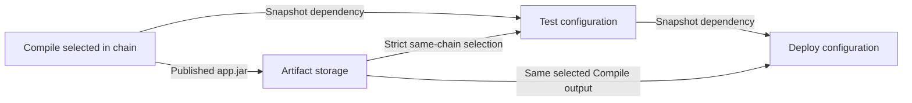

# Keep TeamCity Snapshot and Artifact Dependencies Aligned

Author: [nawazdhandala](https://www.github.com/nawazdhandala)

Tags: CI/CD, DevOps

Description: Pair TeamCity snapshot and artifact dependencies so tests and deployments use the intended build output, even when newer builds finish concurrently.

Consider a pipeline with Compile, Test, and Deploy configurations. Test checks out commit A, but its artifact dependency downloads the latest successful Compile build. While Test was waiting for an agent, someone compiled commit B. The tests now exercise B using test code from A.

Every individual configuration might appear healthy. The mistake is the relationship between them. TeamCity provides two different dependency mechanisms, and a reliable release chain often needs both.

This article uses classic build configurations and the TeamCity 2026.2 Kotlin DSL reference. The fragments belong inside an existing versioned-settings project; they are not a complete project definition. No TeamCity server was used to execute this example.

## Give each dependency one clear job

A **snapshot dependency** connects build configurations, controls their execution relationship, and can synchronize their source revisions. It does not copy the compiled output. An **artifact dependency** downloads published files from a selected build. By itself, it does not establish the required execution order or source synchronization. [Chain dependency settings](https://www.jetbrains.com/help/teamcity/configuring-dependencies.html), [passing artifacts in a chain](https://www.jetbrains.com/help/teamcity/artifact-dependencies.html)

| Configuration choice | What it gives you | What still needs attention |
| --- | --- | --- |
| Snapshot only | An upstream build relationship and revision synchronization | No binary transfer |
| Artifact only, latest successful | Files from a successful matching build | That build might not be the intended producer |
| Snapshot plus strict same-chain artifacts | Coordinated upstream selection and files from that producer | Correct publication paths, tests, and retention |

Think about build identities rather than filenames. Many runs can publish `app.jar`; its name tells you almost nothing about which source revision produced it.



The diagram intentionally sends the original compiled file to deployment. Rebuilding after tests can produce different bytes, even from the same commit, if dependencies, timestamps, or toolchains change.

## Publish a small, explicit artifact set

First make Compile publish a release file and a small provenance record. Provenance means information about where an output came from: for example, producer build ID, source revision, and checksum.

Assume your build already creates `out/app.jar` and `out/build-info.json`. Add these publication rules to Compile's `BuildType`:

```kotlin
artifactRules = """
    out/app.jar => release
    out/build-info.json => release
""".trimIndent()
```

The expected published paths are `release/app.jar` and `release/build-info.json`. Check the producer's Artifacts tab after a staging run rather than guessing paths from the agent filesystem. TeamCity's publication rules map checkout files into stored artifacts; those stored paths are what the downstream dependency sees. [General settings and artifact paths](https://www.jetbrains.com/help/teamcity/configuring-general-settings.html), [build artifacts](https://www.jetbrains.com/help/teamcity/build-artifact.html)

Keep the release set narrow. Downloading every report and temporary file makes it harder to distinguish the deployable product from diagnostics. Never put credentials in provenance records.

## Select the producer in the same chain

Assume `Compile` is the existing Kotlin `BuildType` object for the upstream configuration. Put this fragment inside Test:

```kotlin
dependencies {
    snapshot(Compile) {
        synchronizeRevisions = true
        reuseBuilds = ReuseBuilds.SUCCESSFUL
        onDependencyFailure = FailureAction.FAIL_TO_START
        onDependencyCancel = FailureAction.CANCEL
    }
    artifacts(Compile) {
        buildRule = sameChain()
        artifactRules = """
            release/app.jar => input
            release/build-info.json => input
        """.trimIndent()
        cleanDestination = true
    }
}
```

Use the standard `jetbrains.buildServer.configs.kotlin.*` import in the surrounding settings file. The snapshot options synchronize revisions, allow suitable successful build reuse, and prevent ordinary test execution after an upstream failure. The enum choices are documented in [ReuseBuilds](https://www.jetbrains.com/help/teamcity/kotlin-dsl-documentation/root/reuse-builds/) and [FailureAction](https://www.jetbrains.com/help/teamcity/kotlin-dsl-documentation/root/failure-action/); the properties are listed in [SnapshotDependency](https://www.jetbrains.com/help/teamcity/kotlin-dsl-documentation/root/snapshot-dependency/).

The important artifact setting is `sameChain()`. It is the strict selector. The DSL's default artifact selection is `sameChainOrLastFinished()`, which allows a fallback when the producer is outside the chain. Specify the strict rule when a release must fail rather than silently consume a different producer. [ArtifactDependency API](https://www.jetbrains.com/help/teamcity/kotlin-dsl-documentation/root/artifact-dependency/)

`cleanDestination = true` removes old contents from artifact destination directories before downloading. Reserve `input/` for this purpose; do not point the rule at a directory containing source files or unrelated build state. Required release artifacts should not use the optional `?:` prefix, because a missing binary should prevent the test from proceeding. [Artifact download rules](https://www.jetbrains.com/help/teamcity/artifact-dependencies.html)

Configure Deploy with a snapshot dependency on Test, preserving failure handling, and a strict same-chain artifact dependency on Compile. Compile is upstream through Test. This lets Deploy consume the original producer's file while waiting for the test result. Dependencies are declared in the downstream configuration, and TeamCity resolves upstream links transitively. [Build chains](https://www.jetbrains.com/help/teamcity/build-chain.html)

## Check the downloaded bytes as well as the graph

A useful producer record contains a SHA-256 checksum of the finished `app.jar`. Compute it after all packaging or signing steps. The following Python 3.11 consumer check assumes the downloaded JSON contains an `artifact_sha256` string:

```python
import hashlib
import json
import re
from pathlib import Path

metadata = json.loads(Path("input/build-info.json").read_text())
expected = metadata.get("artifact_sha256")
if not isinstance(expected, str) or not re.fullmatch(r"[0-9a-f]{64}", expected):
    raise SystemExit("Missing or invalid artifact checksum")

with Path("input/app.jar").open("rb") as artifact:
    actual = hashlib.file_digest(artifact, "sha256").hexdigest()
if actual != expected:
    raise SystemExit("Artifact checksum mismatch")
print("Artifact checksum matches producer metadata")
```

Run it before tests and deployment. Matching files print one success message; missing files, malformed metadata, or changed bytes stop the check. Python 3.11 provides the streaming `file_digest` API used here. [Python hashlib](https://docs.python.org/3.11/library/hashlib.html)

This proves consistency between the two downloaded files, not authenticity. Someone who can replace both can change the checksum too. Keep producer permissions controlled and independently compare the producer build identity in TeamCity's dependency view. The graph establishes which producer was selected; the checksum catches accidental file mismatches afterward.

## Rehearse the concurrency case

Use a staging chain and deliberately queue Test for revision A while a newer independent Compile build for revision B finishes. Record the Compile build selected by the chain, the revision shown for Test, and the checksum of its input. The newer successful build must not displace the selected producer.

Then fail Compile, omit its required artifact, and rerun the chain separately. Confirm that failure handling and required artifact downloads stop the downstream work. A test step that never starts cannot accidentally pass against a leftover file.

Finally, run with suitable-build reuse enabled. Reuse means TeamCity can select an existing eligible build; it does not mean taking whichever successful build finished most recently. Eligibility includes source snapshots and other configuration conditions. Inspect the actual selected producer instead of inferring selection from build timestamps. [Suitable build rules](https://www.jetbrains.com/help/teamcity/configuring-dependencies.html)

## Diagnose the relationship before changing the trigger

If the wrong binary arrives, inspect the artifact source selector and producer identity first. If no file arrives, compare the dependency rule with the stored artifact path. If old files appear, check destination isolation and cleanup. If builds use unexpected revisions, inspect synchronization settings across every link, including templates.

Different repositories do not share a single meaningful commit hash. Record the relevant revision for each repository. Deliberately using newer deployment scripts with an older application can be valid, but document that exception and continue selecting the application artifact by its intended build identity.

Keep the approved output available under your retention policy. A correct dependency graph cannot retrieve an artifact that no longer exists. The practical acceptance criterion is simple: every test and deployment can name its producer, explain its source selection, and identify the exact bytes it consumed.
