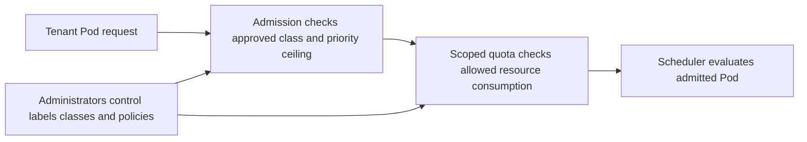

# Restrict Tenant Pod Priority with Admission Policy and Quotas

Author: [nawazdhandala](https://www.github.com/nawazdhandala)

Tags: Kubernetes, Security, Resource Management

Description: Allow only reviewed tenant PriorityClasses, cap their resource usage, and test the policy boundary without disrupting cluster-critical workloads.

Preventing tenants from creating PriorityClass objects does not necessarily prevent them from referencing a class that already exists. If a tenant can submit Pods with an elevated class, it can affect which other workloads the scheduler considers expendable.

Use two controls with different jobs. Admission policy limits which classes a tenant Pod may use. A PriorityClass-scoped ResourceQuota limits how much of an allowed class the namespace may consume. A quota that matches one class does not automatically prohibit every other class.

The examples target **Kubernetes 1.34.0**, using stable `admissionregistration.k8s.io/v1` ValidatingAdmissionPolicy. They assume administrators control namespace labels, admission objects, PriorityClasses, and quotas.

## Define an administrator-owned boundary

Suppose tenant namespaces carry the label `platform.example.com/tenant: "true"`. Administrators provide two ordinary classes: `tenant-standard` and `tenant-batch`, with reviewed numeric priorities between zero and 10,000. These values are an example local policy, not Kubernetes defaults.

Neither class should be a tenant-editable object. Tenants also must not be able to remove the namespace label, edit the binding, delete the quota, or create workloads outside the intended boundary. Review those permissions before calling the policy an isolation control.

The rule checks the class after admission has resolved defaults. An omitted class can be filled from `globalDefault` before validation. If that resolved class is approved, it can pass. Require explicit names in tenant templates as an operating convention, and keep global defaults under administrator control.



This diagram shows logical gates, not a promise about the exact ordering of every admission plugin.

## Validate Pods, including controller-created Pods

Save this policy as part of an administrator-reviewed staging change:

```yaml
apiVersion: admissionregistration.k8s.io/v1
kind: ValidatingAdmissionPolicy
metadata:
  name: tenant-priority-boundary
spec:
  failurePolicy: Fail
  matchConstraints:
    resourceRules:
      - apiGroups: [""]
        apiVersions: ["v1"]
        operations: ["CREATE", "UPDATE"]
        resources: ["pods"]
  validations:
    - expression: >-
        has(object.spec.priorityClassName) &&
        object.spec.priorityClassName in ['tenant-standard', 'tenant-batch']
      message: "Tenant Pods must use tenant-standard or tenant-batch."
    - expression: >-
        has(object.spec.priority) &&
        object.spec.priority >= 0 && object.spec.priority <= 10000
      message: "Tenant Pod numeric priority must be between 0 and 10000."
---
apiVersion: admissionregistration.k8s.io/v1
kind: ValidatingAdmissionPolicyBinding
metadata:
  name: tenant-priority-boundary
spec:
  policyName: tenant-priority-boundary
  validationActions: ["Deny"]
  matchResources:
    namespaceSelector:
      matchLabels:
        platform.example.com/tenant: "true"
```

The first expression permits only the two named classes. The second checks the resolved numeric priority, guarding against an administrator accidentally redefining an allowed name above the local ceiling. Class resolution still belongs to Kubernetes' [priority admission plugin](https://github.com/kubernetes/kubernetes/blob/v1.34.0/plugin/pkg/admission/priority/admission.go); the policy does not set `spec.priority` itself. The same plugin can fill a missing class name from the global default.

The language inside `expression` is Common Expression Language (CEL), used for Kubernetes admission rules. `has(...)` checks field presence before comparison. Kubernetes documents policy matching, validation actions, and type checking in the [ValidatingAdmissionPolicy reference](https://kubernetes.io/docs/reference/access-authn-authz/validating-admission-policy/).

Matching Pods rather than only Deployments covers Pods produced by Jobs, StatefulSets, and other controllers. The tradeoff is that an invalid controller template can be accepted while its subsequent Pod creation fails. Watch controller events, and optionally add separate template validation for earlier user feedback.

This binding applies only to labeled namespaces. It deliberately does not target system namespaces wholesale. Conversely, missing labels are a gap that administrators must detect; a selector does not label namespaces for you.

## Cap an allowed class separately

This quota applies to `tenant-standard` Pods in an existing labeled namespace named `tenant-a`:

```yaml
apiVersion: v1
kind: ResourceQuota
metadata:
  name: tenant-standard-budget
  namespace: tenant-a
spec:
  hard:
    pods: "10"
    requests.cpu: "20"
    requests.memory: "40Gi"
  scopeSelector:
    matchExpressions:
      - scopeName: PriorityClass
        operator: In
        values: ["tenant-standard"]
```

The example permits at most the quota's allowed Pod count and aggregate CPU and memory requests for the matching class. It does not reserve that capacity on nodes, and it does not guarantee that the scheduler can place those Pods.

A tenant using `tenant-batch` does not match this particular quota. Supply a separate batch-class quota or an overall namespace quota according to the resource policy. That distinction is essential: the admission allowlist controls eligibility, while quotas control consumption. See Kubernetes' [PriorityClass quota documentation](https://kubernetes.io/docs/concepts/policy/resource-quotas/#resource-quota-per-priorityclass).

Ensure matching workloads declare the resources required by quota admission. When rolling out to an existing namespace, inspect current usage first; a quota below current usage can block new consumption without removing already-running Pods.

## Roll out without assuming the expression is enough

Start in a dedicated staging tenant namespace. Verify the namespace label, installed PriorityClasses, and policy type-checking status:

```bash
kubectl --context staging get namespace tenant-a --show-labels
kubectl --context staging get priorityclass tenant-standard tenant-batch -o yaml
kubectl --context staging get validatingadmissionpolicy tenant-priority-boundary -o yaml
kubectl --context staging -n tenant-a get resourcequota tenant-standard-budget -o yaml
```

Inspect expression warnings under policy status before enforcement. Local CEL evaluation checks expression logic, but does not reproduce Kubernetes' typed environment, authorization, namespace matching, or every admission plugin.

For a controlled rollout, administrators can first use `Warn` and `Audit` actions to observe violations, then deliberately switch to `Deny`. Warnings do not block requests. Do not combine `Deny` and `Warn` in the same binding; use the documented action combinations.

## Test both denial and legitimate work

Test an approved standard Pod with explicit CPU and memory requests. Then test an unapproved ordinary class and a system-critical class reference; both should be rejected in the labeled namespace. Test an omitted class separately: it should fail if the resolved default is unapproved or empty, but can pass when admission supplies an approved default. This policy cannot distinguish that from an explicitly supplied allowed name.

Also test a controller-created Pod, not just a manually submitted Pod. Confirm that a full standard-class quota blocks additional matching consumption while the separate batch policy behaves as designed. Test namespace-label administration as an authorization boundary rather than granting tenants a way to opt out.

The local checks validated all three manifests against Kubernetes 1.34.0's OpenAPI definitions and evaluated both CEL expressions with representative objects. No API server admission chain or live quota accounting was exercised. Before production enforcement, confirm legitimate tenant workloads pass and that reserved system workloads remain in their separately governed namespaces.
